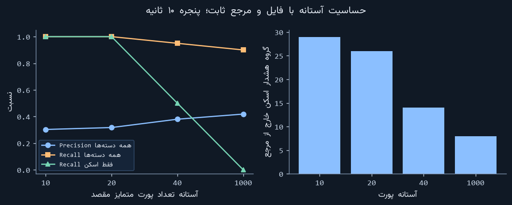
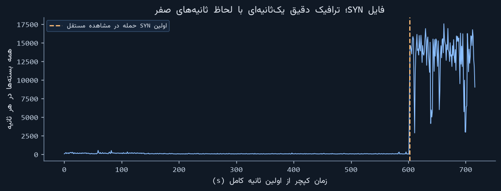
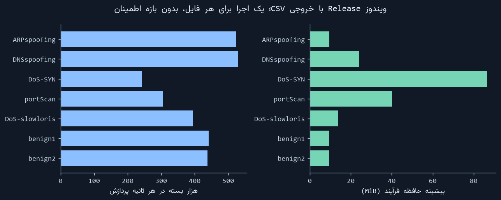
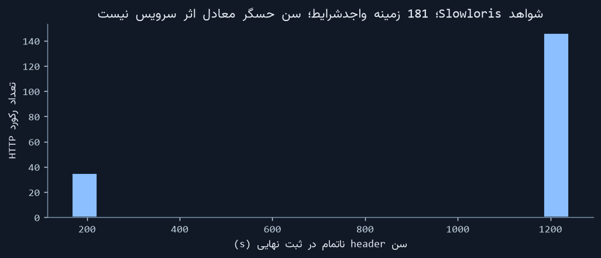

<!DOCTYPE html>
<html lang="fa" dir="rtl">
<head>
<meta charset="utf-8">
<meta name="viewport" content="width=device-width, initial-scale=1">
<title>راهنمای ارائه و گزارش پروژه Mini-NIDS</title>

</head>
<body><main>
<header class="cover">
شبکه‌های کامپیوتریتحلیل آفلاین و زندهC++20 و Qt 6
<h1>راهنمای یادگیری، ارائه و گزارش پروژه Mini-NIDS</h1>

از ساختار یک بسته تا تشخیص حمله، ارزیابی روی داده واقعی و آماده‌سازی تحویلی‌ها

مبنای کار: فایل اصلی <a href="docs/reference/Mini-NIDS.pdf">Mini-NIDS.pdf</a> دانشگاه صنعتی نوشیروانی بابل، ۲۲ صفحه. شماره صفحات این راهنما به صفحات فیزیکی همان فایل اشاره دارد؛ جلد، صفحه ۱ است.

نسخه این راهنما: ۲۵ نوامبر ۲۰۲۶. مثال‌های آموزشی، شواهد واقعی دیتاست، آزمون‌های مهندسی و محدودیت‌های اندازه‌گیری در متن مشخص شده‌اند.

حروف فارسی با وزیرمتن و متن انگلیسی و کدها با Consolas نمایش داده می‌شوند. فونت فارسی همراه سند است؛ نسخه مرورگر و PDF به دانلود فونت از اینترنت نیاز ندارند. ترتیب راست‌به‌چپ متن و ترتیب چپ‌به‌راست اعداد، نشانی‌ها و قطعه‌کدها مستقل تنظیم شده است.

این فایل یک سند HTML داخل فایل <code>PRESENTATION.md</code> است تا راست‌چین، جدول‌ها و قطعه‌کدها خوانا باشند. آن را در پیش‌نمایش Markdown با پشتیبانی HTML بخوانید؛ نسخه PDF و نسخه HTML قابل مشاهده با مرورگر نیز همراه بسته تحویل تهیه می‌شوند. رابط خود برنامه همچنان انگلیسی و چپ‌به‌راست است.

</header>
<nav>
<h2>مسیر مطالعه</h2>

اگر هیچ پیش‌زمینه شبکه ندارید، فصل‌های اول را به‌ترتیب بخوانید. برای ارائه عملی، ابتدا فصل مسیر اجرای پروژه و سپس آزمایش‌ها و پاسخ پرسش‌های سند را مرور کنید.

<a href="#brief">۱. صورت مسئله و تحویلی‌های اجباری و امتیازی</a>
<a href="#basics">۲. پیش‌نیازهای شبکه از صفر</a>
<a href="#packet-layout">۳. ساختمان دقیق بسته‌ها و فایل‌های کپچر</a>
<a href="#state">۴. جریان، وضعیت، زمان و پنجره لغزان</a>
<a href="#architecture">۵. مسیر اجرای پروژه و ساختار پوشه‌ها</a>
<a href="#parsing">۶. خواندن و تجزیه دستی بسته</a>
<a href="#detectors">۷. قواعد تشخیص حملات اجباری</a>
<a href="#slowloris">۸. بازسازی TCP و تشخیص Slowloris</a>
<a href="#live">۹. کپچر زنده، بازپخش و اندازه‌گیری افت بسته</a>
<a href="#outputs">۱۰. قرارداد خروجی‌ها، واحدها و استفاده از رابط</a>
<a href="#evaluation">۱۱. شواهد مستقل، ارزیابی و حساسیت آستانه‌ها</a>
<a href="#questions">۱۲. پاسخ پرسش‌های صفحات ۲۰ و ۲۱</a>
<a href="#delivery">۱۳. محل دقیق تحویلی‌ها و سناریوی ارائه</a>
<a href="#traceability">۱۴. تطبیق همه بخش‌های PDF با پیاده‌سازی</a>
<a href="#references">۱۵. منابع، بازتولید و حدود ادعاها</a>

</nav>

<section class="chapter" id="brief">
<h2>۱. پروژه دقیقاً چه چیزی می‌خواهد؟</h2>

سامانه تشخیص نفوذ شبکه، ترافیک را مشاهده می‌کند و درباره رفتار مشکوک هشدار می‌دهد. این پروژه نسخه آموزشی چنین سامانه‌ای است: فایل ضبط‌شده شبکه را بسته‌به‌بسته می‌خواند، هدرها را خودش تفسیر می‌کند، ارتباط بسته‌های قبلی با بسته فعلی را نگه می‌دارد و بر اساس قواعد قابل توضیح، هشدار و گزارش تولید می‌کند. برنامه به‌طور خودکار جلوی ترافیک را نمی‌گیرد.

در صفحه ۲ سند تأکید شده که تمرکز پروژه روی رفتار پروتکل‌هاست. بنابراین برای تشخیص SYN Flood نباید صرفاً نام فایل را بخوانیم یا بگوییم «عدد بسته‌ها زیاد است»؛ باید نشان دهیم مقصد تعداد زیادی درخواست آغاز اتصال می‌گیرد و بخش بزرگی از آن‌ها کامل نمی‌شوند. در ARP نیز «MAC تغییر کرد» به‌تنهایی کافی نیست، چون تغییر قانونی شبکه هم ممکن است.

<table><thead><tr><th>بخش</th><th>خروجی مورد انتظار در سند</th><th>وضعیت در این پروژه</th></tr></thead><tbody>
<tr><td>تحلیل آفلاین، اجباری</td><td>خواندن PCAP، تجزیه Ethernet/ARP/IPv4/ICMP/TCP/UDP و DNS، آمار و لاگ</td><td>هسته مستقل از Qt و فرمان <code>analyze</code></td></tr>
<tr><td>تحلیل وضعیت، اجباری</td><td>جدول جریان دوطرفه، وضعیت TCP، جدول ARP و کوئری DNS، زمان انقضا و حافظه محدود</td><td>جدول‌های محدود، پنجره ترافیک و آمار دقیق متکی بر دیسک</td></tr>
<tr><td>چهار حمله، اجباری</td><td>ARP Spoofing، Port Scan، SYN Flood، DNS Spoofing؛ برای DNS دست‌کم سه قاعده با توجه به لایه‌های مختلف</td><td>هشت شناسه قاعده اجباری با شواهد قابل مشاهده</td></tr>
<tr><td>ارزیابی و گزارش، اجباری</td><td>بازه مرجع، TP/FP/FN، دقت و بازیابی، تأخیر، تحلیل خطا، حساسیت آستانه و ماتریس قاعده در برابر فایل</td><td>برچسب مرجع مبتنی بر بررسی مستقل TShark، ابزار ارزیابی و نتایج مستند با ذکر عدم قطعیت</td></tr>
<tr><td>اجرای زنده، امتیازی</td><td>همان موتور روی منبع کارت شبکه، ثبت افت بسته و تأخیر و بازپخش در شبکه ایزوله</td><td>فرمان <code>live</code>، رابط libpcap/Npcap و آزمایش بازپخش ایزوله</td></tr>
<tr><td>Slowloris، امتیازی</td><td>بازسازی ترتیب بایت‌های TCP و شناخت کامل‌شدن هدر HTTP؛ تشخیص اتصال‌های متعدد و کند</td><td>بازساز محدود TCP، ماشین حالت HTTP/1.x و قاعده <code>SLOW-01</code></td></tr>
</tbody></table>

وزن‌های صفحه ۲۲ عبارت‌اند از: تجزیه و آمار و DNS، ۲۵٪؛ وضعیت، ۱۵٪؛ چهار دسته حمله، ۳۰٪؛ ارزیابی و خطا، ۱۰٪؛ گزارش، ۲۰٪. اجرای زنده تا ۱۵٪ و Slowloris، پنج درصد امتیاز اضافه دارند. این جدول سهم بخش‌ها را نشان می‌دهد، نه نمره تضمینی پروژه.

درصد دقت از تعداد تست‌های موفق به دست نمی‌آید. تست می‌تواند نشان دهد کد مطابق یک سناریوی ساخته‌شده کار می‌کند؛ ارزیابی دیتاست به شواهد و برچسب مرجع جداگانه نیاز دارد. برچسب‌های این مخزن برداشت مستند از بسته‌های دیده‌شده‌اند؛ برچسب رسمی منتشرکننده دیتاست یا تأیید مستقل شخص دیگری نیستند.

<h3>قوانین مهم طراحی در صفحات ۳ تا ۵</h3>
<ul>
<li>داده با ترتیب فایل و به شکل جریانی پردازش می‌شود. تشخیص نباید از بسته‌های آینده خبر داشته باشد.</li>
<li>کتابخانه کپچر فقط بایت خام، زمان و طول را می‌دهد. استخراج فیلدهای شبکه در کد خود پروژه انجام می‌شود؛ هسته از کتابخانه تحلیل پروتکل استفاده نمی‌کند.</li>
<li>IP یا MAC مهاجم، قربانی، گیت‌وی و Resolver در آشکارساز نوشته نشده است. ثابت‌هایی مانند پورت DNS یا EtherType، تعریف پروتکل‌اند و با هویت یک دستگاه فرق دارند.</li>
<li>زمان تشخیص آفلاین از ساعت بسته می‌آید. سرعت اجرای برنامه و ساعت کامپیوتر معیار پنجره حمله آفلاین نیستند.</li>
<li>طول ضبط‌شده می‌تواند کمتر از طول اصلی باشد؛ برنامه نباید بایت‌های موجودنبوده را بخواند. خرابی ظاهری checksum در اثر Offload نیز معیار حمله نیست.</li>
</ul>
</section>

<section class="chapter" id="basics">
<h2>۲. پیش‌نیازهای شبکه از صفر</h2>
<h3>۲.۱ شبکه، میزبان و بسته</h3>

یک میزبان می‌تواند لپ‌تاپ، سرور، دوربین یا حسگر باشد. شبکه راهی برای جابه‌جایی داده بین میزبان‌هاست. یک فایل بزرگ یا یک مکالمه اینترنتی معمولاً به چندین قطعه تقسیم می‌شود. هر قطعه همراه اطلاعات لازم برای جابه‌جایی فرستاده می‌شود. این اطلاعات کنترلی «هدر» و بخش داده «محتوا» یا Payload نام دارد.

<strong>مثال آموزشی:</strong> وقتی صفحه‌ای را باز می‌کنید، کامپیوتر ابتدا ممکن است نام سایت را با DNS به IP تبدیل کند، سپس یک اتصال TCP بسازد و درخواست وب بفرستد. این کار یک بسته واحد نیست؛ مجموعه‌ای از بسته‌هاست که باید کنار هم تفسیر شوند.

ضبط یا Capture یعنی مشاهده و ثبت بسته‌هایی که از یک نقطه مشخص شبکه عبور کرده‌اند. این نقطه همه شبکه را نمی‌بیند. ممکن است فقط رفتِ ارتباط، چند ثانیه از یک اتصال یا بخشی از محتوا ضبط شده باشد. نبودن یک بسته در فایل، لزوماً به معنی فرستاده‌نشدن آن نیست.

<h3>۲.۲ چرا شبکه لایه دارد؟</h3>

هر لایه یک مسئولیت دارد. Ethernet جابه‌جایی در پیوند محلی را انجام می‌دهد؛ IP مقصد منطقی و مسیر بین شبکه‌ها را مشخص می‌کند؛ TCP یا UDP داده را به برنامه مناسب می‌رسانند؛ DNS و HTTP معنای پیام برنامه را مشخص می‌کنند. هدر یک لایه، داده لایه بالاتر را درون خود حمل می‌کند.

<strong>لایه کاربرد:</strong> پیام DNS یا درخواست HTTP؛ «چه نامی را می‌پرسم؟ چه درخواستی دارم؟»

<strong>لایه انتقال:</strong> TCP یا UDP؛ «این داده مربوط به کدام برنامه و ارتباط است؟»

<strong>لایه شبکه:</strong> IPv4؛ «مبدأ و مقصد منطقی چه آدرس‌هایی دارند؟»

<strong>لایه پیوند:</strong> Ethernet؛ «فریم روی این پیوند باید به کدام کارت شبکه تحویل شود؟»

ARP معمولاً مستقیم داخل فریم Ethernet قرار می‌گیرد و روش پیدا کردن MAC متناظر با یک IPv4 محلی است. پس همه فریم‌ها الزاماً داخل خود IP و TCP ندارند. فریم IPv6، پیام کشف همسایه یا پروتکل مدیریت شبکه نیز ممکن است در فایل باشد.

<h3>۲.۳ فرق IP و MAC</h3>
<table><thead><tr><th>مفهوم</th><th>معنا</th><th>مثال آموزشی</th><th>نکته تحلیلی</th></tr></thead><tbody>
<tr><td>IPv4</td><td>آدرس منطقی ۳۲ بیتی برای مسیریابی</td><td><code>192.0.2.10</code></td><td>در سربرگ IP دیده می‌شود؛ ممکن است در NAT ترجمه شود یا توسط فرستنده جعل شود.</td></tr>
<tr><td>MAC</td><td>شناسه ۴۸ بیتی در هدر پیوند محلی</td><td><code>02:00:00:00:00:10</code></td><td>دستگاه یا گام بعدی را در همین پیوند نشان می‌دهد؛ هویت سراسری سرور اینترنتی نیست.</td></tr>
<tr><td>Subnet</td><td>بخشی از فضای IP که در یک شبکه محلی قرار می‌گیرد</td><td><code>192.0.2.0/24</code></td><td>مثال آموزشی است؛ آشکارساز، زیرشبکه دیتاست را به‌صورت ثابت نمی‌شناسد.</td></tr>
<tr><td>Gateway</td><td>مسیریاب خروج از شبکه محلی</td><td>میزبانی در همان پیوند</td><td>برای مقصد بیرون شبکه، فریم به MAC گیت‌وی می‌رود اما IP مقصد همان سرور دوردست می‌ماند.</td></tr>
</tbody></table>

برای رسیدن به یک سرور دوردست، کامپیوتر MAC سرور را در اینترنت جست‌وجو نمی‌کند. فریم را به MAC گام بعدی محلی می‌دهد. هر مسیریاب برای پیوند بعدی، سربرگ پیوند متناسب با آن پیوند را می‌سازد. بنابراین هزاران IP اینترنتی می‌توانند در یک کپچر محلی با یک MAC مبدأ، یعنی MAC گیت‌وی، دیده شوند.

<h3>۲.۴ پورت، پروتکل و اتصال</h3>

یک میزبان هم‌زمان چند برنامه شبکه دارد. شماره پورت به سیستم‌عامل کمک می‌کند داده را به برنامه درست برساند. مثلاً DNS معمولاً روی UDP/53 و وب معمولاً روی TCP/80 یا TCP/443 دیده می‌شود. این شماره‌ها فقط سرنخ‌اند؛ به‌تنهایی تضمین نمی‌کنند محتوای بسته همان پروتکل باشد.

پورت مبدأِ کلاینت معمولاً موقتی است. مثلاً کلاینت از <code>45000</code> به سرور DNS در پورت <code>53</code> سؤال می‌فرستد و پاسخ از <code>53</code> به <code>45000</code> برمی‌گردد. اگر تعداد زیادی پاسخ به پورت‌های موقت مختلف ببینیم، نباید فوراً سرور را اسکنر بنامیم.

<h3>۲.۵ تفاوت TCP و UDP</h3>
<table><thead><tr><th>TCP</th><th>UDP</th></tr></thead><tbody>
<tr><td>ارتباط حالت‌دار، شماره بایت، تأیید دریافت و ارسال مجدد دارد.</td><td>هر دیتاگرام مستقل است و سازوکار داخلیِ دست‌دهی، تأیید یا ترتیب بایت ندارد.</td></tr>
<tr><td>برنامه یک جریان بایت می‌بیند؛ مرز پیام برنامه لزوماً مرز بسته نیست.</td><td>مرز دیتاگرام حفظ می‌شود؛ برنامه ممکن است خودش قابلیت اطمینان اضافه کند.</td></tr>
<tr><td>مشاهده SYN، SYN-ACK و ACK می‌تواند شروع اتصال را نشان دهد.</td><td>از نبود پاسخ نمی‌توان نتیجه قطعی درباره بسته‌بودن پورت گرفت.</td></tr>
<tr><td>برای تحلیل HTTP باید بایت‌ها بر اساس Sequence Number کنار هم قرار بگیرند.</td><td>برای ارتباط خطای ICMP با یک پروب UDP باید هدر بسته نقل‌شده داخل ICMP بررسی شود.</td></tr>
</tbody></table>
<h3>۲.۶ دست‌دهی سه‌مرحله‌ای TCP</h3>
<pre><code>Client → Server : SYN      seq=100
Server → Client : SYN,ACK  seq=500 ack=101
Client → Server : ACK      seq=101 ack=501</code></pre>

این عددها آموزشی‌اند. SYN یک جایگاه از فضای شماره توالی مصرف می‌کند؛ به همین دلیل ACK برابر شماره قبلی به‌علاوه یک است. پروژه هم جهت بسته و هم این ارتباط عددی را بررسی می‌کند. دیدن سه نامِ پرچم بدون تطبیق Seq/Ack برای اعلام اتصال کامل کافی نیست.

بیت‌های مهم TCP عبارت‌اند از <code>SYN=0x02</code> برای شروع، <code>ACK=0x10</code> برای تأیید، <code>RST=0x04</code> برای بازنشانی و <code>FIN=0x01</code> برای پایانِ یک جهت. یک بسته می‌تواند چند پرچم را هم‌زمان داشته باشد؛ مثلاً SYN-ACK مقدار <code>0x12</code> دارد.

<h3>۲.۷ ARP به زبان ساده</h3>

میزبان می‌پرسد «چه کسی این IPv4 را دارد؟» و یک دستگاه MAC خود را اعلام می‌کند. Request، پرسش است؛ Reply، پاسخ است؛ Gratuitous ARP اعلامی درباره خود فرستنده است که معمولاً در راه‌اندازی یا تغییر شبکه کاربرد دارد. ARP احراز هویت رمزنگاری‌شده ندارد؛ یک دستگاه می‌تواند بگوید IP گیت‌وی متعلق به MAC اوست.

برای پیدا کردن پاسخ بدون درخواست، فقط به درخواست‌هایی نگاه می‌کنیم که پیش از پاسخ دیده شده‌اند. از درخواست آینده نمی‌توان برای قانونی جلوه‌دادن یک پاسخ قبلی استفاده کرد. اگر خودِ درخواست از کپچر جا افتاده باشد، نتیجه «بدون درخواست مشاهده‌شده» است و به‌تنهایی اثبات حمله نیست.

<h3>۲.۸ DNS و Resolver</h3>

DNS نامی مانند <code>example.org</code> را به اطلاعاتی مثل آدرس IP تبدیل می‌کند. Resolver سامانه‌ای است که پاسخ را برای کلاینت فراهم می‌کند. کلاینت در Question نام، نوع و کلاس سؤال را می‌گذارد. پاسخ باید با زمینه سؤال، از جمله شناسه تراکنش و آدرس‌ها و پورت‌ها، مرتبط باشد.

رکورد A یک IPv4 و AAAA یک IPv6 را در پاسخ حمل می‌کند. CNAME نام مستعار را به نام دیگر وصل می‌کند. NXDOMAIN یک کد پاسخ به معنای موجودنبودن نام است و «پاسخ خالی» یا «خرابی بسته» به حساب نمی‌آید. TTL رکورد، مدت اعتبار کش در واحد ثانیه است.

<h3>۲.۹ ICMP، NAT و Offload</h3>

ICMP برای پیام‌های کنترلی و خطا به کار می‌رود. پیام <code>Type=3, Code=3</code> می‌تواند بگوید پورت UDP مقصد در دسترس نیست. درون آن بخشی از بسته اصلی نقل می‌شود. ابتدا باید هدر بیرونی ICMP و سپس هدر نقل‌شده را اعتبارسنجی کنیم؛ بایت داخل یک خطای ICMP نباید اشتباهاً یک DNS تازه تلقی شود.

NAT می‌تواند IP و پورت را در مرز شبکه تغییر دهد. در دیتاست CIC-IDS2017، آدرس دیده‌شده ممکن است آدرس پس از ترجمه باشد. برنامه آنچه در کپچر دیده را گزارش می‌کند؛ نمی‌تواند از آن هویت واقعی میزبان پنهان‌شده پشت NAT را قطعی استخراج کند.

در Offload، بخشی از کار شبکه به کارت شبکه سپرده می‌شود. ممکن است ضبط بسته پیش از محاسبه checksum سخت‌افزاری انجام شده باشد. در چنین وضعی Wireshark checksum را ظاهراً نادرست می‌بیند، درحالی‌که بسته روی سیم اصلاح شده است. پروژه از checksum به‌عنوان معیار حمله استفاده نمی‌کند.

<h3>۲.۱۰ حمله، هشدار و اثبات</h3>

«بسته مشکوک» با «حمله ثابت‌شده» یکسان نیست. یک جریان حالت‌دار ممکن است از وسط کپچر شروع شده باشد؛ چند پاسخ DNS ممکن است به کشف سرویس یا چند Resolver قانونی مربوط باشند؛ یک اوج ترافیک هم ممکن است شروع هم‌زمان دستگاه‌ها باشد. هشدار این برنامه یک نشانه قابل بررسی با شواهد است. نام Severity یا Confidence درصد احتمال محاسبه‌شده و تأییدشده نیست.

</section>

<section class="chapter" id="packet-layout">
<h2>۳. ساختمان دقیق فایل و بسته‌ها</h2>
<h3>۳.۱ بایت، بیت، Offset و ترتیب بایت</h3>

هر بایت هشت بیت دارد. عدد هگزادسیمال <code>0x12</code> یعنی ۱۸ در مبنای ده و در باینری <code>00010010</code>. برای خواندن فیلد دو بایتی باید بدانیم بایت پرارزش اول آمده یا آخر. در هدرهای شبکه معمولاً ترتیب بزرگ‌پایان، یعنی Network Byte Order، استفاده می‌شود؛ اما خود فایل PCAP می‌تواند بزرگ‌پایان یا کوچک‌پایان باشد.

دو بایت <code>00 35</code> در ترتیب شبکه عدد ۵۳ را می‌سازند. فرمول خواندن آن <code>(byte0 &lt;&lt; 8) | byte1</code> است. Offset یعنی فاصله بایتی از ابتدای بخشی که می‌خوانیم. برای خواندن دو بایت در Offset برابر ۱۲، باید دست‌کم ۱۴ بایت موجود باشد.

فراخوانی توابع خواندن در <a href="core/src/Types.cpp">Types.cpp</a> مرز داده را بررسی می‌کند. قرار نیست اشاره‌گر خام را روی یک ساختار سیستم‌عامل بیندازیم و امیدوار باشیم هم‌ترازی حافظه، ترتیب بایت و طول درست باشند. این اصل از علت‌های قابل حمل بودن تجزیه‌گر است.

<h3>۳.۲ فرمت PCAP کلاسیک</h3>
<table><thead><tr><th>بخش</th><th>اندازه</th><th>فیلدهای مهم</th><th>کنترل پروژه</th></tr></thead><tbody>
<tr><td>هدر عمومی</td><td>۲۴ بایت، یک‌بار در ابتدای فایل</td><td>Magic، نسخه، Snaplen، نوع پیوند</td><td>چهار Magic برای دو ترتیب بایت و دو دقت زمانی؛ نسخه ۲٫۴؛ Ethernet نوع ۱</td></tr>
<tr><td>هدر هر رکورد</td><td>۱۶ بایت</td><td>ثانیه، جزء کسری زمان، طول ضبط‌شده، طول اصلی</td><td>جزء زمان معتبر، طول موجود در فایل و سقف بایت بسته</td></tr>
<tr><td>داده رکورد</td><td>به تعداد طول ضبط‌شده</td><td>بایت‌های واقعی فریم</td><td>فقط همین بخش خوانده می‌شود؛ طول اصلی مجوز خواندن بیشتر نیست.</td></tr>
</tbody></table>
<pre><code>PCAP global header: 24 bytes
record 1 header: 16 bytes
record 1 frame: captured_length bytes
record 2 header: 16 bytes
record 2 frame: captured_length bytes
...</code></pre>

<strong>Snaplen</strong> سقفی است که ابزار ضبط برای گرفتن هر بسته اعلام کرده است. <strong>Captured length</strong> تعداد بایت‌هایی است که واقعاً ذخیره شده و <strong>Original length</strong> طول اصلی گزارش‌شده برای فریم است. اگر فریم ۱۵۱۴ بایت بوده ولی فقط ۹۶ بایت آن ضبط شده، نمی‌توان تمام محتوای HTTP را خواند؛ بااین‌حال ممکن است هدرهای TCP سالم باشند.

اگر متادیتای Snaplen نادرست باشد، لزوماً بایت بسته از دست نرفته است. آماده‌سازی ZIP می‌تواند ناسازگاری متادیتا را با هشدار مشخص و در نسخه واردشده اصلاح کند. این کار با نادیده‌گرفتن مرز رکورد، طول اصلی، CRC یا سقف مجاز بسته فرق دارد. فایل اصلی تغییر نمی‌کند.

<!-- CODE:core/src/PcapReader.cpp|bool PcapReader::next|22 -->

کد واقعی: <a href="core/src/PcapReader.cpp#L55"><bdi dir="ltr">core/src/PcapReader.cpp</bdi>، سطر 55</a>؛ اعداد سمت چپ شماره سطرند.

<pre dir="ltr"><code>  55  bool PcapReader::next(PacketView &amp;packet) {
  56      std::array&lt;std::uint8_t, 16&gt; header{};
  57      input_.read(reinterpret_cast&lt;char *&gt;(header.data()), header.size());
  58      if (input_.gcount() == 0 &amp;&amp; input_.eof())
  59          return false;
  60      if (input_.gcount() != 16)
  61          throw Error(&quot;truncated PCAP record header at byte &quot; + std::to_string(position_));
  62      const auto seconds = read32(header, 0);
  63      const auto fraction = read32(header, 4);
  64      const auto captured = read32(header, 8);
  65      const auto original = read32(header, 12);
  66      if (fraction &gt;= (metadata_.nanosecond_resolution ? 1&#x27;000&#x27;000&#x27;000U : 1&#x27;000&#x27;000U))
  67          throw Error(&quot;invalid PCAP timestamp fraction&quot;);
  68      if ((!allow_snaplen_mismatch_ &amp;&amp; captured &gt; metadata_.snaplen) || captured &gt; max_packet_ ||
  69          captured &gt; original)
  70          throw Error(&quot;invalid PCAP captured/original length&quot;);
  71      if (position_ &gt; size_ || size_ - position_ &lt; 16 || captured &gt; size_ - position_ - 16)
  72          throw Error(&quot;truncated PCAP packet data&quot;);
  73      buffer_.resize(captured);
  74      input_.read(reinterpret_cast&lt;char *&gt;(buffer_.data()), captured);
  75      if (input_.gcount() != static_cast&lt;std::streamsize&gt;(captured))
  76          throw Error(&quot;PCAP packet read failed&quot;);</code></pre>
<!-- END CODE -->
<h3>۳.۳ PCAPNG و ZIP</h3>

PCAPNG به‌جای یک ساختار ساده و یک نوع پیوند سراسری، بلوک‌های بخش، رابط و بسته دارد. هر رابط می‌تواند دقت و جابه‌جایی زمان متفاوتی تعریف کند. در این پروژه تحلیل مستقیم هسته روی PCAP کلاسیک انجام می‌شود؛ آماده‌سازی آرشیو، PCAPNG سازگار را به PCAP نانوثانیه‌ای تبدیل می‌کند. پسوند فایل تعیین‌کننده فرمت نیست؛ ممکن است فایل با پسوند <code>.pcap</code> در واقع PCAPNG باشد.

ZIP فقط ظرف فشرده‌سازی است، نه پروتکل شبکه. فهرست فایل‌های سازگار نمایش داده می‌شود و کاربر یک کپچر را برای آماده‌سازی انتخاب می‌کند. مسیر ورودی آرشیو مستقیماً به مسیر فایل خروجی تبدیل نمی‌شود. نام‌های خطرناک، ابهام نام، ورودی رمزگذاری‌شده، بودجه بسط و خرابی ساختار کنترل می‌شوند؛ سپس CRC و تمام رکوردهای کپچر بررسی می‌شوند. این مرحله اعتبار فنی داده را می‌سنجد، نه وجود حمله را.

کدهای مرتبط: <a href="core/src/ZipArchive.cpp">ZipArchive.cpp</a>، <a href="core/src/PcapNg.cpp">PcapNg.cpp</a>؛ توضیح سیاست: <a href="docs/zip-import.md">zip-import.md</a>.

<h3>۳.۴ هدر Ethernet و VLAN</h3>
<table><thead><tr><th>Offset از ابتدای فریم</th><th>طول</th><th>فیلد</th></tr></thead><tbody>
<tr><td>۰</td><td>۶ بایت</td><td>MAC مقصد</td></tr><tr><td>۶</td><td>۶ بایت</td><td>MAC مبدأ</td></tr>
<tr><td>۱۲</td><td>۲ بایت</td><td>EtherType: مثلاً <code>0x0800</code> برای IPv4 و <code>0x0806</code> برای ARP</td></tr>
<tr><td>۱۴ به بعد</td><td>وابسته به فریم</td><td>داده لایه بعد؛ یا برچسب VLAN که محل شروع لایه بعد را جلو می‌برد</td></tr>
</tbody></table>

در فریم دارای VLAN، نمی‌توان همیشه IP را از بایت ۱۴ خواند. برنامه برچسب‌های <code>0x8100</code> و <code>0x88a8</code> را تا عمق محدود باز می‌کند. اگر نوع پیوند، IPv6 یا یک EtherType ناشناخته باشد، آن را با فرض IPv4 تجزیه نمی‌کند.

<!-- CODE:core/src/ProtocolDispatcher.cpp|p.ether_type = be16(bytes, 12)|18 -->

کد واقعی: <a href="core/src/ProtocolDispatcher.cpp#L50"><bdi dir="ltr">core/src/ProtocolDispatcher.cpp</bdi>، سطر 50</a>؛ اعداد سمت چپ شماره سطرند.

<pre dir="ltr"><code>  50          p.ether_type = be16(bytes, 12);
  51          std::size_t cursor = 14;
  52          while (p.ether_type == 0x8100 || p.ether_type == 0x88a8) {
  53              if (p.vlans.size() &gt;= 4)
  54                  throw Error(&quot;VLAN nesting exceeds limit&quot;);
  55              require(bytes, cursor + 4, &quot;truncated VLAN tag&quot;);
  56              p.vlans.push_back(be16(bytes, cursor) &amp; 0x0fff);
  57              p.ether_type = be16(bytes, cursor + 2);
  58              cursor += 4;
  59          }
  60          bytes = bytes.subspan(cursor);
  61          if (p.ether_type == 0x0806) {
  62              p.protocol_name = &quot;ARP&quot;;
  63              require(bytes, 8, &quot;truncated ARP header&quot;);
  64              Arp a;
  65              a.hardware = be16(bytes, 0);
  66              a.protocol = be16(bytes, 2);
  67              a.hardware_length = bytes[4];</code></pre>
<!-- END CODE -->
<h3>۳.۵ هدر ARP</h3>

ARP پس از هدر Ethernet شروع می‌شود. ابتدا نوع سخت‌افزار و پروتکل، طول آدرس‌ها و Opcode می‌آیند؛ بعد MAC و IP فرستنده و MAC و IP هدف. برای Ethernet/IPv4، طول MAC شش و طول IP چهار بایت است. Opcode برابر ۱ یعنی Request و ۲ یعنی Reply.

دو MAC مبدأِ مستقل در اختیار داریم: یکی در Ethernet و یکی در بدنه ARP. اختلاف آن‌ها سرنخ قاعده ARP-02 است. در جعل عادی ARP، مهاجم ممکن است هر دو MAC را هماهنگ بگذارد؛ بنابراین صفر بودن ARP-02 به معنی نبود ARP Spoofing نیست.

<h3>۳.۶ هدر IPv4</h3>

حداقل هدر IPv4 بیست بایت است. IHL طول واقعی هدر را در واحد کلمات چهار بایتی مشخص می‌کند؛ پس IHL برابر ۵ یعنی ۲۰ بایت. Total Length کل بسته IP، شامل هدر و داده است. محل شروع TCP یا UDP با IHL محاسبه می‌شود، نه با فرض همیشگیِ بیست بایت.

<table><thead><tr><th>فیلد</th><th>کاربرد</th><th>خطای رایج</th></tr></thead><tbody>
<tr><td>Version و IHL</td><td>شناخت IPv4 و طول هدر و گزینه‌ها</td><td>اعتماد به نوع Ethernet بدون بررسی نسخه و حداقل طول</td></tr>
<tr><td>Total Length</td><td>مرز داده IP و حذف پَد Ethernet از تفسیر انتقال</td><td>مقایسه کور با طول ضبط‌شده بدون درنظرگرفتن Snaplen</td></tr>
<tr><td>Protocol</td><td>۶ برای TCP، ۱۷ برای UDP، ۱ برای ICMP</td><td>تجزیه همه محتواها به‌عنوان TCP</td></tr>
<tr><td>TTL</td><td>بودجه عبور از گام‌های مسیریابی</td><td>اشتباه‌گرفتن با TTL رکورد DNS که واحدش ثانیه است</td></tr>
<tr><td>Fragment Offset و MF</td><td>تشخیص قطعه‌قطعه شدن بسته</td><td>خواندن پورت از وسط یک قطعه غیرابتدایی</td></tr>
<tr><td>مبدأ و مقصد</td><td>هویت منطقی مشاهده‌شده در این نقطه کپچر</td><td>فرض اینکه NAT وجود نداشته یا مبدأ احراز هویت شده است</td></tr>
</tbody></table>

بازسازی قطعات IPv4 در این پروژه انجام نمی‌شود. در قطعه غیرابتدایی، هدر انتقال خوانده نمی‌شود. در قطعه اول، هدر سالم انتقال قابل استفاده است، ولی DNS تکه‌تکه یا ناقص به‌عنوان پیام کامل مقایسه نمی‌شود. بازسازی جریان TCP در بخش امتیازی با بازسازی قطعات IP یکی نیست.

<h3>۳.۷ هدر TCP، UDP و ICMP</h3>

هدر TCP حداقل بیست بایت دارد. Data Offset طول هدر TCP را مشخص می‌کند؛ فیلدهای پورت، Seq، Ack، پرچم، Window و گزینه‌ها خوانده می‌شوند. Payload فقط پس از اعتبارسنجی طول‌ها به مصرف‌کننده می‌رسد. Checksum دیده می‌شود ولی به قاعده حمله تبدیل نمی‌شود.

هدر UDP هشت بایت دارد: پورت مبدأ، پورت مقصد، Length و Checksum؛ هر کدام دو بایت. Length خود هدر را هم شامل می‌شود. طول کمتر از هشت معتبر نیست. برای قطعه اول یک دیتاگرام IP، طول UDP ممکن است بزرگ‌تر از بخش داده موجود در همان قطعه باشد.

در ICMP، Type و Code در دو بایت اول‌اند. برای خطای پورت UDP، پس از هدر بیرونی، نسخه و IHL بسته اصلی و Offset قطعه آن بررسی می‌شود و فقط در صورت موجودبودن بایت‌ها، پورت‌های اصلی استخراج می‌شوند.

<h3>۳.۸ ساختمان پیام DNS و فشرده‌سازی نام</h3>

DNS هدر دوازده‌بایتی دارد: Transaction ID، پرچم‌ها و شمارنده سؤال‌ها و سه بخش رکورد. سپس Question و رکوردهای Answer، Authority و Additional می‌آیند. نام‌ها با برچسب‌های طول‌دار ذخیره می‌شوند؛ برای <code>example.org</code> ابتدا طول ۷ و بایت‌های example و سپس طول ۳ و org و صفر پایان می‌آید.

<pre><code>07 65 78 61 6d 70 6c 65 03 6f 72 67 00
7  e  x  a  m  p  l  e  3  o  r  g  end</code></pre>

یک اشاره‌گر فشرده‌شده ممکن است نامی را که قبلاً در پیام آمده دوباره استفاده کند. دو بیت بالای بایت اول آن <code>11</code> است؛ مثلاً <code>c0 0c</code> به Offset دوازده در همان پیام اشاره می‌کند. پروژه ارجاع به آینده، چرخش، جهش‌های بیش‌ازحد، نام طولانی و شمارنده‌های غیرمنطقی را رد می‌کند تا هم خواندن خارج از مرز و هم مصرف نامحدود پردازنده کنترل شود.

<!-- CODE:core/src/DnsParser.cpp|Compression references an earlier name|14 -->

کد واقعی: <a href="core/src/DnsParser.cpp#L25"><bdi dir="ltr">core/src/DnsParser.cpp</bdi>، سطر 25</a>؛ اعداد سمت چپ شماره سطرند.

<pre dir="ltr"><code>  25              // Compression references an earlier name, never bytes in the future.
  26              if (target &gt;= offset - 2 || target &lt; 12)
  27                  throw Error(&quot;invalid DNS compression pointer&quot;);
  28              offset = target;
  29              jumped = true;
  30              continue;
  31          }
  32          if (length &amp; 0xc0)
  33              throw Error(&quot;invalid DNS label type&quot;);
  34          if (!length) {
  35              if (!jumped)
  36                  cursor = offset;
  37              return result.empty() ? &quot;.&quot; : result;
  38          }</code></pre>
<!-- END CODE -->
</section>

<section class="chapter" id="state">
<h2>۴. جریان، وضعیت و زمان</h2>
<h3>۴.۱ بسته با جریان چه فرقی دارد؟</h3>

بسته یک واحد مشاهده است. جریان، خلاصه چند بسته مرتبط است. کلید پنج‌تایی از IP مبدأ، IP مقصد، پورت مبدأ، پورت مقصد و شماره پروتکل ساخته می‌شود. در جدول دوطرفه، بسته رفت و برگشت باید یک رکورد را به‌روز کنند؛ بنابراین کلید با مرتب‌سازی دو Endpoint ساخته می‌شود. جهت Forward همان جهت اولین مشاهده است و الزاماً به معنی نقش احراز‌شده کلاینت نیست.

(A, 45000, B, 53, UDP) ↔ (B, 53, A, 45000, UDP)

رکورد Flow زمان اولین و آخرین بسته، تعداد بسته و بایت در دو جهت، مجموع بایت موجود و اصلی، شمارش پرچم‌ها، وضعیت TCP و دلیل خاتمه را دارد. مدت جریان برابر آخرین زمان منهای اولین زمان است. تعداد ردیف‌های خروجی Flow با بیشترین تعداد اتصال هم‌زمان فرق دارد؛ یک کلید پس از انقضا می‌تواند دوباره رکورد بسازد.

<!-- CODE:core/include/mininids/state/FlowTracker.hpp|struct FlowRecord|17 -->

کد واقعی: <a href="core/include/mininids/state/FlowTracker.hpp#L21"><bdi dir="ltr">core/include/mininids/state/FlowTracker.hpp</bdi>، سطر 21</a>؛ اعداد سمت چپ شماره سطرند.

<pre dir="ltr"><code>  21  struct FlowRecord {
  22      std::string key;
  23      Ip src{}, dst{};
  24      std::uint16_t src_port{}, dst_port{};
  25      std::uint8_t protocol{};
  26      Timestamp first{}, last{};
  27      std::uint64_t packets{}, bytes{}, forward{}, reverse{}, retransmissions{};
  28      std::uint64_t captured_bytes{}, forward_bytes{}, reverse_bytes{};
  29      std::uint64_t forward_captured_bytes{}, reverse_captured_bytes{};
  30      std::array&lt;std::uint64_t, 9&gt; flag_counts{};
  31      TcpState state{TcpState::New};
  32      std::uint32_t initial_seq{}, responder_seq{};
  33      bool initiator_is_forward{true}, saw_syn{}, saw_syn_ack{}, forward_fin{}, reverse_fin{};
  34      std::string termination;
  35  };
  36  struct FlowUpdate {
  37      FlowRecord *flow{};</code></pre>
<!-- END CODE -->
<h3>۴.۲ چرا وضعیت ضروری است؟</h3>

اگر تنها یک SYN ببینیم، نمی‌دانیم اتصال بعداً کامل می‌شود یا خیر. با نگهداری وضعیت، می‌توان SYN-ACK و ACK معتبر را به همان تلاش ربط داد. ارسال دوباره همان SYN با همان Sequence Number نباید یک تلاش تازه به حساب آید؛ اما استفاده دوباره از همان پنج‌تایی با شماره توالی آغازین تازه می‌تواند تلاش جدید باشد.

وضعیت‌ها شامل مشاهده SYN، مشاهده SYN-ACK، Established، Closing، Closed، Reset، Timed out و Incomplete/unknown هستند. بسته‌ای از وسط ارتباط نباید بی‌دلیل Established نام بگیرد. پایان FIN در هر جهت ثبت می‌شود؛ این مدل ماشین کامل TCP یک سیستم‌عامل نیست و بازسازی وضعیت‌های جزئی TCP مانند TIME-WAIT را شبیه‌سازی نمی‌کند.

<!-- CODE:core/src/FlowTracker.cpp|if (syn && !ack)|22 -->

کد واقعی: <a href="core/src/FlowTracker.cpp#L75"><bdi dir="ltr">core/src/FlowTracker.cpp</bdi>، سطر 75</a>؛ اعداد سمت چپ شماره سطرند.

<pre dir="ltr"><code>  75      if (syn &amp;&amp; !ack) {
  76          if (f-&gt;saw_syn &amp;&amp; f-&gt;initial_seq == p.seq &amp;&amp; forward == f-&gt;initiator_is_forward &amp;&amp;
  77              f-&gt;state != TcpState::Closed &amp;&amp; f-&gt;state != TcpState::Reset) {
  78              ++f-&gt;retransmissions;
  79          } else {
  80              f-&gt;saw_syn = true;
  81              f-&gt;saw_syn_ack = false;
  82              f-&gt;initial_seq = p.seq;
  83              f-&gt;initiator_is_forward = forward;
  84              f-&gt;state = TcpState::SynObserved;
  85              f-&gt;forward_fin = f-&gt;reverse_fin = false;
  86              update.new_syn = true;
  87          }
  88      } else if (syn &amp;&amp; ack &amp;&amp; f-&gt;saw_syn &amp;&amp; forward != f-&gt;initiator_is_forward &amp;&amp;
  89                 p.ack == f-&gt;initial_seq + 1U) {
  90          f-&gt;saw_syn_ack = true;
  91          f-&gt;responder_seq = p.seq;
  92          if (f-&gt;state == TcpState::SynObserved) {
  93              f-&gt;state = TcpState::SynAckObserved;
  94              update.syn_ack = true;
  95          }
  96      } else if (ack &amp;&amp; f-&gt;state == TcpState::SynAckObserved &amp;&amp; forward == f-&gt;initiator_is_forward &amp;&amp;</code></pre>
<!-- END CODE -->
<h3>۴.۳ Idle Timeout، Active Timeout و سقف ظرفیت</h3>

Idle Timeout حداکثر بی‌خبری مجاز از یک رکورد است. Active Timeout حتی یک رکورد پیوسته فعال را پس از عمر مشخص نهایی می‌کند. مهلت واقعی کمینه زمان آخرین فعالیت به‌علاوه Idle و زمان ایجاد به‌علاوه Active است. هر رکورد یک گره انقضا دارد؛ تازه‌کردن آن، توده‌ای از تایمرهای قدیمی و دورریختنی نمی‌سازد.

deadline = min(last_activity + idle_timeout, created_at + active_timeout)

در صورت پُرشدن جدول، رکورد جدید رد و شمارنده مربوط ثبت می‌شود؛ حافظه بی‌نهایت رشد نمی‌کند. افزایش سقف ظرفیت آستانه تشخیص حمله را عوض نمی‌کند، ولی پوشش ردیابی را بهتر و مصرف بالقوه حافظه را بیشتر می‌کند. حذف محدودیت تعداد ردیف جدول UI، این نیاز موتور را از بین نمی‌برد.

<!-- CODE:core/include/mininids/state/StateTable.hpp|Value *get|21 -->

کد واقعی: <a href="core/include/mininids/state/StateTable.hpp#L30"><bdi dir="ltr">core/include/mininids/state/StateTable.hpp</bdi>، سطر 30</a>؛ اعداد سمت چپ شماره سطرند.

<pre dir="ltr"><code>  30      Value *get(const std::string &amp;key, Timestamp now, Timestamp idle, Timestamp active) {
  31          auto it = entries_.find(key);
  32          if (it == entries_.end()) {
  33              if (entries_.size() &gt;= capacity_) {
  34                  ++dropped;
  35                  return nullptr;
  36              }
  37              const auto timer = expiry_.emplace(now + std::min(idle, active), key);
  38              auto [inserted, ok] = entries_.emplace(key, Entry{Value{}, now, timer});
  39              (void)ok;
  40              return &amp;inserted-&gt;second.value;
  41          }
  42          const auto deadline = std::min(now + idle, it-&gt;second.created + active);
  43          expiry_.erase(it-&gt;second.timer);
  44          it-&gt;second.timer = expiry_.emplace(deadline, key);
  45          return &amp;it-&gt;second.value;
  46      }
  47      template &lt;class Callback&gt; void expire(Timestamp now, Callback callback) {
  48          while (!expiry_.empty() &amp;&amp; expiry_.begin()-&gt;first &lt;= now) {
  49              auto timer = expiry_.begin();
  50              auto it = entries_.find(timer-&gt;second);</code></pre>
<!-- END CODE -->
<h3>۴.۴ پنجره لغزان</h3>

«۲۰ پورت در کل فایل» با «۲۰ پورت در ده ثانیه» یکسان نیست. پنجره لغزان، تلاش‌های تازه را اضافه و تلاش‌های قدیمی‌تر از بازه را حذف می‌کند. برای هر پورت و هر میزبان، شمارنده مرجع نگه می‌داریم؛ وقتی آخرین تلاش مربوط به آن از پنجره خارج شد، آن پورت یا میزبان دیگر در شمارش متمایز حضور ندارد.

در ثانیه ۱ پورت ۸۰ و در ثانیه ۲ پورت ۸۱ آزمایش می‌شود. در ثانیه ۲۰، با پنجره ده‌ثانیه‌ای، این دو دیگر نباید در شمارش اسکن باشند. چندین بسته تکراری به پورت ۸۰ نیز تعداد پورت متمایز را از یک بیشتر نمی‌کند.

کلید اسکن بر مبدأ، مقصد و پروتکل تکیه دارد. کلید Flood، مقصد است تا تلاش‌های چند مبدأ نیز با هم دیده شوند. هر رویداد پنجره یک‌بار اضافه و یک‌بار حذف می‌شود. رویدادهای تکمیل، Reset و پاسخ ICMP آمار همان تلاش را اصلاح می‌کنند.

<!-- CODE:core/src/TrafficWindow.cpp|void TrafficWindow::expire|22 -->

کد واقعی: <a href="core/src/TrafficWindow.cpp#L15"><bdi dir="ltr">core/src/TrafficWindow.cpp</bdi>، سطر 15</a>؛ اعداد سمت چپ شماره سطرند.

<pre dir="ltr"><code>  15  void TrafficWindow::expire(Timestamp now) {
  16      while (!attempts_.empty() &amp;&amp; attempts_.front().time &lt;= now - config_.window) {
  17          const auto &amp;a = attempts_.front();
  18          auto remove = [&amp;](auto &amp;map, const std::string &amp;key, bool source) {
  19              auto it = map.find(key);
  20              auto &amp;b = it-&gt;second;
  21              if (--b.ports[a.port] == 0)
  22                  b.ports.erase(a.port);
  23              const auto host = source ? a.dst : a.src;
  24              if (--b.hosts[host] == 0)
  25                  b.hosts.erase(host);
  26              b.completed -= a.completed;
  27              b.reset -= a.reset;
  28              b.syn_ack -= a.syn_ack;
  29              b.syn_reset -= a.syn_reset;
  30              b.closed_rejected -= a.closed_rejected;
  31              b.incomplete -= !a.completed &amp;&amp; !a.reset;
  32              if (--b.attempts == 0)
  33                  map.erase(it);
  34          };
  35          remove(sources_, a.source_key, true);
  36          if (a.protocol == 6)</code></pre>
<!-- END CODE -->
<h3>۴.۵ سه نوع زمان که نباید مخلوط شوند</h3>
<table><thead><tr><th>نوع زمان</th><th>معنا و کاربرد</th><th>نمایش و واحد</th></tr></thead><tbody>
<tr><td>زمان بسته</td><td>زمان درج‌شده در کپچر؛ مبنای تشخیص آفلاین و مقایسه با برچسب مرجع</td><td>عدد صحیح نانوثانیه از Unix epoch؛ در نمایش، UTC با دقت اصلی میکرو/نانوثانیه</td></tr>
<tr><td>زمان پردازش</td><td>مدت واقعی اجرای برنامه با ساعت یکنواخت؛ معیار بسته بر ثانیه</td><td>ns، µs، ms، ثانیه یا ترکیب دقیقه/ساعت؛ در اجرای زنده شامل انتظار ورودی هم می‌شود.</td></tr>
<tr><td>تأخیر هشدار زنده</td><td>فاصله ساعت Capture تا تحویل نخستین هشدار بسته‌محور؛ شامل صف کپچر و کار موتور</td><td><code>delivery_latency_ns</code>؛ برای ورودی آفلاین یا هشدار زمینه/تایمر، خالی است.</td></tr>
</tbody></table>

اگر ساعت فایل کمی به عقب برود، تصمیم‌ها همچنان در ترتیب فایل انجام می‌شوند و شمارنده Clock regression بالا می‌رود. برای انقضای وضعیت از Watermark غیرکاهشی استفاده می‌کنیم تا زمان عقب‌رفته، یک رکورد منقضی را زنده نکند. آمار ثانیه‌ای دقیق، جداگانه با زمان اصلی بسته جمع می‌شود؛ به همین دلیل در آمار، بسته به ثانیه واقعی خودش تعلق دارد.

دقت ذخیره‌سازی به معنی دقت واقعی ساعت ضبط‌کننده نیست. داشتن نه رقم اعشار، تضمین نمی‌کند کارت شبکه واقعاً زمان را با خطای کمتر از یک نانوثانیه اندازه گرفته است. TTL در IPv4 نیز «گام» و TTL در DNS «ثانیه» است.

</section>

<section class="chapter" id="architecture">
<h2>۵. معماری و مسیر اجرای پروژه</h2>
<pre><code>PCAP / prepared ZIP / live frame source
             ↓
manual Ethernet → ARP or IPv4 → TCP / UDP / ICMP → DNS
             ↓
flow state + ARP/DNS context + traffic window + TCP/HTTP state
             ↓
rule evidence → immediate alert → final aggregate
             ↓
CSV / JSON reports + evaluator + paginated Qt tables</code></pre>

این همان Pipeline مشترکی است که در صفحات ۱۵ تا ۱۹ سند خواسته شده است. تفاوت اجرای آفلاین و زنده، منبع ورودی است؛ منطق پروتکل و تشخیص دوباره نوشته نشده است. GUI نیز موتور دیگری ندارد؛ ورودی و تنظیمات را به Worker می‌دهد و خروجی همان هسته را نمایش می‌دهد.

<table><thead><tr><th>مسیر</th><th>مسئولیت</th><th>نمونه فایل مهم</th></tr></thead><tbody>
<tr><td><code>core/include/mininids</code></td><td>نوع داده، قرارداد منبع، تنظیمات، پروتکل، وضعیت و گزارش</td><td><code>engine/NidsEngine.hpp</code></td></tr>
<tr><td><code>core/src</code></td><td>تجزیه‌گرها و موتور قابل استفاده بدون Qt</td><td><code>PcapReader.cpp</code>، <code>DetectionEngine.cpp</code>، <code>HttpTracker.cpp</code></td></tr>
<tr><td><code>platform</code></td><td>مرزهای سیستم‌عامل؛ آرگومان Unicode ویندوز و کپچر زنده</td><td><code>desktop/LiveSource.cpp</code></td></tr>
<tr><td><code>apps/cli</code></td><td>فرمان‌های تحلیل، آرشیو، بنچمارک و زنده</td><td><code>main.cpp</code></td></tr>
<tr><td><code>apps/gui</code></td><td>کنترلر Qt، Worker، ذخیره سشن و صفحه‌های QML</td><td><code>AppController.cpp</code>، <code>DataModel.cpp</code>، <code>qml/</code></td></tr>
<tr><td><code>config</code></td><td>پیکربندی قابل اعتبارسنجی و نمونه قواعد</td><td><code>default.json</code></td></tr>
<tr><td><code>tests</code></td><td>آزمون رفتار و خطا؛ داده مهندسی ساخته‌شده</td><td><code>ParserTest.cpp</code>، <code>DetectionTest.cpp</code>، <code>HttpTest.cpp</code>، <code>LiveTest.cpp</code></td></tr>
<tr><td><code>scripts/academic</code></td><td>مشاهده مستقل، ساخت مرجع، بازتولید ارزیابی و بسته گزارش</td><td><code>inspect_capture.py</code>، <code>compile_references.py</code>، <code>evaluate.py</code></td></tr>
<tr><td><code>data/ground-truth</code></td><td>بازه‌های مرجع دقیق و قابل استفاده در CLI/GUI</td><td>یک JSON برای هر فایل بررسی‌شده</td></tr>
<tr><td><code>docs/reference</code></td><td>صورت مسئله اصلی و جدول انطباق</td><td><code>Mini-NIDS.pdf</code>، <code>assignment-compliance.md</code></td></tr>
<tr><td><code>docs/academic</code></td><td>شواهد مرجع، جدول‌ها و نمودارهای واقعی گزارش</td><td><code>reviewed-observations.json</code></td></tr>
<tr><td><code>scripts/package</code> و <code>.github/workflows</code></td><td>بسته مستقل و کنترل‌های CI برای سیستم‌عامل‌ها</td><td><code>release.yml</code>، <code>security.yml</code>، <code>live.yml</code></td></tr>
</tbody></table>

دیتاست‌های اصلی در <code>data/archives</code> و <code>data/pcaps</code> نگهداری می‌شوند و عمداً در Git نیستند. فایل منبع PDF، کد تست و مرجع متنی، جزو منبع پروژه‌اند. فایل بیلد، SDK موقت، لاگ و گزارش خامِ آزمایشی نباید با کد منبع اشتباه شوند.

<h3>۵.۱ قراردادهای اصلی</h3>

<code>IPacketSource</code> بایت و متادیتا را می‌دهد؛ <code>ProtocolDispatcher</code> آن را به <code>DecodedPacket</code> تبدیل می‌کند؛ <code>NidsEngine</code> ترتیب اجرای وضعیت و قواعد را اداره می‌کند؛ <code>IEventSink</code> رویداد را به گزارش، ارزیاب یا UI می‌رساند. حافظه بایت بسته متعلق به منبع است و فقط تا خواندن بعدی معتبر است. وضعیت‌های ماندگار باید اطلاعات مورد نیازشان را کپی کنند.

<!-- CODE:core/include/mininids/capture/IPacketSource.hpp|class IPacketSource|24 -->

کد واقعی: <a href="core/include/mininids/capture/IPacketSource.hpp#L22"><bdi dir="ltr">core/include/mininids/capture/IPacketSource.hpp</bdi>، سطر 22</a>؛ اعداد سمت چپ شماره سطرند.

<pre dir="ltr"><code>  22  class IPacketSource {
  23    public:
  24      virtual ~IPacketSource() = default;
  25      virtual bool next(PacketView &amp;packet) = 0;
  26      virtual CaptureMetadata metadata() const = 0;
  27      virtual std::uint64_t position() const = 0;
  28      virtual std::uint64_t size() const = 0;
  29      virtual bool is_live() const {
  30          return false;
  31      }
  32      virtual bool finished() const {
  33          return true;
  34      }
  35      virtual Timestamp idle_time() const {
  36          return 0;
  37      }
  38      virtual SourceStatistics statistics() const {
  39          return {};
  40      }
  41  };
  42  class IProgressObserver {
  43    public:
  44      virtual ~IProgressObserver() = default;
  45      virtual void progress(std::uint64_t bytes, std::uint64_t total, std::uint64_t packets) = 0;</code></pre>
<!-- END CODE -->
<h3>۵.۲ مالکیت، هم‌زمانی و پاسخ‌گویی رابط</h3>

خواندن و آماده‌سازی ZIP و اجرای موتور روی Worker انجام می‌شود. UI مالک موتور نیست که با هر حرکت ماوس آن را متوقف کند. پیام پیشرفت با فاصله کنترل‌شده منتقل می‌شود و لغو از یک پرچم اتمی می‌گذرد. هر سشن یک پایگاه داده خصوصی دارد و تنها Worker نویسنده آن است؛ جست‌وجو روی اتصال خواندن و بیرون از نخ UI اجرا می‌شود.

فقط صفحه جاری جدول در RAM قرار می‌گیرد. صفحه‌بندی، مرتب‌سازی و جست‌وجو روی همه ردیف‌های ثبت‌شده انجام می‌شوند؛ ۲۰۰۰ ردیف اول به‌عنوان کل داده معرفی نمی‌شوند. ردیف نهایی هشدار همان ردیف اولیه را با <code>group_id</code> به‌روز می‌کند و نمایه جست‌وجو هم به‌روز می‌شود.

<!-- CODE:apps/gui/DataModel.cpp|ON CONFLICT(seq) DO UPDATE|10 -->

کد واقعی: <a href="apps/gui/DataModel.cpp#L264"><bdi dir="ltr">apps/gui/DataModel.cpp</bdi>، سطر 264</a>؛ اعداد سمت چپ شماره سطرند.

<pre dir="ltr"><code> 264                          &quot;ON CONFLICT(seq) DO UPDATE SET c0=excluded.c0,c1=excluded.c1,c2=excluded.c2,&quot;
 265                          &quot;c3=excluded.c3,c4=excluded.c4,c5=excluded.c5,detail=excluded.detail,&quot;
 266                          &quot;offset=excluded.offset,captured=excluded.captured,ts=excluded.ts,sp=excluded.sp,&quot;
 267                          &quot;dp=excluded.dp,search=excluded.search&quot;);
 268              insert_[i] = statement.value;
 269              statement.value = nullptr;
 270          }
 271          execute(db, &quot;BEGIN&quot;);
 272      } catch (...) {
 273          for (auto *statement : insert_)</code></pre>
<!-- END CODE -->
<h3>۵.۳ کتابخانه‌ها چرا مجازند؟</h3>

Qt رابط است؛ JSON و spdlog برای تنظیمات و لاگ‌اند؛ miniz فقط فشرده‌سازی و CRC را انجام می‌دهد؛ SQLite برای آمار دقیق و جدول‌های دیسکی است. libpcap/Npcap فقط بایت کپچر می‌دهد. هیچ‌کدام در هسته فیلدهای TCP، ARP یا DNS را استخراج نمی‌کنند. TShark صرفاً ابزار مستقل ارزیابی است و در اجرای برنامه یا نصب نهایی وابستگی اجباری نیست.

</section>

<section class="chapter" id="parsing">
<h2>۶. پردازش مرحله‌به‌مرحله، آمار و اعتبار داده</h2>
<h3>۶.۱ از ورودی تا یک مشاهده قابل استفاده</h3>
<ol>
<li>خواننده، هدر فایل و سپس فقط یک رکورد را می‌خواند. طول‌ها پیش از ساخت span بررسی می‌شوند؛ فایل ناقص، لینک غیر Ethernet یا رکوردی بیش از سقف ایمنی خطای روشن می‌گیرد.</li>
<li>دیسپچر حداقل ۱۴ بایت Ethernet، تگ‌های VLAN، هدر ARP یا IPv4 و سپس TCP/UDP/ICMP را به‌صورت دستی می‌خواند. در IPv4 مقدار IHL ضربدر ۴، مرز هدر است؛ فرض ثابت ۲۰ بایت نادرست است. طول کل IP، طول UDP و Data Offset در TCP باید با بایت‌های موجود سازگار باشند.</li>
<li>بسته دارای وضعیت سالم، ناقص، نامعتبر یا پشتیبانی‌نشده است. بسته غیرقابل تحلیل از شمار کل رکوردها حذف نمی‌شود. IPv6 در سطح شبکه تحلیل نمی‌شود؛ دیدن رکورد AAAA در DNS با پشتیبانی از شبکه IPv6 فرق دارد.</li>
<li>ICMP Destination Unreachable می‌تواند هدر IP و پورت‌های بسته ردشده را نقل کند. ابتدا هدر بیرونی و سپس حداقل طول نقل‌قول بررسی می‌شود. این بایت‌ها پاسخ DNS جدید نیستند و زمینه جداگانه <code>quoted</code> دارند.</li>
<li>با گذشت زمان کپچر، وضعیت‌های منقضی پاک می‌شوند؛ جریان و زمینه ARP/DNS و پنجره‌ها به‌روز می‌شوند؛ قواعد فقط از همین بسته و گذشته استفاده می‌کنند. گزارش بسته و جریان مستقل از صادر شدن هشدار است.</li>
</ol>
<!-- CODE:core/src/ProtocolDispatcher.cpp|DecodedPacket ProtocolDispatcher::decode|25 -->

کد واقعی: <a href="core/src/ProtocolDispatcher.cpp#L36"><bdi dir="ltr">core/src/ProtocolDispatcher.cpp</bdi>، سطر 36</a>؛ اعداد سمت چپ شماره سطرند.

<pre dir="ltr"><code>  36  DecodedPacket ProtocolDispatcher::decode(const PacketView &amp;raw) const {
  37      DecodedPacket p;
  38      p.timestamp = raw.timestamp;
  39      p.live = raw.live;
  40      p.index = raw.index;
  41      p.file_offset = raw.file_offset;
  42      p.original_length = raw.original_length;
  43      p.captured_length = static_cast&lt;std::uint32_t&gt;(raw.bytes.size());
  44      p.capture_truncated = raw.bytes.size() &lt; raw.original_length;
  45      try {
  46          auto bytes = raw.bytes;
  47          require(bytes, 14, &quot;truncated Ethernet header&quot;);
  48          p.dst_mac = mac(bytes, 0);
  49          p.src_mac = mac(bytes, 6);
  50          p.ether_type = be16(bytes, 12);
  51          std::size_t cursor = 14;
  52          while (p.ether_type == 0x8100 || p.ether_type == 0x88a8) {
  53              if (p.vlans.size() &gt;= 4)
  54                  throw Error(&quot;VLAN nesting exceeds limit&quot;);
  55              require(bytes, cursor + 4, &quot;truncated VLAN tag&quot;);
  56              p.vlans.push_back(be16(bytes, cursor) &amp; 0x0fff);
  57              p.ether_type = be16(bytes, cursor + 2);
  58              cursor += 4;
  59          }
  60          bytes = bytes.subspan(cursor);</code></pre>
<!-- END CODE -->

Fragment یعنی قطعه‌قطعه شدن یک دیتاگرام IP. این پروژه بازسازی قطعات IP ندارد. قطعه اول ممکن است اطلاعات محدود پورت بدهد؛ قطعات بعدی بدون هدر حمل به‌عنوان TCP یا DNS کامل تفسیر نمی‌شوند. TCP reassembly بخش امتیازی جای IP reassembly را نمی‌گیرد. نتیجه این محدودیت باید در پرونده‌هایی با fragmentation زیاد محتاطانه خوانده شود.

<h3>۶.۲ DNS فشرده چگونه باز می‌شود؟</h3>

نام <code>www.example.com</code> در DNS مجموعه‌ای از labelهای طول‌دار است، نه رشته پایان‌یافته با صفر معمول C. اشاره‌گر compression با دو بیت بالایی <code>11</code> به offset قبلی در همان پیام می‌رود. parser مرز پیام، طول label، طول نهایی نام و تعداد پرش‌ها را کنترل می‌کند؛ اشاره‌گر حلقوی نباید برنامه را در حلقه بی‌نهایت بیندازد. شمار سؤال‌ها و رکوردها هم محدود است. نام‌ها و مجموعه پاسخ‌ها برای مقایسه عادی‌سازی می‌شوند: جابه‌جایی ترتیب رکورد یا تغییر TTL به‌تنهایی جعل نیست. A، AAAA و CNAME استخراج می‌شوند؛ TTL عمر cache است، نه سن بسته.

<!-- CODE:core/src/DnsParser.cpp|DnsMessage parse_dns|18 -->

کد واقعی: <a href="core/src/DnsParser.cpp#L63"><bdi dir="ltr">core/src/DnsParser.cpp</bdi>، سطر 63</a>؛ اعداد سمت چپ شماره سطرند.

<pre dir="ltr"><code>  63  DnsMessage parse_dns(Bytes data) {
  64      if (data.size() &lt; 12 || data.size() &gt; 65535)
  65          throw Error(&quot;invalid DNS message size&quot;);
  66      DnsMessage dns;
  67      dns.id = be16(data, 0);
  68      dns.flags = be16(data, 2);
  69      dns.response = (dns.flags &amp; 0x8000) != 0;
  70      dns.opcode = static_cast&lt;std::uint8_t&gt;((dns.flags &gt;&gt; 11) &amp; 15);
  71      dns.rcode = static_cast&lt;std::uint8_t&gt;(dns.flags &amp; 15);
  72      const auto questions = be16(data, 4);
  73      const std::array&lt;std::uint16_t, 3&gt; counts{be16(data, 6), be16(data, 8), be16(data, 10)};
  74      if (questions &gt; 64 || static_cast&lt;unsigned&gt;(counts[0]) + counts[1] + counts[2] &gt; 1024)
  75          throw Error(&quot;DNS record count exceeds limit&quot;);
  76      std::size_t cursor = 12;
  77      for (unsigned i = 0; i &lt; questions; ++i) {
  78          auto qname = name(data, cursor);
  79          auto type = be16(data, cursor);
  80          auto klass = be16(data, cursor + 2);</code></pre>
<!-- END CODE -->
<h3>۶.۳ آمار دقیق چه تفاوتی با نمودار رابط دارد؟</h3>

آمار پروتکل در گزارش دسته‌بندی انحصاری بسته بیرونی است؛ برای مثال DNS معمولاً در ستون DNS قرار می‌گیرد و دوباره به جمع UDP اضافه نمی‌شود. TShark می‌تواند یک بسته را در چند لایه هم‌زمان بشمارد یا DNS نقل‌شده/سایر قالب‌ها را هم نشان دهد؛ اختلاف چنین شمارش‌هایی به‌خودی‌خود خطای parser نیست. تعداد رکورد PCAP، جمع bucketهای ثانیه‌ای و تعداد سطرهای خروجی با هم کنترل شده‌اند.

برای آمار دقیق، timestamp خام به ثانیه کامل گرد می‌شود: <code>floor(timestamp_ns / 1e9)</code>. به‌جای نگه‌داشتن تمام ثانیه‌ها و endpointها در RAM، SQLite موقت با cache محدود و batchهای کوچک استفاده می‌شود. جدول نهایی <code>traffic_per_second.csv</code> همه ثانیه‌های دارای بسته را، مرتب و دقیق، دارد؛ ثانیه غایب یعنی صفر بسته. رابط ممکن است برای رسم حداکثر ۲۵۶ نقطه تجمیع کند؛ این صرفاً وضوح نمودار است و فایل یک‌ثانیه‌ای را تغییر نمی‌دهد. ۱۰ مبدأ و مقصد پرترافیک از همه نشانی‌های IPv4 دیده‌شده محاسبه می‌شوند، نه فقط اولین نشانی‌های جاگرفته در جدول ARP.

<!-- CODE:core/src/StatisticsStore.cpp|StatisticsStore::|18 -->

کد واقعی: <a href="core/src/StatisticsStore.cpp#L24"><bdi dir="ltr">core/src/StatisticsStore.cpp</bdi>، سطر 24</a>؛ اعداد سمت چپ شماره سطرند.

<pre dir="ltr"><code>  24  StatisticsStore::StatisticsStore(std::uint64_t max_bytes) {
  25      // Empty filename requests an OS temporary database which SQLite deletes on close.
  26      const auto opened = sqlite3_open(&quot;&quot;, &amp;database_);
  27      try {
  28          check(database_, opened);
  29          execute(database_, &quot;PRAGMA temp_store=FILE; PRAGMA cache_size=-2048; PRAGMA journal_mode=OFF;&quot;);
  30          execute(database_,
  31                  &quot;PRAGMA max_page_count=&quot; + std::to_string(std::max&lt;std::uint64_t&gt;(16, max_bytes / 4096)));
  32          execute(database_, &quot;CREATE TABLE seconds(time INTEGER PRIMARY KEY,packets INTEGER);&quot;
  33                             &quot;CREATE TABLE endpoints(direction INTEGER,ip INTEGER,packets INTEGER,bytes &quot;
  34                             &quot;INTEGER,PRIMARY KEY(direction,ip));BEGIN;&quot;);
  35          check(database_, sqlite3_prepare_v2(database_,
  36                                              &quot;INSERT INTO seconds VALUES(?,?) ON CONFLICT(time) DO UPDATE SET &quot;
  37                                              &quot;packets=packets+excluded.packets&quot;,
  38                                              -1, &amp;seconds_, nullptr));
  39          check(database_,
  40                sqlite3_prepare_v2(database_,
  41                                   &quot;INSERT INTO endpoints VALUES(?,?,?,?) ON CONFLICT(direction,ip) DO UPDATE &quot;</code></pre>
<!-- END CODE -->

توزیع اندازه بسته، TTL در IPv4 و flagهای TCP هم در <code>capture_summary.json</code> هستند. اندازه ثبت‌شده و اندازه اصلی را جدا می‌خوانیم: کارت شبکه ممکن است فقط بخشی از فریم را ذخیره کرده باشد. هشدار <code>packets exceed the declared snaplen; all bounded packet bytes preserved</code> در آماده‌سازی یعنی برخی رکوردها از snaplen اعلامی بزرگ‌ترند؛ اگر مرز و سقف ایمنی معتبر باشد، بایت‌های موجود حفظ می‌شوند. این پیام تشخیص حمله یا اعلام حذف ۱۴۹۱۷ بسته نیست.

<h3>۶.۴ محدودیت ایمنی با محدود کردن نمایش فرق دارد</h3>

رابط همه ردیف‌های ثبت‌شده را صفحه‌بندی و جست‌وجو می‌کند؛ سقف ۲۰۰۰ ردیف ندارد. ولی موتور جریان نامتناهی را با RAM نامتناهی نگه نمی‌دارد: پیش‌فرض ۲۵۰۰۰۰ جریان و ۲۵۰۰۰۰ مدخل پنجره، ۱۰۰۰۰ زمینه DNS و گروه هشدار، و ۴۰۹۶ زمینه ARP است. پایان مهلت باعث ثبت و حذف وضعیت می‌شود؛ فشار ظرفیت با <code>state_drops</code> گزارش می‌شود. این شمارنده تعداد تلاش‌های ردشده برای وضعیت است و الزاماً تعداد بسته‌های خوانده‌نشده یا تعداد جریان متمایز نیست. در هفت اجرای پیش‌فرض این ارزیابی مقدار آن صفر است. گزارش CSV هم بودجه دیسک پیش‌فرض ۲۵۶ MiB دارد؛ پر شدن آن به خطا و وضعیت incomplete منجر می‌شود، نه گزارش موفق ناقص.

</section>

<section class="chapter" id="detectors">
<h2>۷. الگوریتم دقیق چهار تشخیص اجباری</h2>

الگوریتم‌ها rule-based و stateful هستند: شمارنده، مجموعه پورت، جدول تطبیق درخواست و پاسخ، ماشین حالت و زمان انقضا. مدل یادگیری ماشین یا بانک IP مهاجم وجود ندارد. اعداد آستانه، ثابت‌های قابل تنظیم‌اند؛ IP و MAC واقعی این فصل فقط شواهد گزارش‌اند و در قواعد عمومی hardcode نشده‌اند. «confidence=heuristic» احتمال آماری کالیبره‌شده نیست.

<h3>۷.۱ ARP Spoofing؛ جعل مالکیت یک IP</h3>

مهاجم می‌تواند بگوید «IP دروازه متعلق به MAC من است». کلاینتی که این گفته را بپذیرد ترافیک خارج از subnet را به مهاجم می‌فرستد. ARP امضای احراز هویت ندارد. پروژه برای هر IP، MAC اولیه، جاری، قبلی و زمان‌ها را نگه می‌دارد؛ مشاهده اول لنگر مقایسه است، نه حقیقت مورد اعتماد.

درخواست ARP قبلی با مبدأ/مقصد و زمان نگه داشته می‌شود. پاسخ فقط با گذشته تطبیق می‌خورد؛ اگر درخواست بعداً دیده شود، پاسخ قبلی را به عقب «عادی» نمی‌کند. Gratuitous ARP یا درخواست announce با IP فرستنده برابر IP هدف، از شمار مشکوک کنار گذاشته می‌شود. <code>ARP-01</code> وقتی پاسخ فعلی reply غیر gratuitous و بی‌درخواست باشد و MAC متعارض تکرار شود، در پیش‌فرض بعد از ۲ پاسخ مشکوک هشدار می‌دهد. <code>ARP-02</code> تفاوت Ethernet source و sender hardware در ARP را جداگانه گزارش می‌کند؛ مهاجم با یکسان‌سازی این دو الزاماً از ARP-01 عبور نمی‌کند.

<!-- CODE:core/src/ProtocolState.cpp|ProtocolState::arp|28 -->

کد واقعی: <a href="core/src/ProtocolState.cpp#L53"><bdi dir="ltr">core/src/ProtocolState.cpp</bdi>، سطر 53</a>؛ اعداد سمت چپ شماره سطرند.

<pre dir="ltr"><code>  53  ArpObservation ProtocolState::arp(const DecodedPacket &amp;p, Timestamp now) {
  54      ArpObservation o;
  55      if (!p.arp)
  56          return o;
  57      const auto &amp;a = *p.arp;
  58      o.gratuitous = a.sender_ip == a.target_ip;
  59      o.ethernet_mismatch = a.sender_mac != p.src_mac;
  60      if (a.opcode == 1 &amp;&amp; !o.gratuitous) {
  61          if (auto *req = arp_requests_.get(arp_key(a.target_ip, a.sender_ip), now, config_.dns_timeout,
  62                                            config_.dns_timeout))
  63              req-&gt;time = p.timestamp;
  64      }
  65      o.unsolicited = a.opcode == 2 &amp;&amp; !o.gratuitous &amp;&amp; !arp_requests_.find(arp_key(a.sender_ip, a.target_ip));
  66      // ARP probes use 0.0.0.0 and are not ownership assertions.
  67      if (!a.sender_ip || (a.sender_mac[0] &amp; 1))
  68          return o;
  69      auto *m = mappings.get(std::to_string(a.sender_ip), now, config_.arp_timeout, config_.arp_timeout);
  70      if (!m)
  71          return o;
  72      o.mapping = m;
  73      if (!m-&gt;observations) {
  74          m-&gt;baseline = m-&gt;current = a.sender_mac;
  75          m-&gt;first = p.timestamp;
  76      }
  77      if (m-&gt;current != a.sender_mac) {
  78          m-&gt;previous = m-&gt;current;
  79          m-&gt;previous_time = m-&gt;last;
  80          m-&gt;current = a.sender_mac;</code></pre>
<!-- END CODE -->

نمونه آموزشی: ابتدا <code>10.0.0.1 → AA</code> دیده شده است. دو reply بدون درخواست برای همان IP از MAC <code>BB</code> می‌آیند؛ تعارض و تکرار با هم ARP-01 را فعال می‌کنند. اگر تنها یک اعلان gratuitous در تعویض کارت شبکه دیده شود، این قاعده آن را معادل دو پاسخ مخرب نمی‌گیرد.

در فایل واقعی ARP، دروازه ادعایی <code>192.168.137.1</code> ابتدا با <code>3c:18:a0:41:c3:a0</code> دیده می‌شود. MAC متعارض <code>dc:a6:32:dc:27:d5</code> برای قربانی .149 از بسته ۳۲۰۰ و برای .179 از بسته ۴۵۰۰۷ reply می‌فرستد. بازه‌های مشاهده‌شده ۳۱ و ۳۳ reply دارند؛ هشدارهای متعدد ۱۰ثانیه‌ای به‌جای ۶۴ رویداد مستقل، دو کمپین مرجع دارند. فیلد src در این هشدار IP ادعایی دروازه است؛ از آن نمی‌توان IP واقعی میزبان مهاجم را اثبات کرد.

نمونه سالمِ مشابه: failover، DHCP، Proxy ARP یا تعویض NIC هم مالکیت را تغییر می‌دهد. بررسی request قبلی، نادیده‌گرفتن gratuitous، تکرار و پنجره زمانی FP را کم می‌کند؛ صفر نمی‌کند. مشاهده یک‌جهته و گم شدن درخواست‌ها تشخیص unsolicited را ضعیف می‌کند. فاصله‌های طولانی باید بر حسب زمان کپچر و timeout سنجیده شوند، نه صرفاً تعداد سطرها. دفاع شبکه: DHCP snooping و Dynamic ARP Inspection به پشتیبانی و تنظیم درست سوئیچ نیاز دارند؛ binding ثابت برای میزبان‌های محدود ممکن است ولی نگهداری دستی و failover را دشوار می‌کند.

<h3>۷.۲ Port Scan؛ یک مبدأ و پورت‌های زیاد یک مقصد</h3>

کلید تجمیع اسکن <code>(initiator IP, target IP, transport)</code> است. در پنجره پیش‌فرض ۱۰ ثانیه مجموعه پورت‌های مقصد تلاش‌های جدید نگه داشته می‌شود. رسیدن به ۲۰ پورت، <code>SCAN-01</code> برای TCP یا <code>SCAN-02</code> برای UDP می‌سازد. ارسال دوباره SYN یک جریان، یک پورت را به ۲۰ پورت تبدیل نمی‌کند. اسکن افقیِ تعداد زیادی میزبان با یک پورت، طبقه‌بندی اختصاصی این نسخه نیست؛ نیاز این پروژه اسکن پورتِ یک هدف است.

<table><thead><tr><th>شاهد روی پورت باز</th><th>برداشت مجاز</th><th>ابهام</th></tr></thead><tbody>
<tr><td>SYN → SYN/ACK → RST از آغازگر</td><td>نشانه SYN scan؛ اتصال کامل نمی‌شود</td><td>RST باید بعد از پاسخ پورت باز باشد</td></tr>
<tr><td>SYN → SYN/ACK → ACK معتبر</td><td>نشانه Connect؛ handshake تکمیل شده است</td><td>یک اتصال کامل به‌تنهایی اسکن نیست؛ تنوع پورت لازم است</td></tr>
<tr><td>SYN → RST/ACK از مقصد</td><td>پورت بسته</td><td>از پورت بسته نمی‌توان SYN scan و Connect scan را جدا کرد</td></tr>
<tr><td>فقط SYN یا پاسخ ناقص</td><td>نوع اسکن نامعلوم/دید ناکافی</td><td>عدم پاسخ، اثبات حمله یا فیلتر بودن نیست</td></tr>
<tr><td>UDP به پورت‌های گوناگون، گاهی ICMP type 3/code 3</td><td>تلاش UDP؛ ICMP شاهد رد شدن است</td><td>سکوت UDP می‌تواند سرویس باز، فیلتر، loss یا rate limit باشد</td></tr>
</tbody></table>
<!-- CODE:core/src/DetectionEngine.cpp|const auto unresolved_open|24 -->

کد واقعی: <a href="core/src/DetectionEngine.cpp#L65"><bdi dir="ltr">core/src/DetectionEngine.cpp</bdi>، سطر 65</a>؛ اعداد سمت چپ شماره سطرند.

<pre dir="ltr"><code>  65          const auto unresolved_open =
  66              b-&gt;syn_ack &gt; b-&gt;completed + b-&gt;syn_reset ? b-&gt;syn_ack - b-&gt;completed - b-&gt;syn_reset : 0;
  67          const std::string mode = protocol == 17                    ? &quot;UDP&quot;
  68                                   : b-&gt;completed &amp;&amp; b-&gt;syn_reset    ? &quot;TCP mixed SYN/Connect&quot;
  69                                   : b-&gt;completed &amp;&amp; unresolved_open ? &quot;TCP mixed/partial open-port outcomes&quot;
  70                                   : b-&gt;completed                    ? &quot;TCP Connect indicators&quot;
  71                                   : b-&gt;syn_reset                    ? &quot;TCP SYN indicators&quot;
  72                                   : b-&gt;syn_ack                      ? &quot;TCP open-port handshake incomplete&quot;
  73                                   : b-&gt;closed_rejected
  74                                       ? &quot;TCP scan type unknown: closed-port responses only&quot;
  75                                       : &quot;TCP scan type unknown: response visibility insufficient&quot;;
  76          auto a = make_alert(
  77              p, protocol == 17 ? &quot;SCAN-02&quot; : &quot;SCAN-01&quot;, &quot;Port Scan&quot;,
  78              mode + &quot;; distinct_ports=&quot; + std::to_string(b-&gt;ports.size()) +
  79                  &quot;; threshold=&quot; + std::to_string(c.config.scan_ports) +
  80                  &quot;; attempts=&quot; + std::to_string(b-&gt;attempts) + &quot;; completed=&quot; + std::to_string(b-&gt;completed) +
  81                  &quot;; resets_or_unreachable=&quot; + std::to_string(b-&gt;reset) +
  82                  &quot;; window_s=&quot; + std::to_string(static_cast&lt;double&gt;(c.config.window) / second) + &quot;; syn_ack=&quot; +
  83                  std::to_string(b-&gt;syn_ack) + &quot;; open_syn_reset=&quot; + std::to_string(b-&gt;syn_reset) +
  84                  &quot;; closed_rejected=&quot; + std::to_string(b-&gt;closed_rejected) +
  85                  &quot;; unresolved_open=&quot; + std::to_string(unresolved_open));
  86          a.src = ip_string(src);
  87          a.dst = ip_string(dst);
  88          sink.alert(a);</code></pre>
<!-- END CODE -->

اگر هر دو نوع پایان روی پورت باز دیده شوند، evidence حالت mixed را می‌نویسد. یک handshake موفق، کل اسکن را Connect نمی‌کند. ICMP نقل‌شده به tuple اصلی ربط داده می‌شود و به‌جای آغاز یک اسکن از خود روتر، شاهد تلاش قبلی است. پاسخ معتبر DNS با QR=1 به پورت‌های موقت کلاینت نیز «پروب UDP تازه» نیست.

در فایل واقعی PortScan، نشانیِ پس از NAT یعنی <code>172.16.0.1</code> هدف <code>192.168.10.50</code> را می‌کاود. در بازه TCP مرجع، ۱۳۹۵۸۵ SYN به ۹۹۸ پورت دیده شد. بسته‌های ۸۸۵۲۴، ۸۸۵۲۵ و ۸۸۵۲۶ روی پورت ۸۰ نمونه Connect هستند؛ بسته‌های ۹۰۷۱۸، ۹۰۷۲۲ و ۹۰۷۳۵ همان الگوی SYN/ACK و سپس RST آغازگر را نشان می‌دهند. نمونه بسته ۹۰۷۱۷ به پورت ۲۵۶ و RST/ACK در ۹۰۷۲۳ برای تشخیص نوع کافی نیست. مرحله بعدی UDP از بسته ۵۰۱۱۲۱ آغاز می‌شود: ۱۹۶ دیتاگرام به ۸۳ پورت تا بسته ۵۱۹۳۸۷. مرجع UDP را نباید در بازه TCP گم کرد.

نمونه سالم مشابه: مانیتورینگ زیرساخت، service discovery، برنامه‌ای با پورت‌های پویا یا چند کاربر پشت NAT. لازم است تنوع پورت، نوع handshake، جهت، پاسخ و شناخت دارایی‌ها کنار هم خوانده شوند. دفاع: کاهش سرویس‌های قابل دسترس، firewall و محدودسازی نرخ تلاش، با استثناهای مستند برای سامانه‌های مانیتورینگ. NULL/FIN/Xmas شرط اجباری سند نبوده‌اند و قاعده مستقل ندارند.

<h3>۷.۳ SYN Flood؛ فشار روی مقصد و اتصال‌های ناتمام</h3>

در اسکن سؤال این است «یک مبدأ چند پورت را امتحان کرده؟»؛ در SYN flood سؤال «برای یک مقصد چند اتصال تازه شروع و چه تعداد ناتمام مانده؟» است. تجمیع مقصد اجازه می‌دهد چند مبدأ یا IP جعل‌شده به یک هدف را با هم ببینیم. تعداد میزبان‌ها به معنی انتساب هویت واقعی نیست.

attempts ≥ 100 AND incomplete ≥ 80 AND incomplete / attempts ≥ 0.8 window = 10 s

ماشین حالت، SYN/ACK، ACK تکمیل و RST را به تلاش مرتبط وصل می‌کند؛ SYN retransmission تلاش تازه نیست. بسته پایان یک اتصال کامل، از شمار ناتمام اتصال دیگر کم نمی‌شود. با SYN اولیه جدید روی tuple بازیافت‌شده، تلاش جدید شروع می‌شود. فقط نرخ خام بسته بالا کافی نیست؛ burst سالمی با تکمیل زیاد نباید همان علامت را بگیرد.

<!-- CODE:core/src/DetectionEngine.cpp|class SynRule final|28 -->

کد واقعی: <a href="core/src/DetectionEngine.cpp#L91"><bdi dir="ltr">core/src/DetectionEngine.cpp</bdi>، سطر 91</a>؛ اعداد سمت چپ شماره سطرند.

<pre dir="ltr"><code>  91  class SynRule final : public IDetectionRule {
  92    public:
  93      void observe(const DecodedPacket &amp;p, const DetectionContext &amp;c, IAlertSink &amp;sink) const override {
  94          if (!c.config.syn_enabled || !c.flow.new_syn || p.protocol != 6)
  95              return;
  96          const auto *b = c.traffic.target(p.dst);
  97          if (!b || b-&gt;attempts &lt; c.config.syn_count)
  98              return;
  99          const auto incomplete = b-&gt;incomplete;
 100          const auto ratio = static_cast&lt;double&gt;(incomplete) / static_cast&lt;double&gt;(b-&gt;attempts);
 101          if (incomplete &lt; c.config.half_open || ratio &lt; c.config.syn_incomplete_ratio)
 102              return;
 103          auto a = make_alert(
 104              p, &quot;SYN-01&quot;, &quot;SYN Flood&quot;,
 105              &quot;destination-centric SYN concentration; syn_attempts=&quot; + std::to_string(b-&gt;attempts) +
 106                  &quot;; incomplete=&quot; + std::to_string(incomplete) + &quot;; completion_ratio=&quot; +
 107                  std::to_string(1 - ratio) + &quot;; distinct_sources=&quot; + std::to_string(b-&gt;hosts.size()) +
 108                  &quot;; syn_ack=&quot; + std::to_string(b-&gt;syn_ack) + &quot;; resets=&quot; + std::to_string(b-&gt;reset) +
 109                  &quot;; thresholds=&quot; + std::to_string(c.config.syn_count) + &quot;,&quot; +
 110                  std::to_string(c.config.half_open) + &quot;,&quot; + std::to_string(c.config.syn_incomplete_ratio) +
 111                  &quot;; window_s=&quot; + std::to_string(static_cast&lt;double&gt;(c.config.window) / second),
 112              &quot;high&quot;);
 113          // A flood is an aggregate at its destination; a single observed source is not attribution.
 114          a.src = &quot;observed sources=&quot; + std::to_string(b-&gt;hosts.size());
 115          sink.alert(a);
 116      }
 117  };
 118  class DnsRule final : public IDetectionRule {</code></pre>
<!-- END CODE -->

در دیتاست، <code>.182 → .187</code> از بسته ۴۵۶۶۸ در زمان <code>1665163502.374618 s</code> شروع می‌شود و ۱۰۶۶۰۷۱ SYN تا انتهای کمپین دیده می‌شود؛ قله ۱۴۲۹۵ SYN در یک ثانیه است. شمارش مستقل دوطرفه، ۲۱۵۸۹۷ SYN/ACK و ۲۰۳۴۴۴ RST و ۲۸۹ ACK را هم نشان می‌دهد. پس ادعای «قربانی هیچ پاسخی نمی‌دهد» غلط است. هر ۱۴۸۵۷۰۱ بسته TCP این pair در بازه بررسی، فریم ۶۰ بایتی بوده‌اند. وجود RSTهای زیاد نشان می‌دهد فقط داستان صف نیمه‌باز ساده نیست؛ evidence مبتنی بر وضعیت مشاهده‌شده است، نه اندازه‌گیری صف واقعی سرور.

دفاع اول SYN cookies/proxy برای کاهش هزینه تخصیص وضعیت پیش از تأیید کلاینت است؛ به پشتیبانی stack یا تجهیز لبه وابسته است. دفاع دوم محدودسازی نرخ/فیلتر upstream و توزیع ظرفیت است؛ rate limit کور می‌تواند کاربران سالم یا NAT مشترک را آسیب بزند. loss، مسیر نامتقارن و SYN cookies تفسیر نسبت ناتمام را تغییر می‌دهند؛ گزارش بسته به‌تنهایی اشباع CPU یا عدم دسترس‌پذیری سرویس را اثبات نمی‌کند.

<h3>۷.۴ DNS Spoofing؛ سه قاعده در چند لایه</h3>

پاسخ DNS فقط با transaction ID تطبیق نمی‌خورد. کلید شامل IP کلاینت و resolver، پورت کلاینت و resolver، ID، نام سؤال، نوع و class است؛ پاسخ جهت برعکس دارد. فقط سؤال‌های تک‌سؤالی در قواعد جعل استفاده می‌شوند. پاسخ چند resolver مشروع یا پرس‌وجوی broadcast نباید یک رقابت جعل فرض شود. زمینه انتظار، چند resolver محدود را نگه می‌دارد؛ overflow یا multicast/broadcast عدم قطعیت ایجاد می‌کند.

<table><thead><tr><th>قاعده</th><th>مفهوم و شرط</th><th>نمونه سالم و کاهش خطا</th></tr></thead><tbody>
<tr><td>DNS-01؛ لایه کاربرد</td><td>دو مجموعه پاسخ عادی‌سازی‌شده متفاوت در همان زمینه کامل</td><td>CDN/load balancing؛ TTL و ترتیب نادیده گرفته می‌شوند، resolverها جدا هستند؛ تغییر واقعی سریع همچنان می‌تواند مشابه باشد</td></tr>
<tr><td>DNS-02؛ شبکه/پیوند و زمینه سؤال</td><td>endpoint پاسخ با سؤال مشاهده‌شده ناسازگار و MAC پاسخ‌دهنده قبلاً شناخته‌شده نیست؛ یا MAC فریم با نگاشت ARP مشاهده‌شده ناسازگار است</td><td>relay، proxy، failover و cache قدیمی؛ پاسخ‌دهنده‌های شناخته‌شده و چندپاسخی مجاز لحاظ می‌شوند؛ اولین baseline تضمین صحت ندارد</td></tr>
<tr><td>DNS-03؛ پیوند همراه کاربرد</td><td>پاسخ DNS از MAC مرتبط با شواهد اخیر ARP مشکوک رسیده است</td><td>failover یا خطای ARP اولیه؛ بررسی زنجیره ARP، سؤال/پاسخ و مقصد بعدی لازم است</td></tr>
</tbody></table>
<!-- CODE:core/src/DetectionEngine.cpp|class DnsRule final|33 -->

کد واقعی: <a href="core/src/DetectionEngine.cpp#L118"><bdi dir="ltr">core/src/DetectionEngine.cpp</bdi>، سطر 118</a>؛ اعداد سمت چپ شماره سطرند.

<pre dir="ltr"><code> 118  class DnsRule final : public IDetectionRule {
 119    public:
 120      void observe(const DecodedPacket &amp;p, const DetectionContext &amp;c, IAlertSink &amp;sink) const override {
 121          if (!c.config.dns_enabled || !p.dns || !p.dns-&gt;response || p.dns-&gt;questions.size() != 1)
 122              return;
 123          const auto base = &quot;id=&quot; + std::to_string(p.dns-&gt;id) + &quot;; question=&quot; + p.dns-&gt;questions[0].name +
 124                            &quot;; client_port=&quot; + std::to_string(p.dst_port) + &quot;; resolver=&quot; + ip_string(p.src) +
 125                            &quot;; source_mac=&quot; + mac_string(p.src_mac) + &quot;; answer=&quot; + c.dns.answer;
 126          if (c.dns.conflicting)
 127              sink.alert(make_alert(p, &quot;DNS-01&quot;, &quot;DNS Spoofing&quot;,
 128                                    &quot;conflicting responses in the same observed query context; &quot; + base +
 129                                        &quot;; first_answer=&quot; + c.dns.previous_answer +
 130                                        &quot;; first_response=&quot; + timestamp_string(c.dns.previous_response_time),
 131                                    &quot;high&quot;));
 132          if ((c.dns.context_mismatch &amp;&amp; !c.dns.known_responder_mac) || c.dns.layer_mismatch)
 133              sink.alert(
 134                  make_alert(p, &quot;DNS-02&quot;, &quot;DNS Spoofing&quot;,
 135                             std::string(c.dns.context_mismatch
 136                                             ? &quot;response endpoints differ from observed question context; &quot;
 137                                             : &quot;ARP/Ethernet source mismatch; &quot;) +
 138                                 base,
 139                             &quot;low&quot;));
 140          if (c.dns.arp_correlated)
 141              sink.alert(make_alert(p, &quot;DNS-03&quot;, &quot;DNS Spoofing&quot;,
 142                                    &quot;DNS response MAC correlated with recent suspicious ARP evidence; &quot; + base,
 143                                    &quot;high&quot;));
 144      }
 145  };
 146  } // namespace
 147  DetectionEngine::DetectionEngine() {
 148      rules_.push_back(std::make_unique&lt;ArpRule&gt;());
 149      rules_.push_back(std::make_unique&lt;ScanRule&gt;());
 150      rules_.push_back(std::make_unique&lt;SynRule&gt;());</code></pre>
<!-- END CODE -->

پاسخی که سؤالش در capture نیست فقط <code>unmatched</code> است؛ ممکن است capture وسط ارتباط شروع شده باشد. این مورد به‌تنهایی DNS-02 تولید نمی‌کند. پاسخ mDNS روی ۵۳۵۳ یا DNS داخل نقل‌قول ICMP نیز به‌جای DNS معمول روی UDP/53 تفسیر نمی‌شود. baseline MAC پاسخ‌دهنده احراز هویت رمزنگاری‌شده نیست و خودش می‌تواند آلوده شود.

زنجیره واقعی فایل DNS: در بسته ۱۶۶۰ reply جعلی ARP برای .49 دیده می‌شود؛ بسته ۵۳۹۵ پرسش <code>api.wyzecam.com</code> به 8.8.8.8 با ID <code>0x050c</code> و پورت کلاینت 49461 است؛ در بسته ۵۴۹۷ پاسخ با همان زمینه و MAC متعارض <code>dc:a6:32:dc:27:d5</code>، آدرس <code>192.168.137.35</code> را می‌دهد. فایل نمونه CSV این زنجیره را نگه می‌دارد. استفاده از IP ظاهری 8.8.8.8 مشروع بودن پاسخ را ثابت نمی‌کند.

در کل فایل ۴۸۳ پاسخ DNS با MAC متعارض دیده شده که ۴۷۷ مورد A با .35 دارند. پنج قربانی .49، .28، .158، .29 و .92 در مرجع‌اند. چون در همان زمینه جعلی، دو پاسخ با جواب متناقض به‌صورت قابل مشاهده نداریم، صفر بودن DNS-01 در ماتریس خطای پیاده‌سازی نیست؛ DNS-03 مسیر پیوند را پوشش می‌دهد. در مقابل پاسخ‌های discovery به <code>devicehelper.cisco.com</code> از چند responder مشروع نمونه‌ای هستند که نباید خودکار جعل نامیده شوند.

برای پذیرفته‌شدن پاسخ جعلی، قربانی باید آن را در زمینه یک درخواست معتبر بپذیرد؛ ID و پورت تصادفی حدس را دشوار می‌کنند ولی امضای داده نیستند. DNSSEC با زنجیره اعتبارسنجی رکورد امضاشده دفاع کاربردی است؛ صرف فعال بودن DNSSEC روی یک نامِ بدون امضا تضمین ندارد. DoT/DoH مسیر تا resolver را رمزگذاری/احراز می‌کنند و به اعتماد resolver وابسته‌اند؛ برای حسگر غیرفعال، نام و جواب مخفی می‌شوند. در لایه ۲ DAI و کنترل پورت سوئیچ، در لایه ۳ anti-spoofing و جداسازی شبکه، و در لایه کاربرد اعتبارسنجی DNSSEC/ resolver معتبر دفاع مکمل‌اند. ARP همچنان ممکن است دیده شود، ولی این موتور از ترافیک رمز‌شده، DNS-01 یا محتوای HTTP استخراج نمی‌کند.

<h3>۷.۵ اولین هشدار چه وقت واقعاً تحویل می‌شود؟</h3>

وقتی شرط قاعده برقرار شد، اولین نمونه همان لحظه به sink می‌رسد و <code>alert_events.csv</code> flush می‌شود. گروه‌بندی با کلید rule/src/dst و پنجره ثابت ۱۰ ثانیه تکرارها را می‌شمارد. هنگام پایان پنجره یا EOF، نسخه نهایی همان <code>group_id</code> با تعداد رخداد و آخرین زمان به <code>alerts.csv</code> می‌رود؛ ارزیاب آن را بار دوم نمی‌شمارد. UI همان ردیف را به‌روز می‌کند. timestamp قدیمی به‌تنهایی تحویل فوری را ثابت نمی‌کرد؛ این تفکیک journal/summary این تفاوت را روشن می‌کند.

<!-- CODE:core/src/DetectionEngine.cpp|void AlertDeduplicator::alert|25 -->

کد واقعی: <a href="core/src/DetectionEngine.cpp#L163"><bdi dir="ltr">core/src/DetectionEngine.cpp</bdi>، سطر 163</a>؛ اعداد سمت چپ شماره سطرند.

<pre dir="ltr"><code> 163  void AlertDeduplicator::alert(const Alert &amp;value) {
 164      ++candidates;
 165      const auto key = value.rule_id + &quot;/&quot; + value.src + &quot;/&quot; + value.dst;
 166      auto *a = pending.get(key, now_, config_.dedup_window, config_.dedup_window);
 167      if (!a)
 168          return;
 169      if (a-&gt;rule_id.empty()) {
 170          *a = value;
 171          a-&gt;group_id = ++emitted;
 172          if (a-&gt;live &amp;&amp; a-&gt;trigger_kind == &quot;packet&quot;) {
 173              const auto wall = std::chrono::duration_cast&lt;std::chrono::nanoseconds&gt;(
 174                                    std::chrono::system_clock::now().time_since_epoch())
 175                                    .count();
 176              a-&gt;delivery_latency_ns = wall - a-&gt;timestamp;
 177          }
 178          downstream_.alert(*a);
 179      } else {
 180          a-&gt;last = std::max(a-&gt;last, value.timestamp);
 181          a-&gt;first_suspicious = std::min(a-&gt;first_suspicious, value.first_suspicious);
 182          ++a-&gt;occurrences;
 183      }
 184  }
 185  void AlertDeduplicator::flush() {
 186      pending.expire(std::numeric_limits&lt;Timestamp&gt;::max(),
 187                     [&amp;](const Alert &amp;a) { downstream_.alert_final(a); });</code></pre>
<!-- END CODE -->
</section>

<section class="chapter" id="slowloris">
<h2>۸. بخش امتیازی Slowloris و بازسازی TCP</h2>
<h3>۸.۱ حمله کم‌سرعت چرا با شمار بسته تشخیص داده نمی‌شود؟</h3>

سرور HTTP برای خواندن header درخواست، وضعیت اتصال را نگه می‌دارد. مهاجم می‌تواند تعداد زیادی اتصال کامل TCP بسازد، آغاز یک درخواست معتبر بفرستد و قبل از خط خالی پایان header توقف کند؛ سپس هر از گاهی بایت کمی اضافه کند تا مهلت خواندن تمدید شود. مصرف پهنای باند ممکن است کم باشد ولی worker/connection سرور اشغال بماند. بنابراین این rule روی SYN خام یا نرخ زیاد packet بنا نشده است.

پایان header در HTTP/1.x چهار بایت <code>\r\n\r\n</code> است. فرستادن <code>Content-Length: 42\r\n</code> بدون CRLF بعدی هنوز پایان header نیست؛ این عدد مربوط به body پس از پایان header است. مشاهده کلمه GET توسط Wireshark به‌تنهایی کامل بودن header را نشان نمی‌دهد.

<h3>۸.۲ بازسازی؛ packetها مرز پیام HTTP نیستند</h3>

TCP یک جریان بایت است. مثال: segment با seq=1000 شامل <code>GET / HT</code> و segment با seq=1008 ادامه <code>TP/1.1</code> دارد؛ حتی اگر دومی زودتر برسد، parser باید ترتیب بایت را ببیند. SYN یک شماره توالی مصرف می‌کند. ACK بعدی، شماره بایت مورد انتظار است. seq به‌صورت ۳۲بیتی wrap می‌شود؛ مقایسه ساده عددی نزدیک مرز 2³² غلط است.

<code>TcpStream</code> از SYN+1 شروع می‌کند، segmentهای خارج از ترتیب را با سقف ۱۲۸ قطعه/۶۴ KiB نگه می‌دارد و فقط بایت‌های پیوسته تازه را تحویل HTTP می‌دهد. retransmission سازگار دوباره به header اضافه نمی‌شود. overlap متناقض با سیاست first-seen حفظ و جریان unreliable علامت می‌خورد؛ در این حالت سکوت یا نقصِ ناشی از ابهام، مدرک Slowloris نیست. hole یا snaplen truncation هم قابلیت استناد را کم می‌کند.

<!-- CODE:core/src/TcpStream.cpp|TcpStream::|28 -->

کد واقعی: <a href="core/src/TcpStream.cpp#L6"><bdi dir="ltr">core/src/TcpStream.cpp</bdi>، سطر 6</a>؛ اعداد سمت چپ شماره سطرند.

<pre dir="ltr"><code>   6  void TcpStream::start(std::uint32_t sequence) {
   7      if (initialized_)
   8          throw Error(&quot;TCP stream is already anchored&quot;);
   9      initialized_ = true;
  10      next_sequence_ = sequence;
  11  }
  12  void TcpStream::push(std::uint32_t sequence, Bytes data, const std::function&lt;void(Bytes)&gt; &amp;consume) {
  13      if (data.empty() || !reliable_)
  14          return;
  15      if (!initialized_)
  16          start(sequence);
  17      auto difference = std::bit_cast&lt;std::int32_t&gt;(sequence - next_sequence_);
  18      if (difference &lt; 0) {
  19          const auto old = static_cast&lt;std::uint64_t&gt;(-static_cast&lt;std::int64_t&gt;(difference));
  20          const auto overlap = std::min&lt;std::uint64_t&gt;(old, data.size());
  21          retransmitted_bytes += overlap;
  22          for (std::uint64_t i = 0; i &lt; overlap; ++i) {
  23              if (old &gt; delivered + i)
  24                  continue;
  25              const auto offset = delivered + i - old;
  26              const auto history_start = delivered - history_.size();
  27              if (offset &gt;= history_start &amp;&amp; history_[static_cast&lt;std::size_t&gt;(offset - history_start)] !=
  28                                                 data[static_cast&lt;std::size_t&gt;(i)]) {
  29                  ++conflicting_bytes;
  30                  reliable_ = false;
  31              }
  32          }
  33          data = data.subspan(static_cast&lt;std::size_t&gt;(overlap));</code></pre>
<!-- END CODE -->

parser HTTP ماشین حالت request-line، headers، body و chunk/trailer دارد. Content-Length اجازه می‌دهد body یک درخواست با header درخواست بعدی اشتباه نشود؛ chunked هم framing جدا دارد. ترکیب مبهم Content-Length با Transfer-Encoding یا طول‌های متناقض پذیرفته نمی‌شود. درخواست pipelined پس از تمام شدن body جدا شروع می‌شود. این parser محدود HTTP/1.x است؛ نه مرورگر کامل، نه HTTP/2 و نه رمزگشای TLS.

<h3>۸.۳ شرط SLOW-01 و چرخه عمر</h3>

same (client IP, server IP, server port) established AND HTTP recognized AND headers incomplete AND reliable AND no gap age ≥ 30 s AND unique header bytes / age ≤ 32 B/s progress at ≥ 3 distinct capture times eligible concurrent connections ≥ 20

فقط HTTP روشن روی ۸۰ و ۸۰۸۰ و اتصال دارای handshake مشاهده‌شده بررسی می‌شود. «پیشرفت» یعنی بایت جدید متصل‌شده به جریان، نه ACK یا retransmission. زمان‌بند، موعد واجدشرایط‌شدن را محاسبه می‌کند تا برای هر packet تمام اتصال‌ها را نگردد. پایان header، FIN/RST، استفاده مجدد tuple، idle=120s یا active=3600s اتصال را از گروه واجدشرایط حذف می‌کند. state مستقل HTTP، بسته به مهلتش، از پایان دوره گزارش flow طولانی‌تر می‌ماند. سقف ۱۰۰۰۰ stream و ۶۴ MiB بودجه بایت HTTP، و حداکثر header=16 KiB است.

<!-- CODE:core/src/HttpTracker.cpp|void eligible|26 -->

کد واقعی: <a href="core/src/HttpTracker.cpp#L307"><bdi dir="ltr">core/src/HttpTracker.cpp</bdi>، سطر 307</a>؛ اعداد سمت چپ شماره سطرند.

<pre dir="ltr"><code> 307      void eligible(Tracked &amp;s, Timestamp now, IAlertSink &amp;sink) {
 308          if (!config.slowloris_enabled || !s.parser.incomplete() || !s.established || !s.stream.reliable() ||
 309              s.stream.gap() || s.capture_gap || s.parser.progress &lt; config.slowloris_min_progress)
 310              return;
 311          if (s.slow)
 312              return;
 313          s.slow = true;
 314          slow[s.group].insert(s.key);
 315          const auto concurrent = slow[s.group].size();
 316          if (concurrent &lt; config.slowloris_connections)
 317              return;
 318          Alert alert;
 319          alert.timestamp = alert.last = now;
 320          alert.first_suspicious = s.parser.first;
 321          alert.packet_index = s.parser.last_packet;
 322          alert.rule_id = &quot;SLOW-01&quot;;
 323          alert.attack = &quot;Slowloris&quot;;
 324          alert.severity = &quot;high&quot;;
 325          alert.live = s.live;
 326          alert.source_mac = s.source_mac;
 327          alert.trigger_kind = &quot;timer/context&quot;;
 328          alert.src = ip_string(s.src);
 329          alert.dst = ip_string(s.dst);
 330          alert.evidence =
 331              &quot;concurrent established HTTP requests with incomplete headers; destination_port=&quot; +
 332              std::to_string(s.dport) + &quot;; slow_connections=&quot; + std::to_string(concurrent) +</code></pre>
<!-- END CODE -->

<code>http_log.csv</code> برای هر درخواست/پایان زمینه، first/last، روش، هدف، header_bytes، header_complete، established، reliable، gap، slow، progress_events، retransmitted_bytes، out_of_order، conflicts، شماره بسته‌های اول/آخر و دلیل پایان را دارد. <code>slow=true</code> واجدشرایط‌بودن یک زمینه است و با تعداد گروه‌های هشدار یکی نیست. header کامل‌شده بلافاصله از مجموعه slow خارج می‌شود.

<h3>۸.۴ شاهد واقعی و نمونه‌ای که نباید بیش‌تفسیر شود</h3>

جریان مستقل TShark شماره ۲۷۵۴ در فایل Slowloris، handshake بسته‌های ۱۴۷۴۹۵ تا ۱۴۷۴۹۷ و GET ناقص در ۱۴۷۴۹۸ دارد؛ اما در ۱۴۸۳۶۵، کمتر از یک ثانیه بعد FIN می‌فرستد و سرور پاسخ 400 می‌دهد. پس این تک‌جریانِ ابتدای کمپین، به‌تنهایی یک اتصال طولانی Slowloris نیست.

نمونه دقیق‌تر، stream=3055 با پورت کلاینت 54018 است. header اولیه ۲۳۱ بایتی در بسته ۱۵۰۴۷۳ دیده می‌شود. در بسته ۱۸۴۵۶۹ حدود ۶۴ ثانیه بعد ۸ بایت و در ۲۱۴۳۷۶ حدود ۱۱۹ ثانیه بعد ۸ بایت تازه می‌آید؛ ادامه‌های بعدی هم فاصله طولانی دارند. بازسازی، retransmissionهای ۲۳۱ بایتی را پیشرفت جدید نمی‌شمارد. سطر HTTP این زمینه ۲۴۷ بایت header، سه پیشرفت زمانی، reliable=true و header_complete=false ثبت می‌کند. برخی ادامه‌های بعدی از idle=120s عبور می‌کنند و زمینه قبلی منقضی می‌شود؛ این محدودیت دید عمداً ثبت می‌شود. در مجموع فایل ۶۸۷۰ سطر HTTP، ۱۸۱ زمینه واجدشرایط و سه گروه SLOW-01 دارد؛ ۲۲۴۳ جریان TCP دارای داده وب در بررسی مستقل دیده شد. این اعداد واحد یکسان ندارند.

کلاینت موبایل کند، uplink ضعیف و تعداد زیادی کاربر پشت NAT می‌توانند مشابه باشند. شرط چنداتصال، تکمیل handshake، معتبر بودن request، چند پیشرفت و نبود gap محافظه‌کاری ایجاد می‌کند؛ تضمین صحت نیست. دفاع عملی: timeout خواندن header، حداقل نرخ دریافت پس از مهلت مناسب، سقف header/connection و reverse proxy با مدیریت اتصال؛ انتخاب سخت‌گیرانه ممکن است کاربران کند را قطع کند. بدون مشاهده سرور، اثر واقعی روی workerها یا سرویس را از این PCAP اثبات نکرده‌ایم.

</section>

<section class="chapter" id="live">
<h2>۹. بخش امتیازی کپچر زنده و بازپخش ایزوله</h2>

در حالت آفلاین منبع <code>PcapReader</code> است؛ در حالت زنده <code>LiveSource</code> بایت و timestamp را از libpcap/Npcap می‌گیرد. هر دو همان <code>NidsEngine</code>، parser، state و ruleها را اجرا می‌کنند. libpcap پروتکل را برای ما تحلیل نمی‌کند. در GUI فعلی واردکردن فایل وجود دارد؛ مسیر زنده از CLI در دسترس است.

<pre><code>mininids interfaces
mininids live --interface INTERFACE_NAME --duration 60 --output results/live-001
# --duration 0: until Ctrl+C; choose a NEW output directory</code></pre>

پیش‌فرض promiscuous خاموش است. فقط رابط Ethernet با DLT=1 پذیرفته می‌شود؛ رابط <code>any</code> لینوکس معمولاً Linux cooked header دارد و نمی‌توان آن را Ethernet فرض کرد. خواندن nonblocking با polling محدود، توقف در زمان مقرر و Ctrl+C را حتی وقتی هیچ بسته‌ای نمی‌آید ممکن می‌کند. زمان idle زنده هم انقضای وضعیت و زمان‌بندی Slowloris را جلو می‌برد.

<!-- CODE:platform/desktop/LiveSource.cpp|bool LiveSource::next|26 -->

کد واقعی: <a href="platform/desktop/LiveSource.cpp#L182"><bdi dir="ltr">platform/desktop/LiveSource.cpp</bdi>، سطر 182</a>؛ اعداد سمت چپ شماره سطرند.

<pre dir="ltr"><code> 182  bool LiveSource::next(PacketView &amp;packet) {
 183      if (finished())
 184          return false;
 185      auto &amp;s = *impl_;
 186      Header *header{};
 187      const unsigned char *bytes{};
 188      const auto result = s.read(s.handle, &amp;header, &amp;bytes);
 189      if (result == 0) {
 190          std::this_thread::sleep_for(std::chrono::milliseconds(10));
 191          return false;
 192      }
 193      if (result != 1)
 194          throw Error(std::string(&quot;Live capture read failed: &quot;) + s.error(s.handle));
 195      if (!header || (!bytes &amp;&amp; header-&gt;captured) || header-&gt;captured &gt; s.snaplen ||
 196          header-&gt;captured &gt; header-&gt;original || header-&gt;time.tv_sec &lt; 0 ||
 197          static_cast&lt;std::uint64_t&gt;(header-&gt;time.tv_sec) &gt; 5&#x27;000&#x27;000&#x27;000ULL || header-&gt;time.tv_usec &lt; 0 ||
 198          header-&gt;time.tv_usec &gt;= 1&#x27;000&#x27;000)
 199          throw Error(&quot;Capture backend returned invalid frame metadata&quot;);
 200      packet = {static_cast&lt;Timestamp&gt;(header-&gt;time.tv_sec) * second +
 201                    static_cast&lt;Timestamp&gt;(header-&gt;time.tv_usec) * 1000,
 202                ++s.packets,
 203                0,
 204                header-&gt;original,
 205                Bytes(bytes, header-&gt;captured),
 206                true};
 207      s.bytes += header-&gt;captured;</code></pre>
<!-- END CODE -->
<table><thead><tr><th>سیستم</th><th>نیاز حالت زنده</th><th>تحلیل فایل</th></tr></thead><tbody>
<tr><td>Windows</td><td>درایور Npcap و دسترسی مجاز به adapter؛ کتابخانه از System32/Npcap بار می‌شود. driver به‌علت نصب سیستمی و مجوز بازتوزیع داخل نصاب عمومی کپی نشده است.</td><td>نیاز به Npcap و دسترسی ادمین ندارد</td></tr>
<tr><td>Linux</td><td>libpcap و اجازه capture؛ بسته لینوکسی می‌تواند runtime را همراه داشته باشد. sudo برای تست namespace ایزوله استفاده می‌شود.</td><td>نیاز به capture capability ندارد</td></tr>
<tr><td>macOS</td><td>libpcap سیستم و اجازه BPF؛ signing/notarization انتشار مستقل موضوع جداست</td><td>Qt و runtime در app bundle همراه می‌شوند</td></tr>
</tbody></table>
<h3>۹.۱ سه نوع تأخیر و افت را اشتباه نگیریم</h3>
<ul>
<li><strong>تأخیر تشخیص کمپین:</strong> زمان اولین هشدار درست منهای شروع مرجع، در ساعت کپچر؛ برای قواعد نیازمند جمع شدن شواهد ممکن است چند ثانیه یا دقیقه باشد.</li>
<li><strong>تأخیر تحویل زنده:</strong> ساعت UTC هنگام تحویل اولین هشدار منهای timestamp بسته؛ در <code>delivery_latency_ns</code>. برای هشدار timer/context خالی است چون یک بسته محرک واحد ندارد. اختلاف ساعت می‌تواند مقدار منفی بدهد؛ این عدد تضمین دقت ساعت نیست.</li>
<li><strong>افت capture:</strong> شمار received/dropped/interface_dropped از driver، مستقل از <code>state_drops</code> موتور. تعریف شمارنده‌ها در سیستم‌ها یکسان نیست؛ صفر interface_dropped ممکن است یعنی سیستم آن را گزارش نمی‌کند.</li>
</ul>

اگر producer از consumer سریع‌تر باشد، بافر driver پر می‌شود. بزرگ کردن RAM نامحدود راه حل نیست؛ کاهش کار مسیر داغ، ثبت streaming و اندازه‌گیری نرخ/افت لازم است. lost packet می‌تواند query DNS یا بخشی از handshake/header را پنهان کند؛ پس FP، FN و نامعلومی بیشتر می‌شود. در این معماری صف نامحدود packet بین worker و موتور وجود ندارد و پردازش پشت‌سرهم است.

<h3>۹.۲ آزمایش امن و قابل تکرار</h3>
<pre><code># Linux, CMake/Ninja + libpcap-dev + iproute2 + tcpreplay
cmake --preset release -DMININIDS_BUILD_BENCHMARKS=OFF
cmake --build --preset release --parallel 3
sudo bash scripts/test/live-replay.sh build/release tmp/live-replay</code></pre>

اسکریپت هر دو انتهای veth را در یک network namespace تازه می‌گذارد؛ route یا bridge به LAN ایجاد نمی‌کند. fixture مهندسی روی سه پروفایل ۱۰۰ packet/s، ۱۰۰۰۰ packet/s و topspeed بارگذاری می‌شود. journal باید پیش از بازپخش ایجاد شده باشد؛ در پایان latency median/p95، نرخ، آمار driver و فشار state در results.json ذخیره می‌شود و namespace با trap پاک می‌شود. workflow <code>.github/workflows/live.yml</code> همین مسیر را در Ubuntu اجرا می‌کند و artifact نگه می‌دارد.

حد اعتبارسنجی این تحویل: تست ABI مصنوعی، مسیر مشترک موتور، تحویل فوری، metadata نامعتبر، لغو و مدتِ بدون packet روی Windows پاس شده‌اند. backend آزمایشی عمداً شمارنده افت ساختگی دارد؛ آن عدد، افت واقعی شبکه نیست. در این محیط Npcap نصب نشده و Linux namespace قابل اجرا نبود؛ آزمایش واقعی driver/بازپخش لینوکس این نسخه محلی اجرا نشده است. اسکریپت و workflow آماده‌اند؛ تا اجرای آن‌ها نباید برای latency یا packet loss واقعی عدد ساخت. این محدودیتِ اندازه‌گیری با پیاده‌سازی مسیر زنده متفاوت است.

</section>

<section class="chapter" id="outputs">
<h2>۱۰. خروجی‌ها، جست‌وجو و روش اجرای عملی</h2>
<h3>۱۰.۱ ساخت از سورس</h3>

ابزار توسعه شامل C++20، CMake≥3.25 و Ninja است. GUI به Qt 6.8.3 و compiler سازگار نیاز دارد؛ SQLite/JSON/spdlog/miniz و تست‌ها از نسخه‌های pin‌شده دریافت می‌شوند. نصب‌کننده برای کاربر نهایی این ابزارهای توسعه را لازم ندارد. دستورهای کامل هر سیستم در <a href="docs/building.md">building.md</a> و ساخت release در <a href="docs/releases.md">releases.md</a> است.

<pre><code># Windows PowerShell, matching Qt MinGW 13.1 kit
./scripts/build/windows-qt.ps1 -QtRoot C:/Qt/6.8.3/mingw_64 -CompilerRoot C:/Qt/Tools/mingw1310_64
# CLI/core, compiler-enabled terminal on Windows/Linux/macOS
cmake --preset release
cmake --build --preset release
ctest --test-dir build/release --output-on-failure
# Qt, Unix-like shell with the correct Qt prefix
cmake --preset gui -DCMAKE_PREFIX_PATH=/path/to/Qt/6.8.3/gcc_64
cmake --build --preset gui
ctest --preset gui</code></pre>

روی macOS مسیر Qt معمولاً پوشه macos است؛ روی لینوکس پوشه نصب gcc_64 و شناسه دانلود SDK برابر linux_gcc_64 است. runtimeهای دو نسخه متفاوت MinGW را مخلوط نکنید. خروجی خام exe در پوشه build یک بسته قابل توزیع نیست؛ Setup یا ZIP کامل release شامل Qt/QML/plugin/compiler runtime و آیکن برنامه است. workflow انتشار روی push برای چهار target دسکتاپ کار می‌کند و انتشار را بعد از موفقیت همه بسته‌ها انجام می‌دهد. عنوان نسخه، تاریخ UTC سورس و latest/پیش‌انتشار در مستند انتشار توضیح داده شده‌اند.

<h3>۱۰.۲ آماده‌سازی دیتاست و تحلیل</h3>

<a href="https://drive.google.com/file/d/1LDimxqgP6C18QUA-LrQmIJSW3FjtdpGS/view?pli=1">لینک دیتاست ارائه‌شده توسط کاربر</a> محل دانلود است، نه ورودی parser. نسخه محلی <code>data/archives/dataset-stu.zip</code> و هفت capture در <code>data/pcaps/</code> عمداً داخل Git نیستند. فایل مرجع پروژه و annotationها داخل Git هستند.

<pre><code>mininids archive list --input data/archives/dataset-stu.zip
mininids archive prepare --help
mininids analyze --input data/pcaps/DNSspoofing-stu.pcap --output results/dns-001 --ground-truth data/ground-truth/DNSspoofing-stu.json --config config/default.json
mininids rules
mininids --help</code></pre>

در GUI: Open file → انتخاب PCAP یا ZIP → انتخاب entry → Prepare capture → Start analysis. Prepare فقط فایل انتخابی را با CRC و مرز رکوردها بررسی/تبدیل می‌کند؛ تحلیل حمله هنگام Start است. basename هر entry مسیر خروجی دلخواه نمی‌سازد؛ خروجی موقت خصوصی است و path traversal، entry رمزدار، نسبت expansion افراطی و فرمت ناسازگار رد می‌شوند. PCAPNG سازگار با Ethernet می‌تواند به PCAP نانوثانیه تبدیل شود. فایل ورودی دست‌نخورده می‌ماند.

<h3>۱۰.۳ هر فایل گزارش چه معنایی دارد؟</h3>
<table><thead><tr><th>فایل</th><th>اطلاعات و تفسیر</th></tr></thead><tbody>
<tr><td>alerts.csv</td><td>شش ستون اجباری timestamp,rule_id,attack,src,dst,evidence؛ هر سطر یک گروه نهایی، نه یک بسته و نه لزوماً یک حمله مستقل</td></tr>
<tr><td>alert_events.csv</td><td>اولین تحویل هر گروه و flush فوری؛ group_id برای اتصال به نسخه نهایی؛ trigger_kind و latency زنده</td></tr>
<tr><td>alerts_extended.csv</td><td>شدت، heuristic confidence، packet_index، تعداد تکرار، اولین/آخرین زمان، source_mac؛ ردیف‌ها هم‌ترتیب alerts.csv هستند</td></tr>
<tr><td>flows.csv</td><td>tuple، زمان‌ها، state و termination، شمار packet و wire/captured bytes هر جهت؛ duration_ns نانوثانیه است</td></tr>
<tr><td>dns_log.csv</td><td>سؤال، ID، پاسخ، A/AAAA/CNAME، TTLها و matched/conflicting/ARP/context flags؛ هر DNS بدونهشدار هم ثبت می‌شود</td></tr>
<tr><td>http_log.csv</td><td>وضعیت header و بازسازی TCP، پیشرفت، نقص، retransmission و دلیل پایان؛ توضیح کامل فصل ۸</td></tr>
<tr><td>protocol_statistics.csv</td><td>شمارش انحصاری پروتکل بسته بیرونی</td></tr>
<tr><td>traffic_per_second.csv</td><td>همه bucketهای دقیق یک‌ثانیه‌ای غیرصفر؛ timestamp خام Unix و زمان UTC؛ زمان غایب صفر است</td></tr>
<tr><td>capture_summary.json</td><td>جمع packet/flow/alert، طول زمانی کپچر، توزیع اندازه/TTL/flag، top endpoints، ناقص/نامعتبر، state pressure، clock regression و وضعیت منبع</td></tr>
<tr><td>detection_metrics.json</td><td>TP/FP/FN، duplicate، P/R، delay هر بازه و تفکیک دسته؛ بدون مرجع مقادیر null و not_evaluated</td></tr>
<tr><td>performance.json</td><td>زمان پردازش واقعی، packet/s و peak memory فرآیند؛ با طول زمانی کپچر فرق دارد</td></tr>
<tr><td>rules_snapshot.json</td><td>همه پارامترهای مؤثر همین اجرا برای تکرارپذیری</td></tr>
<tr><td>report_units.json / session_status.json</td><td>قرارداد واحدها و نشان complete/cancelled/incomplete؛ وجود چند CSV به‌تنهایی موفقیت نیست</td></tr>
</tbody></table>
<!-- CODE:core/src/ReportWriter.cpp|void ReportWriter::alert(const Alert|15 -->

کد واقعی: <a href="core/src/ReportWriter.cpp#L82"><bdi dir="ltr">core/src/ReportWriter.cpp</bdi>، سطر 82</a>؛ اعداد سمت چپ شماره سطرند.

<pre dir="ltr"><code>  82  void ReportWriter::alert(const Alert &amp;a) {
  83      write(live_alerts_, std::to_string(a.group_id) + &quot;,&quot; + timestamp_string(a.timestamp) + &quot;,&quot; +
  84                              csv_field(a.rule_id) + &quot;,&quot; + csv_field(a.attack) + &quot;,&quot; +
  85                              csv_field(identity(a.src)) + &quot;,&quot; + csv_field(identity(a.dst)) + &quot;,&quot; +
  86                              csv_field(config_.redact ? &quot;identity-bearing evidence redacted&quot; : a.evidence) +
  87                              &quot;,&quot; + (a.delivery_latency_ns ? std::to_string(*a.delivery_latency_ns) : &quot;&quot;) +
  88                              &quot;,&quot; + csv_field(a.trigger_kind) + &quot;,&quot; + csv_field(identity(a.source_mac)) + &quot;\n&quot;);
  89      live_alerts_.flush();
  90      if (!live_alerts_)
  91          throw Error(&quot;live alert flush failed&quot;);
  92  }
  93  void ReportWriter::time_bucket(Timestamp timestamp, std::uint64_t packets) {
  94      write(seconds_, timestamp_string(timestamp) + &quot;,&quot; + csv_field(timestamp_utc(timestamp)) + &quot;,&quot; +
  95                          std::to_string(packets) + &quot;\n&quot;);
  96  }</code></pre>
<!-- END CODE -->

Timestampهای CSV ثانیه Unix با ۹ رقم اعشار هستند؛ <code>1668612358.195610000</code> تعداد ثانیه از epoch است، نه ۱٫۶ میلیارد ثانیه طول حمله. UI آن را UTC نشان می‌دهد؛ مدت‌ها با ns/µs/ms/s/min/h خوانا می‌شوند. DNS TTL ثانیه و IPv4 TTL شمار hop است. wire bytes و captured bytes را به‌جای هم به‌عنوان حجم شبکه گزارش نکنید.

<h3>۱۰.۴ جست‌وجو و کار با داده زیاد</h3>

Packets، Flows، Alerts و DNS از SQLite خصوصی سشن صفحه می‌گیرند؛ جدول حافظه نامحدود یا حذف پس از ۲۰۰۰ سطر ندارد. جست‌وجو و sort روی کل داده ثبت‌شده انجام می‌شود. علامت سؤال کنار search راهنمای modal همان جدول را باز می‌کند؛ syntax شامل عبارت آزاد، فیلدها، مقایسه عدد/زمان و OR است. قواعد دقیق و مثال‌های معتبر در <a href="docs/table-search.md">table-search.md</a> هستند. هنگام تایپ، درخواست قدیمی لغو و نتیجه جدید روی worker آماده می‌شود. انتخاب packet جزئیات و hex آن را از فایل capture می‌خواند؛ CSVهای اصلی برای تحویل دانشگاه به UI وابسته نیستند.

برای دمو ابتدا benign را باز کنید، صفر هشدار را با «هیچ حمله‌ای در دنیا وجود ندارد» اشتباه نگیرید؛ سپس DNS و رابطه ARP→DNS، بعد SYN و نمودار قله، PortScan و modeهای mixed، و سرانجام HTTP ناقص را نشان دهید. در Reports پوشه خروجی و rules_snapshot را باز کنید تا داور پارامترها را ببیند. برای توقف Ctrl+C در CLI یا Cancel در GUI است؛ خروجی نیمه‌تمام باید با وضعیت cancelled توضیح داده شود.

</section>

<section class="chapter" id="evaluation">
<h2>۱۱. ارزیابی واقعی، baseline، خطاها و کارایی</h2>
<h3>۱۱.۱ روش مستقل و حد ادعا</h3>

هفت capture محلی در مجموع ۳۶۷۷۶۳۷ رکورد دارند. پیش از تحلیل، SHA-256 هر فایل با <a href="docs/academic/reviewed-observations.json">reviewed-observations.json</a> کنترل شد. TShark 4.6.10 برای مشاهده مستقل ARP، سؤال/پاسخ DNS، SYNها، portها و بایت HTTP استفاده شد؛ ابزار و engine یک parser نیستند. زمان‌های اعشاری با Decimal به نانوثانیه صحیح تبدیل و ۲۰ بازه مرجع در <a href="data/ground-truth/README.md">data/ground-truth</a> ثبت شد. هیچ IP مهاجم یا filename از این مرجع وارد موتور تشخیص نمی‌شود؛ فقط ارزیاب بعد از هشدار از annotation استفاده می‌کند.

این برچسب‌ها تفسیر مستندِ شواهد توسط عامل در همین بررسی هستند؛ برچسب رسمی ناشر دیتاست یا داوری مستقل انسانی دوم نیستند. بنابراین «دقت تأییدشده عمومی» ادعا نمی‌شود. مرزها اولین و آخرین شاهد مشاهده‌شده‌اند؛ حمله پیش از شروع فایل یا پس از پایان آن نامعلوم است. benign1 با ابتدای فایل SYN داده مشترک دارد؛ این مجموعه تقسیم train/test مستقل برای ادعای تعمیم‌پذیری نیست. الگوریتم نیز ML ندارد.

واحد مرجع کمپین/بازه poisoning است، نه هر packet یا هر دور scan. دو بازه ARP، چهارده رویداد در DNS شامل نه ARP و پنج DNS، یک SYN، دو مرحله TCP/UDP scan و یک Slowloris داریم. دو فایل benign مرجع خالی دارند. در SYN فقط مقصد constrain می‌شود چون src هشدار، تجمیع منابع است. در ARP/DNS شرط MAC منبع هم اعمال شده تا پاسخ gateway مشروع داخل یک بازه حمله، TP حساب نشود. tolerance زمانی صفر است.

<h3>۱۱.۲ baseline پیش از حمله</h3>

از اولین ثانیه کامل فایل تا حداکثر ۶۰ ثانیه یا قبل از زودترین onset مرجع، میانگین و بیشینه محاسبه شد؛ ثانیه‌های غایب صفرند. برای ARP و DNS فقط ۲۶ و ۳۷ ثانیه چنین فضای قبل از حمله موجود است. baseline توصیفی است و نام آن نباید با هویت «مورد اعتماد» اشتباه شود. پیش‌فرض قواعد ثابت و قابل تنظیم است؛ در این نسخه یادگیری خودکار آستانه از baseline ادعا نشده است.

<!-- TABLE:baseline -->
<table><thead><tr><th>فایل</th><th>بازه پایه (s)</th><th>میانگین packet/s</th><th>بیشینه packet/s</th><th>میانگین SYN/s</th><th>بیشینه SYN/s</th></tr></thead><tbody><tr><td><bdi dir="ltr">ARPspoofing-stu</bdi></td><td><bdi dir="ltr">26</bdi></td><td><bdi dir="ltr">121.038</bdi></td><td><bdi dir="ltr">191</bdi></td><td><bdi dir="ltr">0.846154</bdi></td><td><bdi dir="ltr">5</bdi></td></tr><tr><td><bdi dir="ltr">DNSspoofing-stu</bdi></td><td><bdi dir="ltr">37</bdi></td><td><bdi dir="ltr">44.027</bdi></td><td><bdi dir="ltr">144</bdi></td><td><bdi dir="ltr">0.297297</bdi></td><td><bdi dir="ltr">2</bdi></td></tr><tr><td><bdi dir="ltr">DoS-SYN-stu</bdi></td><td><bdi dir="ltr">60</bdi></td><td><bdi dir="ltr">136.05</bdi></td><td><bdi dir="ltr">521</bdi></td><td><bdi dir="ltr">1.78333</bdi></td><td><bdi dir="ltr">4</bdi></td></tr><tr><td><bdi dir="ltr">portScan-stu</bdi></td><td><bdi dir="ltr">60</bdi></td><td><bdi dir="ltr">345.167</bdi></td><td><bdi dir="ltr">2580</bdi></td><td><bdi dir="ltr">6.95</bdi></td><td><bdi dir="ltr">43</bdi></td></tr><tr><td><bdi dir="ltr">DoS-slowloris-stu</bdi></td><td><bdi dir="ltr">60</bdi></td><td><bdi dir="ltr">360.667</bdi></td><td><bdi dir="ltr">2980</bdi></td><td><bdi dir="ltr">7.03333</bdi></td><td><bdi dir="ltr">48</bdi></td></tr><tr><td><bdi dir="ltr">benign1</bdi></td><td><bdi dir="ltr">60</bdi></td><td><bdi dir="ltr">136.05</bdi></td><td><bdi dir="ltr">521</bdi></td><td><bdi dir="ltr">1.78333</bdi></td><td><bdi dir="ltr">4</bdi></td></tr><tr><td><bdi dir="ltr">benign2</bdi></td><td><bdi dir="ltr">60</bdi></td><td><bdi dir="ltr">52.9167</bdi></td><td><bdi dir="ltr">114</bdi></td><td><bdi dir="ltr">1.61667</bdi></td><td><bdi dir="ltr">4</bdi></td></tr></tbody></table>
<!-- END TABLE -->

مثلاً SYN زمینه حدود ۱٫۷۸ SYN/s میانگین و ۴ SYN/s بیشینه در baseline دارد، درحالی‌که مبدأ/مقصد کمپین در قله ۱۴۲۹۵ SYN/s دارند. در Slowloris بالا رفتن اتصال‌های با header ناتمام مهم‌تر از قله pps است. در DNS نیز جهش ARP و پاسخ از MAC متعارض، کنار نرخ خام اهمیت دارد. CSV دقیق <a href="docs/academic/baselines.csv">baseline</a> مرزهای Unix و سیاست انتخاب را دارد.

<h3>۱۱.۳ ماتریس همه قواعد روی همه فایل‌ها</h3>

مرز زمانی دقیق هر رویداد، قبل از اجرای ارزیاب و از بایت‌های مستقل تعیین شده است. «اول/آخر» در جدول، شماره رکورد در همان فایل capture است؛ طول بازه با زمان پردازش CLI یا طول کل فایل فرق دارد. رویدادهای خالی benign در این جدول سطر ندارند.

<!-- TABLE:events -->
<table><thead><tr><th>فایل</th><th>بازه</th><th>آغاز Unix s</th><th>پایان Unix s</th><th>طول بازه (s)</th><th>بسته اول / آخر</th></tr></thead><tbody><tr><td><bdi dir="ltr">ARPspoofing-stu</bdi></td><td><bdi dir="ltr">arp-192.168.137.149</bdi></td><td><bdi dir="ltr">1666098027.066042000</bdi></td><td><bdi dir="ltr">1666098291.379114000</bdi></td><td><bdi dir="ltr">264.313072000</bdi></td><td><bdi dir="ltr">3200 / 40340</bdi></td></tr><tr><td><bdi dir="ltr">ARPspoofing-stu</bdi></td><td><bdi dir="ltr">arp-192.168.137.179</bdi></td><td><bdi dir="ltr">1666098672.568265000</bdi></td><td><bdi dir="ltr">1666098956.948459000</bdi></td><td><bdi dir="ltr">284.380194000</bdi></td><td><bdi dir="ltr">45007 / 191845</bdi></td></tr><tr><td><bdi dir="ltr">DNSspoofing-stu</bdi></td><td><bdi dir="ltr">arp-192.168.137.49</bdi></td><td><bdi dir="ltr">1668612338.490305000</bdi></td><td><bdi dir="ltr">1668612592.794480000</bdi></td><td><bdi dir="ltr">254.304175000</bdi></td><td><bdi dir="ltr">1660 / 211867</bdi></td></tr><tr><td><bdi dir="ltr">DNSspoofing-stu</bdi></td><td><bdi dir="ltr">arp-192.168.137.28</bdi></td><td><bdi dir="ltr">1668613021.826901000</bdi></td><td><bdi dir="ltr">1668613315.594220000</bdi></td><td><bdi dir="ltr">293.767319000</bdi></td><td><bdi dir="ltr">214303 / 304355</bdi></td></tr><tr><td><bdi dir="ltr">DNSspoofing-stu</bdi></td><td><bdi dir="ltr">arp-192.168.137.158</bdi></td><td><bdi dir="ltr">1668613459.402883000</bdi></td><td><bdi dir="ltr">1668613733.869427000</bdi></td><td><bdi dir="ltr">274.466544000</bdi></td><td><bdi dir="ltr">311432 / 397810</bdi></td></tr><tr><td><bdi dir="ltr">DNSspoofing-stu</bdi></td><td><bdi dir="ltr">arp-192.168.137.29</bdi></td><td><bdi dir="ltr">1668614251.484109000</bdi></td><td><bdi dir="ltr">1668614515.784962000</bdi></td><td><bdi dir="ltr">264.300853000</bdi></td><td><bdi dir="ltr">401355 / 413616</bdi></td></tr><tr><td><bdi dir="ltr">DNSspoofing-stu</bdi></td><td><bdi dir="ltr">arp-192.168.137.177</bdi></td><td><bdi dir="ltr">1668614768.166329000</bdi></td><td><bdi dir="ltr">1668615052.495757000</bdi></td><td><bdi dir="ltr">284.329428000</bdi></td><td><bdi dir="ltr">414234 / 426448</bdi></td></tr><tr><td><bdi dir="ltr">DNSspoofing-stu</bdi></td><td><bdi dir="ltr">arp-192.168.137.223</bdi></td><td><bdi dir="ltr">1668615208.495588000</bdi></td><td><bdi dir="ltr">1668615472.817693000</bdi></td><td><bdi dir="ltr">264.322105000</bdi></td><td><bdi dir="ltr">427906 / 444427</bdi></td></tr><tr><td><bdi dir="ltr">DNSspoofing-stu</bdi></td><td><bdi dir="ltr">arp-192.168.137.4</bdi></td><td><bdi dir="ltr">1668615663.975981000</bdi></td><td><bdi dir="ltr">1668615958.305356000</bdi></td><td><bdi dir="ltr">294.329375000</bdi></td><td><bdi dir="ltr">444947 / 456677</bdi></td></tr><tr><td><bdi dir="ltr">DNSspoofing-stu</bdi></td><td><bdi dir="ltr">arp-192.168.137.92</bdi></td><td><bdi dir="ltr">1668616152.495074000</bdi></td><td><bdi dir="ltr">1668616436.830167000</bdi></td><td><bdi dir="ltr">284.335093000</bdi></td><td><bdi dir="ltr">457213 / 536476</bdi></td></tr><tr><td><bdi dir="ltr">DNSspoofing-stu</bdi></td><td><bdi dir="ltr">arp-192.168.137.72</bdi></td><td><bdi dir="ltr">1668616637.811141000</bdi></td><td><bdi dir="ltr">1668616912.141030000</bdi></td><td><bdi dir="ltr">274.329889000</bdi></td><td><bdi dir="ltr">542217 / 592651</bdi></td></tr><tr><td><bdi dir="ltr">DNSspoofing-stu</bdi></td><td><bdi dir="ltr">dns-192.168.137.158</bdi></td><td><bdi dir="ltr">1668613484.802310000</bdi></td><td><bdi dir="ltr">1668613613.981661000</bdi></td><td><bdi dir="ltr">129.179351000</bdi></td><td><bdi dir="ltr">318215 / 355990</bdi></td></tr><tr><td><bdi dir="ltr">DNSspoofing-stu</bdi></td><td><bdi dir="ltr">dns-192.168.137.28</bdi></td><td><bdi dir="ltr">1668613040.959222000</bdi></td><td><bdi dir="ltr">1668613264.978882000</bdi></td><td><bdi dir="ltr">224.019660000</bdi></td><td><bdi dir="ltr">217948 / 289246</bdi></td></tr><tr><td><bdi dir="ltr">DNSspoofing-stu</bdi></td><td><bdi dir="ltr">dns-192.168.137.29</bdi></td><td><bdi dir="ltr">1668614264.269491000</bdi></td><td><bdi dir="ltr">1668614397.223798000</bdi></td><td><bdi dir="ltr">132.954307000</bdi></td><td><bdi dir="ltr">402285 / 408984</bdi></td></tr><tr><td><bdi dir="ltr">DNSspoofing-stu</bdi></td><td><bdi dir="ltr">dns-192.168.137.49</bdi></td><td><bdi dir="ltr">1668612358.195610000</bdi></td><td><bdi dir="ltr">1668612585.581919000</bdi></td><td><bdi dir="ltr">227.386309000</bdi></td><td><bdi dir="ltr">5497 / 209323</bdi></td></tr><tr><td><bdi dir="ltr">DNSspoofing-stu</bdi></td><td><bdi dir="ltr">dns-192.168.137.92</bdi></td><td><bdi dir="ltr">1668616201.726405000</bdi></td><td><bdi dir="ltr">1668616437.287985000</bdi></td><td><bdi dir="ltr">235.561580000</bdi></td><td><bdi dir="ltr">469774 / 536596</bdi></td></tr><tr><td><bdi dir="ltr">DoS-SYN-stu</bdi></td><td><bdi dir="ltr">syn-campaign</bdi></td><td><bdi dir="ltr">1665163502.374618000</bdi></td><td><bdi dir="ltr">1665163616.651272000</bdi></td><td><bdi dir="ltr">114.276654000</bdi></td><td><bdi dir="ltr">45668 / 1545359</bdi></td></tr><tr><td><bdi dir="ltr">portScan-stu</bdi></td><td><bdi dir="ltr">tcp-scan-campaign</bdi></td><td><bdi dir="ltr">1499449872.347477000</bdi></td><td><bdi dir="ltr">1499450160.372022000</bdi></td><td><bdi dir="ltr">288.024545000</bdi></td><td><bdi dir="ltr">88524 / 425454</bdi></td></tr><tr><td><bdi dir="ltr">portScan-stu</bdi></td><td><bdi dir="ltr">udp-scan-campaign</bdi></td><td><bdi dir="ltr">1499450590.753596000</bdi></td><td><bdi dir="ltr">1499450671.531778000</bdi></td><td><bdi dir="ltr">80.778182000</bdi></td><td><bdi dir="ltr">501121 / 519387</bdi></td></tr><tr><td><bdi dir="ltr">DoS-slowloris-stu</bdi></td><td><bdi dir="ltr">slow-http-campaign</bdi></td><td><bdi dir="ltr">1499258926.220762000</bdi></td><td><bdi dir="ltr">1499260262.609300000</bdi></td><td><bdi dir="ltr">1336.388538000</bdi></td><td><bdi dir="ltr">147498 / 540920</bdi></td></tr></tbody></table>
<!-- END TABLE -->

همه نه قاعده در همه فایل‌ها فعال بوده‌اند؛ تنظیم پیش‌فرض scan_ports=20 است. خانه‌ها تعداد <strong>گروه هشدار</strong> هستند و ستون TP تعداد <strong>بازه مرجع شناسایی‌شده</strong> است. تفاوت ۱۶۵ گروه ARP با ۹ رویداد مرجع طبیعی است؛ تکرار گروه درست به duplicate می‌رود.

<!-- TABLE:matrix -->
<table><thead><tr><th>capture</th><th>ARP-01</th><th>ARP-02</th><th>SCAN-01</th><th>SCAN-02</th><th>SYN-01</th><th>DNS-01</th><th>DNS-02</th><th>DNS-03</th><th>SLOW-01</th><th>TP</th><th>FP</th><th>FN</th></tr></thead><tbody><tr><td><bdi dir="ltr">ARPspoofing-stu</bdi></td><td><bdi dir="ltr">46</bdi></td><td><bdi dir="ltr">0</bdi></td><td><bdi dir="ltr">0</bdi></td><td><bdi dir="ltr">0</bdi></td><td><bdi dir="ltr">0</bdi></td><td><bdi dir="ltr">0</bdi></td><td><bdi dir="ltr">0</bdi></td><td><bdi dir="ltr">0</bdi></td><td><bdi dir="ltr">0</bdi></td><td><bdi dir="ltr">2</bdi></td><td><bdi dir="ltr">0</bdi></td><td><bdi dir="ltr">0</bdi></td></tr><tr><td><bdi dir="ltr">DNSspoofing-stu</bdi></td><td><bdi dir="ltr">165</bdi></td><td><bdi dir="ltr">0</bdi></td><td><bdi dir="ltr">0</bdi></td><td><bdi dir="ltr">26</bdi></td><td><bdi dir="ltr">0</bdi></td><td><bdi dir="ltr">0</bdi></td><td><bdi dir="ltr">59</bdi></td><td><bdi dir="ltr">88</bdi></td><td><bdi dir="ltr">0</bdi></td><td><bdi dir="ltr">14</bdi></td><td><bdi dir="ltr">43</bdi></td><td><bdi dir="ltr">0</bdi></td></tr><tr><td><bdi dir="ltr">DoS-SYN-stu</bdi></td><td><bdi dir="ltr">0</bdi></td><td><bdi dir="ltr">0</bdi></td><td><bdi dir="ltr">0</bdi></td><td><bdi dir="ltr">0</bdi></td><td><bdi dir="ltr">11</bdi></td><td><bdi dir="ltr">0</bdi></td><td><bdi dir="ltr">0</bdi></td><td><bdi dir="ltr">0</bdi></td><td><bdi dir="ltr">0</bdi></td><td><bdi dir="ltr">1</bdi></td><td><bdi dir="ltr">0</bdi></td><td><bdi dir="ltr">0</bdi></td></tr><tr><td><bdi dir="ltr">portScan-stu</bdi></td><td><bdi dir="ltr">0</bdi></td><td><bdi dir="ltr">0</bdi></td><td><bdi dir="ltr">19</bdi></td><td><bdi dir="ltr">1</bdi></td><td><bdi dir="ltr">0</bdi></td><td><bdi dir="ltr">0</bdi></td><td><bdi dir="ltr">0</bdi></td><td><bdi dir="ltr">0</bdi></td><td><bdi dir="ltr">0</bdi></td><td><bdi dir="ltr">2</bdi></td><td><bdi dir="ltr">0</bdi></td><td><bdi dir="ltr">0</bdi></td></tr><tr><td><bdi dir="ltr">DoS-slowloris-stu</bdi></td><td><bdi dir="ltr">0</bdi></td><td><bdi dir="ltr">0</bdi></td><td><bdi dir="ltr">0</bdi></td><td><bdi dir="ltr">0</bdi></td><td><bdi dir="ltr">0</bdi></td><td><bdi dir="ltr">0</bdi></td><td><bdi dir="ltr">0</bdi></td><td><bdi dir="ltr">0</bdi></td><td><bdi dir="ltr">3</bdi></td><td><bdi dir="ltr">1</bdi></td><td><bdi dir="ltr">0</bdi></td><td><bdi dir="ltr">0</bdi></td></tr><tr><td><bdi dir="ltr">benign1</bdi></td><td><bdi dir="ltr">0</bdi></td><td><bdi dir="ltr">0</bdi></td><td><bdi dir="ltr">0</bdi></td><td><bdi dir="ltr">0</bdi></td><td><bdi dir="ltr">0</bdi></td><td><bdi dir="ltr">0</bdi></td><td><bdi dir="ltr">0</bdi></td><td><bdi dir="ltr">0</bdi></td><td><bdi dir="ltr">0</bdi></td><td><bdi dir="ltr">0</bdi></td><td><bdi dir="ltr">0</bdi></td><td><bdi dir="ltr">0</bdi></td></tr><tr><td><bdi dir="ltr">benign2</bdi></td><td><bdi dir="ltr">0</bdi></td><td><bdi dir="ltr">0</bdi></td><td><bdi dir="ltr">0</bdi></td><td><bdi dir="ltr">0</bdi></td><td><bdi dir="ltr">0</bdi></td><td><bdi dir="ltr">0</bdi></td><td><bdi dir="ltr">0</bdi></td><td><bdi dir="ltr">0</bdi></td><td><bdi dir="ltr">0</bdi></td><td><bdi dir="ltr">0</bdi></td><td><bdi dir="ltr">0</bdi></td><td><bdi dir="ltr">0</bdi></td></tr></tbody></table>
<!-- END TABLE -->

خانه‌های غیرمنتظره باید توضیح داشته باشند: ARP در فایل DNS بخشی از زنجیره دو مرحله‌ای است؛ DNS-01 در این capture صفر است چون تعارض جواب در زمینه واحد دیده نشده؛ ARP-02 صفر است چون جعل با یکسان نگه داشتن Ethernet/ARP sender هم ممکن است. SCAN-02 در فایل DNS و بخشی از DNS-02 نیازمند بررسی خطا هستند. Slowloris در فایل‌های دیگر صفر است چون معیار هم‌زمانی header ناقص برقرار نشده؛ این صفر، تضمین بی‌خطا بودن تمام ترافیک نیست.

<h3>۱۱.۴ TP، FP، FN و تکرار دقیقاً چه هستند؟</h3>

Precision = TP / (TP + FP) &nbsp; &nbsp; Recall = TP / (TP + FN)

اولین گروه با دسته، زمان و هویت سازگار با یک رویداد TP است؛ گروه‌های درست بعدی همان رویداد duplicate هستند. گروه خارج از همه رویدادهای سازگار FP و رویدادِ بدون هیچ گروه درست FN است. تقسیم صفر، null می‌شود. ارزیابی packet-label نیست؛ بنابراین جمع تعداد بسته‌ها را بر تعداد حمله تقسیم نمی‌کنیم و accuracy/TN بدون تعریف واحدهای منفی ارائه نمی‌دهیم.

<!-- CODE:core/src/Evaluation.cpp|void Evaluator::observe|23 -->

کد واقعی: <a href="core/src/Evaluation.cpp#L32"><bdi dir="ltr">core/src/Evaluation.cpp</bdi>، سطر 32</a>؛ اعداد سمت چپ شماره سطرند.

<pre dir="ltr"><code>  32  void Evaluator::observe(const Alert &amp;a) {
  33      ++by_rule_[a.rule_id];
  34      GroundTruthEvent *match = nullptr;
  35      for (auto &amp;e : events_) {
  36          if (e.attack == a.attack &amp;&amp; (e.src.empty() || e.src == a.src) &amp;&amp; (e.dst.empty() || e.dst == a.dst) &amp;&amp;
  37              (e.src_mac.empty() || e.src_mac == a.source_mac) &amp;&amp; a.timestamp &gt;= e.start - tolerance_ &amp;&amp;
  38              a.timestamp &lt;= e.end + tolerance_) {
  39              if (!match || e.start &lt; match-&gt;start)
  40                  match = &amp;e;
  41          }
  42      }
  43      if (!match) {
  44          ++false_positives_;
  45          ++false_by_attack_[a.attack];
  46      } else if (!match-&gt;first_detection)
  47          match-&gt;first_detection = a.timestamp;
  48      else {
  49          match-&gt;first_detection = std::min(*match-&gt;first_detection, a.timestamp);
  50          ++duplicates_;
  51      }
  52  }
  53  nlohmann::json Evaluator::result(bool provided) const {
  54      if (!provided)</code></pre>
<!-- END CODE -->

با این تعریف، پیش‌فرض <strong>۲۰ TP، ۴۳ FP، صفر FN و ۳۵۵ duplicate</strong> از ۴۱۸ گروه دارد؛ precision کل حدود <strong>۳۱٫۷۵٪</strong> و recall مرجع <strong>۱۰۰٪</strong> است. این recall فقط برای همین ۲۰ بازه مشاهده‌شده است؛ precision پایین را نباید با حذف هشدارهای نامطلوب از گزارش پنهان کرد. هر دو benign در این اجرای پیش‌فرض صفر هشدار دارند، ولی این برای ادعای FP صفر کل مجموعه کافی نیست.

<h3>۱۱.۵ بررسی همه هشدارهای اضافی</h3>

فایل <a href="docs/academic/alert-review.csv">alert-review.csv</a> هر ۴۱۸ گروه را با group_id، شماره packet، timestamp، قانون، source_mac، تکرار، evidence اولیه، رویداد منطبق و دلیل داوری ثبت می‌کند؛ همه ۴۳ FP پوشش داده شده‌اند. دو خانواده دلیل داریم:

برای کنترل استدلال، trigger هر ۴۳ FP دوباره با TShark مستقل بازخوانی شده و تطابق IP/MAC/UDP/DNS در <a href="docs/academic/packet-evidence/false-alert-triggers.csv">false-alert-triggers.csv</a> ثبت شده است. شماره packet از alert فقط محل شاهد را تعیین می‌کند؛ label مرجع از alert ساخته نشده است.

<ol>
<li><strong>۲۶ گروه UDP در DNS:</strong> میزبان .42 به مقصدهای بیرونی از جمله 205.174.165.69 و 66.23.204.162 پورت‌های مقصد متنوع دارد. شرط شمار پورت برقرار است اما قصد scan مستقلاً تأیید نشده. packet ۴۳۷۷ یک UDP از پورت 55719 به 63688 و frame=94 B است؛ packet ۶۸۷۱ به پورت 10267 با frame=330 B است. TShark فقط UDP نشان می‌دهد؛ نسبت دادن قطعی به P2P یا یک نرم‌افزار خاص بدون شاهد درست نیست. در مرجع فعلی FP حساب شده‌اند و احتمال ترافیک ثانویه برچسب‌نخورده هم قید شده است.</li>
<li><strong>۱۷ گروه DNS-02 از gateway مشروع:</strong> MAC اصلی <code>3c:18:a0:41:c3:a0</code> در حین تغییر/انقضای تاریخچه ARP با نگاشت موقت ناسازگار دیده شده است. مثلاً packet ۱۳۸۵۲۹ پاسخ <code>connectivity.smartthings.com</code> و packet ۱۴۱۴۷۲ پاسخ <code>ntp.sjtu.edu.cn</code> دارند. heuristic تاریخچه محلی می‌تواند پس از poisoning، پاسخ سالم را هم mismatch بداند. شرط source_mac مرجع جلوی TP کاذب داخل بازه حمله را می‌گیرد.</li>
</ol>

بهبود مناسب برای شبکه عملی: تنظیم SCAN بر اساس سرویس/نقش میزبان و پاسخ‌ها، annotation مستقل بیشتر، نگهداری هویت gateway از منبع معتبر شبکه و سطح‌بندی هشدار. whitelist کردن IPهای همین دیتاست یا جابه‌جا کردن مرز مرجع برای زیباتر شدن metric راه‌حل علمی نیست. پاسخ بدون query هم از قبل به‌تنهایی هشدار نیست و چند responder discovery مجاز لحاظ شده‌اند.

<h3>۱۱.۶ تأخیر کشف بر حسب زمان capture</h3>
<!-- TABLE:delays -->
<table><thead><tr><th>فایل</th><th>بازه مرجع</th><th>تأخیر کشف</th></tr></thead><tbody><tr><td><bdi dir="ltr">ARPspoofing-stu</bdi></td><td><bdi dir="ltr">arp-192.168.137.149</bdi></td><td><bdi dir="ltr">1.009932 s</bdi></td></tr><tr><td><bdi dir="ltr">ARPspoofing-stu</bdi></td><td><bdi dir="ltr">arp-192.168.137.179</bdi></td><td><bdi dir="ltr">34.075143 s</bdi></td></tr><tr><td><bdi dir="ltr">DNSspoofing-stu</bdi></td><td><bdi dir="ltr">arp-192.168.137.49</bdi></td><td><bdi dir="ltr">1.010344 s</bdi></td></tr><tr><td><bdi dir="ltr">DNSspoofing-stu</bdi></td><td><bdi dir="ltr">arp-192.168.137.28</bdi></td><td><bdi dir="ltr">2 min 24.184388 s</bdi></td></tr><tr><td><bdi dir="ltr">DNSspoofing-stu</bdi></td><td><bdi dir="ltr">arp-192.168.137.158</bdi></td><td><bdi dir="ltr">1.011381 s</bdi></td></tr><tr><td><bdi dir="ltr">DNSspoofing-stu</bdi></td><td><bdi dir="ltr">arp-192.168.137.29</bdi></td><td><bdi dir="ltr">1.012825 s</bdi></td></tr><tr><td><bdi dir="ltr">DNSspoofing-stu</bdi></td><td><bdi dir="ltr">arp-192.168.137.177</bdi></td><td><bdi dir="ltr">1.018421 s</bdi></td></tr><tr><td><bdi dir="ltr">DNSspoofing-stu</bdi></td><td><bdi dir="ltr">arp-192.168.137.223</bdi></td><td><bdi dir="ltr">987.255 ms</bdi></td></tr><tr><td><bdi dir="ltr">DNSspoofing-stu</bdi></td><td><bdi dir="ltr">arp-192.168.137.4</bdi></td><td><bdi dir="ltr">995.302 ms</bdi></td></tr><tr><td><bdi dir="ltr">DNSspoofing-stu</bdi></td><td><bdi dir="ltr">arp-192.168.137.92</bdi></td><td><bdi dir="ltr">4.041942 s</bdi></td></tr><tr><td><bdi dir="ltr">DNSspoofing-stu</bdi></td><td><bdi dir="ltr">arp-192.168.137.72</bdi></td><td><bdi dir="ltr">1.018265 s</bdi></td></tr><tr><td><bdi dir="ltr">DNSspoofing-stu</bdi></td><td><bdi dir="ltr">dns-192.168.137.158</bdi></td><td><bdi dir="ltr">0 ns</bdi></td></tr><tr><td><bdi dir="ltr">DNSspoofing-stu</bdi></td><td><bdi dir="ltr">dns-192.168.137.28</bdi></td><td><bdi dir="ltr">1 min 56.487075 s</bdi></td></tr><tr><td><bdi dir="ltr">DNSspoofing-stu</bdi></td><td><bdi dir="ltr">dns-192.168.137.29</bdi></td><td><bdi dir="ltr">0 ns</bdi></td></tr><tr><td><bdi dir="ltr">DNSspoofing-stu</bdi></td><td><bdi dir="ltr">dns-192.168.137.49</bdi></td><td><bdi dir="ltr">0 ns</bdi></td></tr><tr><td><bdi dir="ltr">DNSspoofing-stu</bdi></td><td><bdi dir="ltr">dns-192.168.137.92</bdi></td><td><bdi dir="ltr">0 ns</bdi></td></tr><tr><td><bdi dir="ltr">DoS-SYN-stu</bdi></td><td><bdi dir="ltr">syn-campaign</bdi></td><td><bdi dir="ltr">6.283 ms</bdi></td></tr><tr><td><bdi dir="ltr">portScan-stu</bdi></td><td><bdi dir="ltr">tcp-scan-campaign</bdi></td><td><bdi dir="ltr">33.106403 s</bdi></td></tr><tr><td><bdi dir="ltr">portScan-stu</bdi></td><td><bdi dir="ltr">udp-scan-campaign</bdi></td><td><bdi dir="ltr">3.357 ms</bdi></td></tr><tr><td><bdi dir="ltr">DoS-slowloris-stu</bdi></td><td><bdi dir="ltr">slow-http-campaign</bdi></td><td><bdi dir="ltr">1 min 48.37217 s</bdi></td></tr></tbody></table>
<!-- END TABLE -->

صفر در DNS یعنی اولین پاسخ جعلیِ قابل مشاهده همان بسته‌ای است که rule correlation را فعال کرده؛ نه اینکه پردازش هیچ زمان CPU ندارد. تأخیر حدود ۱۱۶٫۵ ثانیه برای قربانی .28 یا ۱۴۴٫۲ ثانیه در ARP همان victim، محدودیت تکرار/context و طول عمر وضعیت را نشان می‌دهد؛ میانگین تنها این دنباله را پنهان می‌کند. تشخیص TCP scan حدود ۳۳٫۱ ثانیه بعد از اولین شاهد کمپین است چون آغاز آن فقط چند اتصال معمول‌نما دارد و تا تنوع پورت کافی جمع شود زمان می‌گذرد. UDP سریع‌تر به آستانه می‌رسد. Slowloris حدود ۱۰۸٫۴ ثانیه برای جمع شدن چنداتصال واجدشرایط زمان می‌خواهد.

<h3>۱۱.۷ حساسیت به آستانه، با همه شرایط ثابت</h3>

هفت فایل با scan_ports برابر ۱۰، ۲۰، ۴۰ و ۱۰۰۰ دوباره اجرا شده‌اند؛ ۲۸ اجرای کامل. window=10s و سایر تنظیم‌ها و referenceها ثابت‌اند. این آزمایش tradeoff را نشان می‌دهد، نه انتخاب آستانه‌ای که روی همان فایل‌ها «بهترین» score بسازد.

<!-- TABLE:sensitivity -->
<table><thead><tr><th>آستانه پورت</th><th>TP کل</th><th>FP کل</th><th>FN کل</th><th>Precision کل</th><th>Recall کل</th><th>FP اسکن</th><th>Recall اسکن</th><th>میانگین delay اسکن‌های کشف‌شده (s)</th></tr></thead><tbody><tr><td><bdi dir="ltr">10</bdi></td><td><bdi dir="ltr">20</bdi></td><td><bdi dir="ltr">46</bdi></td><td><bdi dir="ltr">0</bdi></td><td><bdi dir="ltr">0.30303</bdi></td><td><bdi dir="ltr">1</bdi></td><td><bdi dir="ltr">29</bdi></td><td><bdi dir="ltr">1</bdi></td><td><bdi dir="ltr">16.5532</bdi></td></tr><tr><td><bdi dir="ltr">20</bdi></td><td><bdi dir="ltr">20</bdi></td><td><bdi dir="ltr">43</bdi></td><td><bdi dir="ltr">0</bdi></td><td><bdi dir="ltr">0.31746</bdi></td><td><bdi dir="ltr">1</bdi></td><td><bdi dir="ltr">26</bdi></td><td><bdi dir="ltr">1</bdi></td><td><bdi dir="ltr">16.5549</bdi></td></tr><tr><td><bdi dir="ltr">40</bdi></td><td><bdi dir="ltr">19</bdi></td><td><bdi dir="ltr">31</bdi></td><td><bdi dir="ltr">1</bdi></td><td><bdi dir="ltr">0.38</bdi></td><td><bdi dir="ltr">0.95</bdi></td><td><bdi dir="ltr">14</bdi></td><td><bdi dir="ltr">0.5</bdi></td><td><bdi dir="ltr">33.1099</bdi></td></tr><tr><td><bdi dir="ltr">1000</bdi></td><td><bdi dir="ltr">18</bdi></td><td><bdi dir="ltr">25</bdi></td><td><bdi dir="ltr">2</bdi></td><td><bdi dir="ltr">0.418605</bdi></td><td><bdi dir="ltr">0.9</bdi></td><td><bdi dir="ltr">8</bdi></td><td><bdi dir="ltr">0</bdi></td><td><bdi dir="ltr"></bdi></td></tr></tbody></table>
<!-- END TABLE -->

شکل ۱. precision/recall کل با recall اختصاصی اسکن تفکیک شده‌اند؛ افزایش آستانه تا ۱۰۰۰ هر دو رویداد اسکن مرجع را از دست می‌دهد. باقی ماندن ۸ گروه UDP در پس‌زمینه نشان می‌دهد آستانه تنها درمان FP نیست.

در آستانه ۴۰، UDP scan مرجع از دست می‌رود و FN=1 می‌شود؛ در ۱۰۰۰ هر دو مرحله اسکن FN می‌شوند. میانگین delay جدول فقط کشف‌شده‌ها را دارد؛ خالی شدن آن در ۱۰۰۰ «تأخیر صفر» نیست. P/R کل شامل ۱۷ DNS FP است که با آستانه اسکن تغییر نمی‌کنند؛ برای تحلیل دقیق باید ستون‌های اختصاصی scan هم دیده شوند.

<h3>۱۱.۸ نمودار دقیق زمانی و کارایی</h3>

شکل ۲. محور افقی ثانیه از آغاز فایل و محور عمودی همه packetهای هر ثانیه است؛ خط onset از بررسی مستقل SYN آمده و قله شامل پاسخ‌ها هم هست.

<!-- TABLE:performance -->
<table><thead><tr><th>فایل</th><th>بسته</th><th>پردازش (s)</th><th>packet/s</th><th>بیشینه حافظه (byte)</th><th>افت state</th></tr></thead><tbody><tr><td><bdi dir="ltr">ARPspoofing-stu</bdi></td><td><bdi dir="ltr">192845</bdi></td><td><bdi dir="ltr">0.367981</bdi></td><td><bdi dir="ltr">524062</bdi></td><td><bdi dir="ltr">10055680</bdi></td><td><bdi dir="ltr">0</bdi></td></tr><tr><td><bdi dir="ltr">DNSspoofing-stu</bdi></td><td><bdi dir="ltr">593288</bdi></td><td><bdi dir="ltr">1.12243</bdi></td><td><bdi dir="ltr">528573</bdi></td><td><bdi dir="ltr">25153536</bdi></td><td><bdi dir="ltr">0</bdi></td></tr><tr><td><bdi dir="ltr">DoS-SYN-stu</bdi></td><td><bdi dir="ltr">1545418</bdi></td><td><bdi dir="ltr">6.36658</bdi></td><td><bdi dir="ltr">242739</bdi></td><td><bdi dir="ltr">90755072</bdi></td><td><bdi dir="ltr">0</bdi></td></tr><tr><td><bdi dir="ltr">portScan-stu</bdi></td><td><bdi dir="ltr">583766</bdi></td><td><bdi dir="ltr">1.91278</bdi></td><td><bdi dir="ltr">305192</bdi></td><td><bdi dir="ltr">42139648</bdi></td><td><bdi dir="ltr">0</bdi></td></tr><tr><td><bdi dir="ltr">DoS-slowloris-stu</bdi></td><td><bdi dir="ltr">549214</bdi></td><td><bdi dir="ltr">1.39011</bdi></td><td><bdi dir="ltr">395087</bdi></td><td><bdi dir="ltr">14610432</bdi></td><td><bdi dir="ltr">0</bdi></td></tr><tr><td><bdi dir="ltr">benign1</bdi></td><td><bdi dir="ltr">109689</bdi></td><td><bdi dir="ltr">0.248304</bdi></td><td><bdi dir="ltr">441753</bdi></td><td><bdi dir="ltr">9842688</bdi></td><td><bdi dir="ltr">0</bdi></td></tr><tr><td><bdi dir="ltr">benign2</bdi></td><td><bdi dir="ltr">103417</bdi></td><td><bdi dir="ltr">0.236395</bdi></td><td><bdi dir="ltr">437476</bdi></td><td><bdi dir="ltr">9781248</bdi></td><td><bdi dir="ltr">0</bdi></td></tr></tbody></table>
<!-- END TABLE -->

شکل ۳. اندازه‌گیری Windows Release با CSV و ارزیاب فعال؛ بیشینه حافظه کل فرآیند است. واحد نمودار MiB=2²⁰ byte است.

محیط: Windows، Intel Core i7-1165G7 با ۴ هسته/۸ رشته، MinGW 13.1، Qt 6.8.3، CMake 4.4.5 و Ninja 1.13. اندازه‌گیری‌ها یک اجرا برای هر profile/file هستند؛ اجرای warm-cache، scheduling و فعالیت‌های هم‌زمان روی عدد اثر دارند و confidence interval نداریم. بزرگ‌ترین فایل از نظر byte، Slowloris با ۳۱۵۴۴۴۲۷۶ بایت است؛ بزرگ‌ترین از نظر شمار packet، SYN با ۱۵۴۵۴۱۸ بسته است. SYN در این اجرا حدود ۲۴۲۷۳۹ packet/s و peak=90755072 byte داشته است. برای مقایسه ظرفیت تولیدی یا برتری compiler باید آزمایش کنترل‌شده تکراری انجام شود.

peak memory از GetProcessMemoryInfo در Windows و getrusage در Unix می‌آید؛ ru_maxrss در Linux به KiB و در macOS به byte است و به byte تبدیل می‌شود. این peak در طول عمر فرآیند است، پس GUI بازاستفاده‌شده ممکن است کار قبلی را هم شامل شود؛ میانگین حافظه اندازه‌گیری نشده و null است. memory budget داخلی سقف RSS سیستم عامل نیست.

<!-- CODE:core/src/ProcessMetrics.cpp|std::uint64_t process_peak_memory_bytes|21 -->

کد واقعی: <a href="core/src/ProcessMetrics.cpp#L14"><bdi dir="ltr">core/src/ProcessMetrics.cpp</bdi>، سطر 14</a>؛ اعداد سمت چپ شماره سطرند.

<pre dir="ltr"><code>  14  std::uint64_t process_peak_memory_bytes() {
  15  #ifdef _WIN32
  16      PROCESS_MEMORY_COUNTERS counters{};
  17      if (GetProcessMemoryInfo(GetCurrentProcess(), &amp;counters, sizeof(counters)))
  18          return counters.PeakWorkingSetSize;
  19  #else
  20      rusage usage{};
  21      if (getrusage(RUSAGE_SELF, &amp;usage) == 0) {
  22  #ifdef __APPLE__
  23          return static_cast&lt;std::uint64_t&gt;(usage.ru_maxrss);
  24  #else
  25          return static_cast&lt;std::uint64_t&gt;(usage.ru_maxrss) * 1024;
  26  #endif
  27      }
  28  #endif
  29      return 0;
  30  }
  31  } // namespace mininids</code></pre>
<!-- END CODE -->

کیفیت capture هم ثبت می‌شود: PortScan تعداد ۱۳۵۸۱۰ رکورد truncated دارد؛ header سالم همچنان قابل تحلیل است. SYN سه و Slowloris تعداد ۲۰۷ عقب‌گرد timestamp دارند؛ watermark برای state غیرکاهشی است ولی آمار خام زمان اصلی را حفظ می‌کند. در ARP و DNS به‌ترتیب ۳۸ و ۱۷۱ frame نامعتبر شمارش شده‌اند؛ حذف آن‌ها از شمار کل یا تبدیل خودکارشان به حمله درست نیست.

شکل ۴. توزیع سن زمینه‌های HTTP واجدشرایط؛ timeout داده حسگر است و از آن اشغال واقعی worker سرور نتیجه نمی‌شود.

<h3>۱۱.۹ تکرار آزمایش</h3>
<pre><code>python scripts/academic/inspect_capture.py --help
python scripts/academic/compile_references.py
python scripts/academic/evaluate.py --executable PATH_TO_MININIDS --output output/study-new
python scripts/academic/summarize.py --study output/study-new
python scripts/academic/packet_evidence.py --tshark PATH_TO_TSHARK
python scripts/academic/plot_results.py --study output/study-new
python scripts/academic/build_presentation.py</code></pre>

مراحل و نصب ابزارهای صرفاً پژوهشی در <a href="docs/academic/README.md">README ارزیابی</a> است. ترتیب build، نسخه parser خارجی، هش capture، snapshot تنظیمات و محدودیت‌های روش را همراه نتیجه نگه دارید. fixtureهای tests برای درستی مهندسی هستند و جای annotation مستقل داده واقعی را نمی‌گیرند.

</section>

<section class="chapter" id="questions">
<h2>۱۲. پاسخ پرسش‌های سند اصلی، با شاهد و استدلال</h2>

این فصل راهنمای دفاع شفاهی است. صورت سؤال‌ها به مفهوم فارسی بازنویسی شده و ارجاع صفحه، صفحه فیزیکی PDF است. برای جزئیات الگوریتم به فصل‌های ۶ تا ۹ و برای مقدار خروجی‌ها به فصل ۱۱ برگردید.

<h3>۱۲.۱ پرسش‌های عمومی صفحه ۲۰</h3>

<strong>۱. یک ارتباط سالم را از ARP و DNS تا TCP و پایان دنبال کنید.</strong>

نمونه واقعی <code>benign1.pcap</code>، کلاینت .41 با MAC <code>ac:17:02:05:34:27</code> و دروازه .1 با MAC <code>3c:18:a0:41:c3:a0</code> است. <a href="docs/academic/packet-evidence/benign-walkthrough.csv">benign-walkthrough.csv</a> همه فیلدهای این نمونه را دارد. در ۱۵۸۶ reply مالکیت .41 و در ۱۵۸۹ request از gateway برای .41 ثبت شده؛ در همین capture پاسخ پیش از درخواست دیده می‌شود. نباید برای خوش‌فرم شدن روایت ترتیب را جعل کنیم یا از این جابه‌جایی تنها، حمله نتیجه بگیریم. requestهای عادی دیگر و نگاشت پایدار همین MAC شاهد زمینه‌اند.

<table><thead><tr><th>بسته</th><th>مرحله</th><th>فیلدهای تعیین‌کننده</th></tr></thead><tbody>
<tr><td>۱۶۵۰ → ۱۶۵۸</td><td>DNS برای api.met.no</td><td>.41:60791 → .1:53؛ ID=0x3ff2؛ جواب 157.249.81.141</td></tr>
<tr><td>۱۹۵۹</td><td>SYN ارتباط بعدی HTTP</td><td>.41:51768 → 157.249.81.141:80؛ seq=215627327</td></tr>
<tr><td>۱۹۷۸</td><td>SYN/ACK سرور</td><td>seq=1308897056، ack=215627328؛ در فایل دیرتر از ACK کلاینت آمده است</td></tr>
<tr><td>۱۹۷۵</td><td>ACK آغازگر</td><td>seq=215627328، ack=1308897057؛ اعداد با دو SYN سازگارند</td></tr>
<tr><td>۱۹۷۶</td><td>درخواست HTTP</td><td>PSH/ACK، داده 196 B؛ seq از همان ابتدای جریان</td></tr>
<tr><td>۱۹۹۵</td><td>پاسخ HTTP</td><td>375 B از سرور؛ seq=1308897057</td></tr>
<tr><td>۱۹۸۸ و ۱۹۹۶</td><td>FIN دو جهت</td><td>کلاینت seq=215627524 و سرور seq=1308897432</td></tr>
<tr><td>۲۰۱۱</td><td>ACK پایان مشاهده‌شده</td><td>سرور seq=1308897433، ack=215627525؛ FIN هم یک شماره مصرف کرده است</td></tr>
</tbody></table>

درخواست DNS دیگری در ۱۹۵۸ و جوابش در ۱۹۶۰ هم وجود دارد، اما cache از ۱۶۵۸ آدرس را داشته؛ نمی‌توان گفت SYN حتماً منتظر query اخیر بوده است. capture چند مسیر مشاهده را با ترتیب متفاوت نشان می‌دهد: ACK و داده کلاینت پیش از SYN/ACK سمت gateway ثبت شده‌اند و FIN کلاینت پیش از داده سرور آمده است. ترتیب منطقی TCP از seq/ack فهمیده می‌شود؛ موتور streaming محافظه‌کارانه روی ترتیب موجود کار می‌کند و ممکن است establishment بعضی ارتباط‌های سالم را کامل ثبت نکند. این محدودیت دید در تحلیل و انتخاب ورودی Slowloris مهم است و با ساختن داده آینده برطرف نشده است.

<strong>۲. چرا MAC مقصد با IP مقصد یکسان نیست و NAT چه تغییری می‌دهد؟</strong>

برای سرور خارج از subnet، frame به MAC دروازه محلی می‌رود ولی IP مقصد سرور باقی می‌ماند. مثلاً GET بالا IP=157.249.81.141 ولی Ethernet dst همان gateway است. روتر frame جدید می‌سازد و MACها در هر hop عوض می‌شوند. NAT ممکن است IP/port را هم عوض کند؛ .1 در PortScan هویت پس از NAT است و الزاماً یک کاربر واحد نیست. گروه‌بندی src IP را نباید احراز هویت کاربر یا MAC سرتاسری دانست.

<strong>۳. checksum خراب و offload چگونه تفسیر می‌شود؟</strong>

checksum برای کشف خرابی انتقال است، نه امضا یا هویت مهاجم. capture روی میزبان فرستنده می‌تواند قبل از تکمیل checksum توسط NIC انجام شود؛ segmentation/receive offload هم اندازه‌ها یا فریم‌های بسیار بزرگ تولید می‌کند. این موتور checksum را مبنای rule نمی‌گیرد. برای ادعای خرابی واقعی باید محل capture، تنظیم offload و دید سمت مقابل بررسی شود؛ malformed طول یا pointer DNS مسئله جداست و با checksum اشتباه نمی‌شود.

<strong>۴. چرا تجمیع اسکن بر مبدأ و flood بر مقصد است؟</strong>

اسکن تنوع پورت‌های یک آغازگر به یک هدف را می‌سنجد؛ flood مصرف منابع یک هدف توسط مجموع آغازگرها را. نگه‌داشتن فقط rate مبدأ، flood توزیع‌شده را خرد می‌کند؛ نگه‌داشتن فقط مقصد، چند کاربر سالم به سرویس‌های مختلف را یک اسکن واحد جلوه می‌دهد. <code>TrafficWindow</code> هر دو نمای source/target را با تلاش‌های یکتا و حذف‌های زمانی incremental نگه می‌دارد.

<strong>۵. burst سالم چگونه با حمله فرق می‌کند؟</strong>

به تکمیل handshake، تعداد distinct ports/hosts، پاسخ‌ها، نقش سرویس، طول زمان و baseline نگاه می‌کنیم. ۲۰۰ اتصال وب که بیشترشان کامل می‌شوند شبیه ۲۰۰ SYN ناتمام نیستند؛ اما capture نامتقارن می‌تواند همین تفاوت را پنهان کند. تست <code>BenignCompletedBurstAndRetransmissionsDoNotFlood</code> این حالت مهندسی را بررسی می‌کند. دو benign واقعی صفر هشدار داشته‌اند، ولی ۲۶ UDP FP در فایل DNS نشان می‌دهد این محافظت برای تمام الگوهای پس‌زمینه کافی نیست.

<strong>۶. HTTPS و DoH چه دیدی را حذف می‌کنند؟</strong>

HTTPS، متن HTTP و مرز header آن را از حسگر مخفی می‌کند؛ SLOW-01 این نسخه روی TLS قابل اعمال نیست. در DoH/DoT سؤال و پاسخ DNS هم رمز‌شده‌اند؛ DNS-01/02/03 محتوایی بدون رمزگشایی فعال نمی‌شوند. IPها، portها، زمان و اندازه و TCP handshake هنوز ممکن است دیده شوند؛ ARP/scan/SYN ruleها به plaintext DNS وابسته نیستند. مشاهده IP resolver به معنی دیدن domain پرسیده‌شده نیست.

<strong>۷. یک حمله چندلایه از داده خودتان توضیح دهید.</strong>

در DNS capture ابتدا ARP مالکیت gateway را از MAC متعارض تبلیغ می‌کند؛ سپس پاسخ ظاهراً از 8.8.8.8 با transaction/port سؤال ولی MAC همان طرف مشکوک می‌آید و api.wyzecam.com را به .35 می‌برد. این پیوند L2 به L3/UDP و L7 است. پاسخ با ID درست می‌تواند جعلی باشد؛ پاسخ با MAC ناشناخته هم بدون زمینه کافی جعل ثابت‌شده نیست. packetهای ۱۶۶۰، ۵۳۹۵ و ۵۴۹۷ شاهد مستقل‌اند؛ SYNهای بعدی قربانی به .35 در <a href="docs/academic/packet-evidence/dns-chain.csv">dns-chain.csv</a> ثبت شده‌اند. موفقیت بهره‌برداری از برنامه یا پذیرش قطعی cache از این شاهد به‌تنهایی نتیجه نمی‌شود.

<strong>۸. FP، حساسیت و ماتریس همه‌فایل‌ها چه نتیجه‌ای دارند؟</strong>

فصل ۱۱ همه خانه‌های نه‌قاعده/هفت‌فایل را دارد؛ ledger هر گروه و تغییر آستانه ۱۰/۲۰/۴۰/۱۰۰۰ منتشر شده است. با افزایش آستانه FP اسکن کم می‌شود ولی UDP و سپس TCP مرجع از دست می‌روند؛ آستانه بالاتر به‌تنهایی precision قابل اعتماد نمی‌سازد. نتیجه کاربردی: ruleها قابل توضیح و آزموده‌اند، اما اپراتور باید هشدار را با زمینه و کیفیت مرجع داوری کند.

<h3>۱۲.۲ شش پرسش ARP صفحه ۲۰</h3>
<ol>
<li><strong>مهاجم چه فیلدهایی را دست‌کاری می‌کند؟</strong> sender protocol address را IP دروازه و sender hardware را MAC خودش می‌گذارد؛ target IP/MAC قربانی است. Ethernet src را می‌تواند برابر sender hardware کند تا ARP-02 فعال نشود؛ ARP-01 به تعارض تاریخی نگاه می‌کند.</li>
<li><strong>تغییر قانونی MAC چگونه مشابه می‌شود؟</strong> failover و تعویض NIC مثال‌اند. Gratuitousها و جواب درخواست قبلی از شمار reply مشکوک کنار می‌روند؛ baseline اولیه تضمین اعتماد ندارد و برای دفاع قوی به اطلاعات binding معتبر شبکه نیاز است.</li>
<li><strong>unsolicited بدون نگاه به آینده چگونه معلوم می‌شود؟</strong> فقط درخواست‌های پیشین و منقضی‌نشده در جدول است. پاسخ بدون آن‌ها unsolicited از دید حسگر است؛ درخواست از دست‌رفته یا خارج از بازه capture می‌تواند این نسبت را غلط کند.</li>
<li><strong>چرا مهاجم reply را تکرار می‌کند؟</strong> cache قربانی expire یا با ترافیک مشروع تصحیح می‌شود. تکرار نگاشت جعلی را تازه می‌کند؛ rule هم برای کاهش حساسیت به یک تغییر گذرا به تکرار نیاز دارد. گروه ۱۰ثانیه‌ای تعداد تکرار را در evidence حفظ می‌کند.</li>
<li><strong>دید یک‌جهته چه محدودیتی دارد؟</strong> ممکن است فقط قربانی‌به‌gateway یا فقط replyها دیده شوند. MAC مهاجم در segment دیگر معتبر نیست؛ از claimed IP در ARP نمی‌توان IP واقعی مهاجم را نتیجه گرفت. به همین علت confidence heuristic و انتساب مشروط است.</li>
<li><strong>فاصله زمانی و نرخ چگونه سنجیده می‌شوند؟</strong> زمان اصلی capture و lifetime=120s مهم است. دو reply با فاصله‌ای بیش از مهلت زمینه، همان شواهد دو reply نزدیک نیستند؛ شمارش کل فایل بدون انقضا خطاست. نمونه‌های واقعی و delayهای ۱ و ۳۴ ثانیه‌ای ARP نشان می‌دهند چند بسته اول همیشه برای تصمیم کافی نیستند.</li>
</ol>
<h3>۱۲.۳ چهار پرسش PortScan صفحه ۲۱</h3>
<ol>
<li><strong>چرا state لازم است؟</strong> یک SYN می‌تواند اتصال کاملاً سالم باشد؛ تنوع پورت در window، نسبت پاسخ‌ها و دنباله handshake از چند بسته حاصل می‌شود. 5-tuple canonical و initiator direction اجازه می‌دهند جواب به آغازگر وصل شود، نه به اسکن خیالی از سرور.</li>
<li><strong>ابهام UDP و ICMP rate limit چیست؟</strong> UDP handshake ندارد. ICMP type3/code3 شاهد بسته‌بودن است؛ نبود آن حالت باز/فیلتر/اتلاف/محدودسازی را جدا نمی‌کند. SCAN-02 تعداد مقصدها را می‌سنجد و ICMP را مکمل می‌گیرد، نه تنها شرط تشخیص UDP.</li>
<li><strong>SYN و Connect را از کدام بسته‌ها جدا می‌کنیم؟</strong> روی پورت باز، SYN/ACK سپس RST آغازگر در برابر ACK معتبر. سه‌تایی‌های ۹۰۷۱۸/۹۰۷۲۲/۹۰۷۳۵ و ۸۸۵۲۴/۸۸۵۲۵/۸۸۵۲۶ مثال واقعی‌اند. در بررسی مستقل کل pair، ۲۹۵ stream با open-reset، ۴۰۹ با open-ACK و ۱۳۸۸۸۱ با closed/no-open-response دیده شد؛ این شمار stream در کل pair است و با تعداد SYNهای داخل بازه کمپین یکی نیست.</li>
<li><strong>چه برنامه سالمی پورت زیاد دارد؟</strong> ابزار inventory، monitoring، discovery، overlay یا کاربران پشت NAT. به‌جای hardcode IP، باید service context و شواهد تکمیل/رد شدن و baseline نقش میزبان بررسی شود. اثر آستانه در فصل ۱۱ و UDP FPهای واقعی نشان داده شده است.</li>
</ol>
<h3>۱۲.۴ تحلیل اختصاصی SYN Flood صفحه ۲۱</h3>

flagهای واقعی به‌جای حدس از اسم فایل بررسی شده‌اند: SYN، SYN/ACK، RST و ACK؛ پاسخ قربانی وجود دارد و فریم‌های pair در بازه منتخب ۶۰ B هستند. onset اولین SYN مشاهده‌شده مهاجم و انتها آخرین SYN همان campaign در reference ثبت شده؛ مرز اشباع واقعی سرویس را اندازه نگرفته‌ایم. نمودار exact pps قبل/حین حمله، نسبت ناتمام موتور، delay=6.283ms و دو دفاع با پیش‌شرط/اثر جانبی در فصل‌های ۷ و ۱۱ پاسخ این بخش‌اند. شمارنده packet و شمارنده attempt یکی نیستند؛ retransmission می‌تواند اولی را زیاد کند بدون اینکه دومی زیاد شود.

<h3>۱۲.۵ پنج پرسش DNS صفحه ۲۱</h3>
<ol>
<li><strong>رقابت پاسخ و رابطه با ARP چیست؟</strong> پاسخ جعلی باید پیش از پذیرش پاسخ معتبر یا در مسیر قربانی اثر کند. ARP می‌تواند ترافیک را به مهاجم هدایت کند و دید/تزریق را ممکن کند؛ ولی ARP و DNS دو مرحله مجزای شواهدند. در این capture مشاهده دو جواب متناقض در یک زمینه کامل لازم نبوده چون شواهد پیوند جعلی داریم؛ پس DNS-01 صفر ولی DNS-03 فعال است.</li>
<li><strong>هر لایه چه نشانه‌ای دارد؟</strong> Ethernet/ARP تغییر مالکیت و MAC، IP/UDP endpoint و پورت، DNS سؤال/ID/answer. یکسان بودن IP resolver معروف، اثبات سلامت L2 یا اعتبار answer نیست. اختلاف MAC هم می‌تواند route/proxy مشروع باشد.</li>
<li><strong>پاسخ با چه کنترل‌هایی پذیرفته می‌شود و ID/port چرا مهم‌اند؟</strong> resolver/client باید زمینه query باز، endpointها، ID، سؤال/نوع/class و حدود زمانی را بررسی کند. ID شانزده‌بیتی و پورت مبدأ غیرقابل‌پیش‌بینی فضای حدس را بیشتر می‌کنند؛ رمزنگاری/امضای پاسخ نیستند. موتور همین زمینه را از مشاهده می‌سازد و نبود query را visibility issue می‌داند.</li>
<li><strong>برای هر rule نمونه FP چیست؟</strong> DNS-01 تغییر سریع CDN در یک context؛ DNS-02 relay/failover/تاریخچه ARP ناپایدار، شامل ۱۷ نمونه واقعی؛ DNS-03 خطای مثبت ARP در جابه‌جایی قانونی gateway. تطبیق responder، حذف TTL/ترتیب و بازبینی زنجیره کاهش‌دهنده‌اند؛ تضمین حذف همه FP نداریم.</li>
<li><strong>دفاع در سه لایه و پیش‌نیازش چیست؟</strong> L2: DAI با binding معتبر/DHCP snooping و پشتیبانی سوئیچ. L3: anti-spoofing/ACL/جداسازی و دانستن مسیر مجاز، با محدودیت در شبکه دارای NAT. L7: resolver معتبر و DNSSEC با validation/زنجیره امضا، یا کانال DoT/DoH معتبر تا resolver. DNSSEC محرمانگی نمی‌دهد و HTTPS به‌تنهایی سلامت هر نگاشت DNS را تأیید نمی‌کند.</li>
</ol>
<h3>۱۲.۶ سه پرسش امتیازی صفحه ۲۱</h3>
<ol>
<li><strong>live، صف، افت و latency:</strong> منبع nonblocking به همان موتور وصل است؛ بافر driver محدود است و dropped driver با state_drops فرق دارد. journal فوری و delivery latency وجود دارد؛ تست isolated veth با سه نرخ و workflow نوشته شده اما اندازه‌گیری hardware این محیط انجام نشده است. روش و محدودیت فصل ۹ را همراه عدد احتمالی CI ارائه کنید.</li>
<li><strong>چرا threshold نرخ برای Slowloris کافی نیست؟</strong> این حمله با نرخ کم header ناتمام و اتصال زیاد ایجاد می‌کند؛ کلاینت کند هم نرخ کم دارد. تعداد هم‌زمان، عمر، چند پیشرفت معتبر، وضعیت established و نبود gap لازم است. نمونه ۸ B با فاصله‌های بلند در stream3055 و نتیجه ۱۸۱ زمینه/سه گروه نشان داده شده است.</li>
<li><strong>seq/retransmission چگونه بازسازی می‌شوند؟</strong> SYN+1 نقطه شروع، بافر out-of-order، حذف بایت تکراری، کنترل overlap متناقض و wrap32، و تحویل فقط بایت پیوسته. اگر header کامل شود فوراً از slow حذف می‌شود؛ محدودیت حافظه یا capture gap را دلیل حمله نمی‌گیریم. تست‌های TcpStream و Http این مسیرها و framing body/chunked/pipeline را پوشش می‌دهند.</li>
</ol>
</section>

<section class="chapter" id="delivery">
<h2>۱۳. تحویلی‌ها کجا هستند و چگونه ارائه شوند؟</h2>
<table><thead><tr><th>تحویلی صفحه ۲۲</th><th>محل دقیق</th><th>نکته دفاع</th></tr></thead><tbody>
<tr><td>سورس کامل و دستور اجرا</td><td>core/، platform/، apps/، tests/، cmake/، scripts/، README.md و RUNBOOK.md</td><td>Qt از core جداست؛ protocol decoding دستی است</td></tr>
<tr><td>گزارش PDF نهایی</td><td>docs/report/Mini-NIDS-report-fa.pdf</td><td>نسخه چاپی همین راهنمای جامع شامل روش، شواهد، آزمایش‌ها و پاسخ‌هاست؛ با PDF صورت مسئله فرق دارد</td></tr>
<tr><td>صورت مسئله اصلی</td><td><a href="docs/reference/Mini-NIDS.pdf">docs/reference/Mini-NIDS.pdf</a></td><td>اصل ۲۲صفحه‌ای بدون تغییر در Git</td></tr>
<tr><td>خروجی per-file پروتکل/DNS/flow/alert</td><td>پوشه reports/default/NAME در بسته تحویل؛ خروجی‌های مسیر موقت output/assessment-final در ZIP نهایی حفظ شده‌اند</td><td>هر فایل snapshot تنظیمات و session_status دارد؛ گزارش‌های چهار آستانه نیز همراه‌اند</td></tr>
<tr><td>جدول قواعد، توجیه و ضد مثال</td><td><a href="docs/detection-rules.md">docs/detection-rules.md</a> و فصل ۷</td><td>هشت rule اجباری + SLOW-01؛ هر FP و راه کاهش آن روشن است</td></tr>
<tr><td>برچسب و شاهد مستقل</td><td><a href="docs/academic/reviewed-observations.json">reviewed-observations.json</a>، data/ground-truth/ و docs/academic/packet-evidence/</td><td>هش، شماره packet، زمان دقیق و دامنه ادعا؛ نه truth استخراج‌شده از خود alert</td></tr>
<tr><td>ارزیابی و حساسیت و FP</td><td>docs/academic/results.json، rule-file-matrix.csv، sensitivity.csv، detection-delays.csv و alert-review.csv</td><td>همه ۴۱۸ گروه داوری و ۲۸ اجرا ثبت شده‌اند؛ FP پنهان نشده است</td></tr>
<tr><td>کارایی و نمودارها</td><td>docs/academic/performance.csv، baselines.csv و figures/ با PNG و SVG</td><td>بزرگ‌ترین byte/file با بیشترین packet/file متفاوت است</td></tr>
<tr><td>بخش زنده و بازپخش</td><td>LiveSource، tests/LiveTest.cpp، scripts/test/live-replay.sh و .github/workflows/live.yml</td><td>آزمون واقعی driver محلی اندازه‌گیری نشده؛ workflow باید اجرا و artifact آن ضمیمه شود</td></tr>
<tr><td>بخش Slowloris</td><td>TcpStream.cpp، HttpTracker.cpp، tests/HttpTest.cpp و http_log.csv</td><td>بازسازی واقعی و CRLFCRLF؛ سه گروه در capture واقعی</td></tr>
</tbody></table>

بسته آماده تحویل <code>output/Mini-NIDS-submission.zip</code> شامل سورس نسخه جاری، راهنما، PDF نهایی/اصلی، annotation، CSVهای پژوهشی، نمودارها و خروجی کامل تحلیل است. ورودی capture حجیم، SDK، build، فایل Git و log موقت در آن نیست. برای بازتولید ابتدا دیتاست را از لینک ارائه‌شده دریافت و hash آن را کنترل کنید. نسخه قابل بازکردن در مرورگر، <code>PRESENTATION.html</code> داخل ریشه بسته است؛ مسیرهای نسبی به سورس و نمودارها از همان ریشه کار می‌کنند.

<h3>۱۳.۱ ترتیب پیشنهادی ارائه ۱۵ تا ۲۰ دقیقه‌ای</h3>
<ol>
<li>۲ دقیقه: هدف PDF، سه تفاوت IP/MAC/port و حالت آفلاین/زنده.</li>
<li>۳ دقیقه: یک packet و PCAP، parser دستی و مسیر pipeline؛ چرا state و زمان لازم‌اند.</li>
<li>۵ دقیقه: ARP→DNS واقعی، SYN مقصدگرا و دو mode scan همراه نمونه packet.</li>
<li>۲ دقیقه: TCP reassembly، header ناقص و نمونه trickle واقعی Slowloris.</li>
<li>۴ دقیقه: نمودار pps، ماتریس، FPها، sensitivity و peak memory؛ محدودیت مرجع را صریح بگویید.</li>
<li>۲ دقیقه: GUI با جست‌وجوی کل داده/جزئیات packet و پوشه گزارش؛ مسیر live و حد اعتبارسنجی.</li>
<li>زمان پرسش: از فصل ۱۲، سپس قطعه‌کدها و فایل‌های شاهد مستقل استفاده کنید.</li>
</ol>
<h3>۱۳.۲ شواهد آزمون و مرز تأیید</h3>

بیلد Release با Qt 6.8.3/MinGW 13.1 و ۶۵ CTest روی Windows پاس شده است. آزمون‌های parser prefix/length/compression، state expiration/sequence، DNS benign/multiresponder، scan mode، exact statistics، directional bytes، گزارش ناقص، immediate alert، MAC-constrained evaluation، TCP stream/HTTP و live ABI، همراه کنترلر/ناوبری QML اجرا شده‌اند. screenshot review همه ۹ صفحه و اندازه باریک از تحلیل فایل واقعی انجام شده است. بسته Windows با runtime همراه ساخته و dependency graph و QML smoke آن در محیط پاک از SDK بررسی شده‌اند. این شواهد جای اجرای native Linux/macOS یا بارگذاری driver واقعی را نمی‌گیرند؛ CI برای آن‌ها آماده است.

</section>

<section class="chapter" id="traceability">
<h2>۱۴. تطبیق کل PDF با این پروژه</h2>

این جدول مسیر مطالعه همه ۲۲ صفحه را می‌دهد. ارزیابی نمره و پذیرش مرجع پژوهشی با مدرس است؛ داشتن کد یا پاس شدن تست معادل کسب نمره تضمینی نیست. جدول فنی قابل کلیک در <a href="docs/reference/assignment-compliance.md">assignment-compliance.md</a> نگه داشته می‌شود.

<table><thead><tr><th>صفحات PDF</th><th>خواسته/مفهوم</th><th>فصل و محل پیاده‌سازی/تحویل</th></tr></thead><tbody>
<tr><td>۱</td><td>مشخصات و موضوع</td><td>جلد و فصل ۱؛ اصل PDF حفظ شده است</td></tr>
<tr><td>۲</td><td>اهداف شبکه، توضیح‌پذیری و اندازه‌گیری</td><td>فصل‌های ۱، ۲ و ۱۱؛ الگوریتم‌ها stateful و rule-based هستند</td></tr>
<tr><td>۳–۴</td><td>آفلاین اجباری، parsing دستی، streaming، چهار حمله، قواعد چندلایه DNS، بدون hardcode</td><td>فصل‌های ۳، ۵–۷؛ PcapReader/ProtocolDispatcher/DetectionEngine؛ defaults پارامترند نه label</td></tr>
<tr><td>۵–۶</td><td>کیفیت داده، snaplen، checksum، NAT، IPv6، fragmentation، زمان و مراحل تحلیل هر فایل</td><td>فصل‌های ۳، ۶ و ۱۱؛ capture_summary و seven-file outputs/baseline/onset/evidence/delay/FP</td></tr>
<tr><td>۷</td><td>ARP request/reply، تاریخچه، unsolicited، gratuitous و mismatch</td><td>فصل ۷.۱؛ ProtocolState و ARP-01/02؛ پرسش‌های فصل ۱۲.۲</td></tr>
<tr><td>۸–۹</td><td>TCP SYN/Connect، UDP، ambiguity و ICMP</td><td>فصل ۷.۲؛ FlowTracker/TrafficWindow و SCAN-01/02؛ نمونه‌های مستقل open/closed</td></tr>
<tr><td>۹–۱۱</td><td>SYN مقصدگرا، ناقص/کامل، baseline، flags/sizes/response، FP/delay و دفاع</td><td>فصل ۷.۳ و ۱۱؛ SYN-01، pps دقیق و شمارش مستقل پاسخ قربانی</td></tr>
<tr><td>۱۱–۱۳</td><td>ARP+DNS، زمینه سؤال/جواب، ID/port/name/TTL و سه rule چندلایه، دام‌های تفسیر</td><td>فصل ۷.۴ و ۱۲.۵؛ DnsParser/ProtocolState و DNS-01/02/03؛ dns-chain.csv</td></tr>
<tr><td>۱۴–۱۶</td><td>Slowloris امتیازی، TCP sequence، HTTP header و اتصال‌های طولانی</td><td>فصل ۸؛ TcpStream و HttpTracker، SLOW-01 و http_log؛ TCP فقط cleartext HTTP محدود</td></tr>
<tr><td>۱۵–۱۶</td><td>آمار، topها، flags/sizes، نمودار دقیق، لاگ DNS، bidirectional flow و timeouts</td><td>فصل‌های ۴–۶ و ۱۰؛ StatisticsStore، ProcessMetrics، CSV یک‌ثانیه‌ای و bytes هر جهت</td></tr>
<tr><td>۱۶–۱۷</td><td>schema دقیق alert، گروه‌بندی و تحویل فوری</td><td>فصل ۷.۵؛ AlertDeduplicator و ReportWriter؛ initial journal در کنار finalized six-column CSV</td></tr>
<tr><td>۱۷–۱۸</td><td>مرجع مستقل، TP/FP/FN، delay، sensitivity، ماتریس و کارایی</td><td>فصل ۱۱؛ ۲۰ بازه مشاهده‌شده، ledger همه گروه‌ها، چهار آستانه و حافظه native؛ مرجع رسمی نیست</td></tr>
<tr><td>۱۸–۱۹</td><td>live امتیازی با موتور مشترک، انتشار آنی و تست ایزوله افت/تأخیر</td><td>فصل ۹؛ CLI backend و script/workflow موجود؛ اندازه‌گیری driver واقعی محلی انجام نشده است</td></tr>
<tr><td>۲۰</td><td>هشت پرسش عمومی و شش پرسش ARP</td><td>فصل ۱۲.۱ و ۱۲.۲؛ benign-walkthrough با seq/ack و محدودیت ترتیب capture</td></tr>
<tr><td>۲۱</td><td>پرسش‌های scan/SYN/DNS و bonus</td><td>فصل‌های ۱۲.۳ تا ۱۲.۶، فصل ۷ و داده مستقل packet-evidence</td></tr>
<tr><td>۲۲</td><td>وزن بخش‌ها و بسته تحویل code/README/outputs/rules/report</td><td>فصل ۱ و ۱۳؛ PRESENTATION.md، PDF نهایی و submission ZIP با manifest</td></tr>
</tbody></table>
</section>

<section class="chapter" id="references">
<h2>۱۵. منابع و حدود نتیجه‌گیری</h2>

منبع تکلیف، <a href="docs/reference/Mini-NIDS.pdf">Mini-NIDS.pdf</a> با ۲۲ صفحه و ۲۵۰۲۴۸ بایت است. SHA-256 اصل:

<pre><code>b96b22cb76accca96cf94ff1c02f07b249d8938ecef41d7a87f1b4447a6553fa</code></pre>

برای بررسی مفاهیم و APIها از منابع اولیه استفاده شده است:

<ul>
<li><a href="https://www.rfc-editor.org/rfc/rfc826">RFC 826 — ARP</a>: قالب و نگاشت لایه پیوند.</li>
<li><a href="https://www.rfc-editor.org/rfc/rfc791">RFC 791 — IPv4</a> و <a href="https://www.rfc-editor.org/rfc/rfc792">RFC 792 — ICMP</a>: طول و fragmentation و خطای نقل‌شده.</li>
<li><a href="https://www.rfc-editor.org/rfc/rfc768">RFC 768 — UDP</a> و <a href="https://www.rfc-editor.org/rfc/rfc9293">RFC 9293 — TCP</a>: پورت، sequence و state. قواعد IDS تفسیر heuristic این رفتارها هستند.</li>
<li><a href="https://www.rfc-editor.org/rfc/rfc1035">RFC 1035 — DNS</a> و <a href="https://www.rfc-editor.org/rfc/rfc5452">RFC 5452 — Forged DNS answers</a>: قالب نام فشرده و کنترل زمینه پاسخ.</li>
<li><a href="https://www.rfc-editor.org/rfc/rfc9112">RFC 9112 — HTTP/1.1</a>: پایان header و framing بدنه. parser آموزشی زیرمجموعه محدود و محافظه‌کار این پروتکل است.</li>
<li><a href="https://www.tcpdump.org/manpages/pcap.3pcap.html">libpcap manual</a> و <a href="https://npcap.com/guide/npcap-devguide.html">Npcap developer guide</a>: منبع بایت، link type، metadata و counter؛ نه decoding پروتکل در هسته.</li>
<li><a href="https://www.wireshark.org/docs/man-pages/tshark.html">TShark manual</a>: dissector مستقل و فیلدهای شاهد؛ runtime اپ به آن وابسته نیست.</li>
<li><a href="https://www.sqlite.org/tempfiles.html">SQLite temporary files</a> و <a href="https://www.sqlite.org/fts5.html">FTS5</a>: آمار دیسکی و جست‌وجوی کل داده با cache محدود.</li>
<li><a href="https://doc.qt.io/qt-6.8/qt-generate-deploy-qml-app-script.html">Qt runtime/QML deployment</a>: بسته‌بندی اپ مستقل از SDK توسعه.</li>
</ul>

خروجی این سامانه شاهد رفتار مشکوک است. ساعت capture، snaplen، مسیر نامتقارن، NAT، داده برچسب‌نخورده و محدودیت وضعیت روی برداشت اثر دارند. این گزارش هم نتایج درست و هم FPها و موارد اندازه‌گیری‌نشده را نگه می‌دارد. مرجع رسمی و ترافیک متنوع‌تر و آزمایش واقعی driver برای ادعای عملیاتی وسیع‌تر لازم‌اند؛ هیچ نمره دانشگاهی یا تضمین امنیت شبکه از این اعداد استنتاج نشده است.

</section>
</main></body></html>
