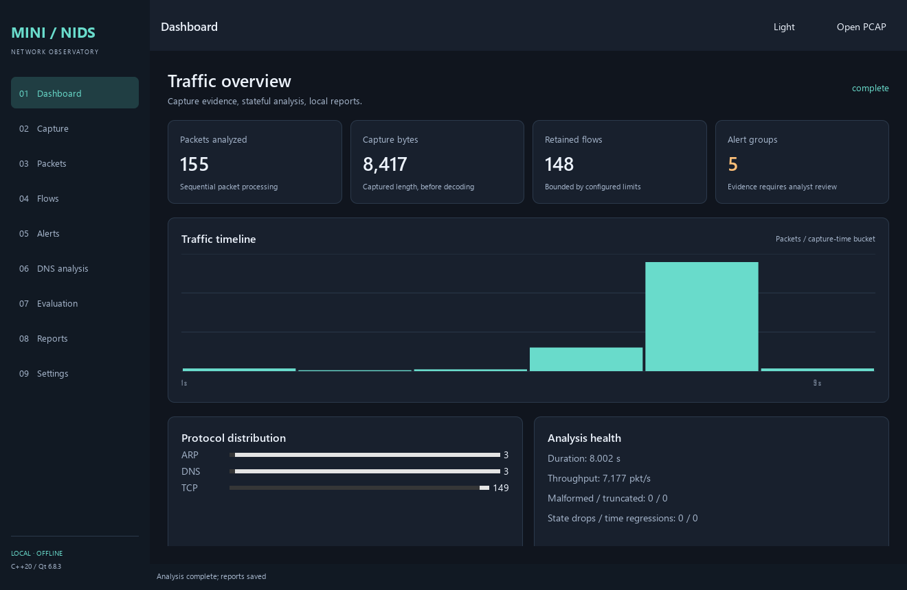

# Mini-NIDS

C++20 offline network intrusion analysis for the Mini-NIDS university assignment.
The pure C++ core is independent of Qt. The graphical client uses Qt 6 Quick/QML.

## Current status

Implemented: streaming classic PCAP reader, Ethernet/VLAN, ARP, IPv4, TCP, UDP,
ICMP with quoted transport tuples, and bounded compressed DNS decoding (A/AAAA/CNAME).
The reader supports both byte orders and microsecond/nanosecond captures. Snaplen
truncation preserves available headers; checksums are exposed but not used as attack
evidence. Stateful ARP spoofing, TCP/UDP port scans, multi-signal SYN flood and three
DNS spoofing rules are implemented. The CLI streams CSV/JSON reports and can evaluate
independently annotated ground truth. The Qt GUI connects all nine analysis sections
to real engine data, with bounded models, worker analysis and on-demand packet hex.
Windows GCC 15.2 Debug build and 35 parser/state/detection/pipeline/CLI tests passed on 2026-11-23.
Other platforms are unverified. The state layer adds bounded bidirectional flows,
sequence-validated TCP handshakes, idle/active expiration, capture-time windows and
strict JSON configuration. SYN retransmissions do not inflate attempt counts.
Tuple reuse with a new initial sequence starts a new attempt; completion followed by
reset does not subtract another connection's half-open state. JSON nesting is bounded.
The 22-page assignment was read in full, including rendered pages because its Persian
font encoding produces unreliable extracted text. Assignment PCAPs and ground truth
are absent; dataset accuracy must not be inferred from engineering fixtures.

## Build

Requires CMake >=3.25, Ninja and a C++20 compiler. Initial configuration downloads
version-pinned GoogleTest, nlohmann/json and spdlog when packages are unavailable.

```sh
cmake --preset dev
cmake --build --preset dev
ctest --preset dev
```

Use `cmake --preset vcpkg` with `VCPKG_ROOT` pointing to a working vcpkg checkout
for manifest dependency management. GUI, benchmark and sanitizer presets are separate.
See [RUNBOOK.md](RUNBOOK.md) for operational details and current limitations.

## Qt application

Requires Qt 6.8.3 and its matching compiler kit. On this Windows machine:

```powershell
./scripts/build/windows-qt.ps1 -QtRoot .qt/6.8.3/mingw_64 -CompilerRoot .qt/Tools/mingw1310_64
./build/gui-qt/apps/gui/mininids_gui.exe
```

The build script places the matching compiler and Qt runtime on PATH for build/tests.
Keep those paths in the launch terminal too, or deploy the runtime before distribution.
Windows Qt 6.8.3 / MinGW 13.1 passes 37 checks including controller and QML navigation
tests. Desktop, light, compact and Persian/RTL screens were rendered and inspected.
The initial Persian catalog is incomplete. See [UI design](docs/ui-design-system.md).



## Analyze

```sh
build/dev/apps/cli/mininids analyze --input capture.pcap --output results/session-001 --config config/default.json
build/dev/apps/cli/mininids rules list
build/dev/apps/cli/mininids rules validate --config config/detection-rules.json
build/dev/apps/cli/mininids benchmark --input capture.pcap
```

Append `.exe` on Windows when needed. Output directories must be new. Reports include
the exact six-column `alerts.csv`, extended alert metadata, flows, DNS logs, protocol
statistics, capture summary, performance, rules snapshot and detection metrics.
Use `--ground-truth events.json` for evaluation; absent truth produces null accuracy.
See [evaluation format](docs/evaluation.md) and [detector limits](docs/detection-rules.md).
