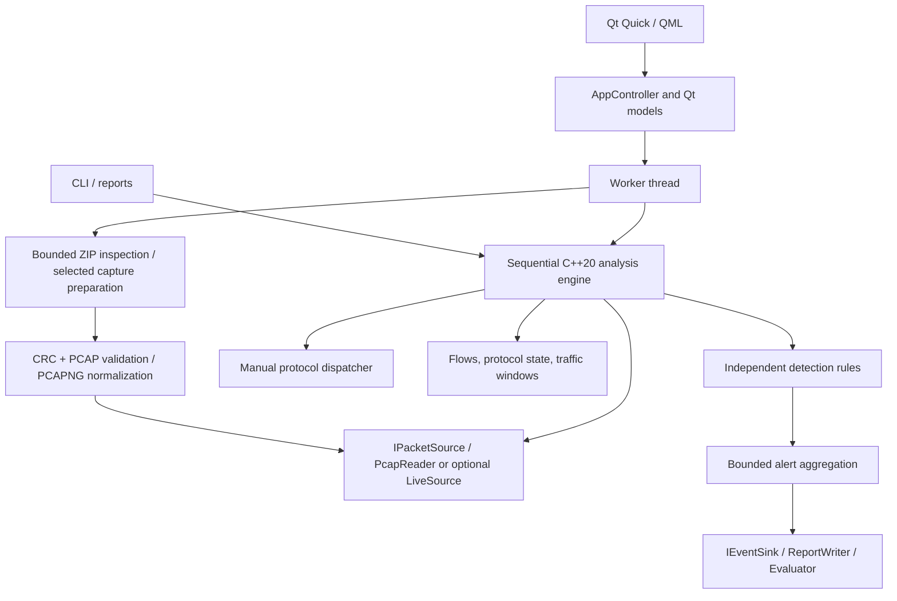

# Architecture and boundaries

The core imports no Qt, native UI or capture-library headers. IPacketSource,
IPacketDecoder, IDetectionRule, IAlertSink, IReportWriter, IAnalysisClock and
IProgressObserver isolate real seams. Cancellation uses a lock-free atomic flag.
A generic state-store interface is unnecessary; the concrete bounded StateTable has
one expiration node per entry. Hash lookups and ordered timer refreshes avoid scanning
all state for each packet. Full-table ordering happens only at final report flush.

Packet buffers belong to the source; parser spans expire on the next source read.
Persistent flows, ARP/DNS contexts and alert evidence own copied metadata. Windows
store bounded attempts with incremental source and destination aggregates. Capacity
exhaustion rejects new entries and records drops, reducing visibility rather than
allocating indefinitely. Per-table limits are not a hard process RSS budget.

ZIP inspection/preparation shares no detection state and does not decode protocols.
miniz provides streaming store/deflate/ZIP64 and CRC under an allocation budget. Only
the selected capture reaches a private temporary directory. Manual bounded PCAPNG
normalization preserves timestamped packet data before the usual PCAP engine starts;
record validation and snaplen warning counts accompany source provenance in GUI reports.

Processing is deterministic in file order. Capture time drives detection and state
expiration; a nondecreasing watermark handles time regressions, which are counted.
Original timestamps remain on alerts. Steady wall time measures computation only.
GUI progress crosses threads at most around 10Hz; history snapshots transfer once.

ReportWriter creates a new session directory, streams rows and leaves an incomplete
marker until flush/finalization. Structural PCAP errors stop the run; individual
packet errors are counted and skipped. The evaluator consumes aggregate alerts and
bounded reference intervals. No look-ahead or learned dataset identity is used.

## New reporting and bonus paths

First alert delivery and group finalization are separate callbacks. `alert()` writes and
flushes the initial journal, updates the UI and evaluates once. `alert_final()` records
counts/last time and updates the same GUI SQLite row by group_id; its FTS update trigger
replaces stale searchable text. Required alerts.csv remains six columns.

SQLite is shared by Qt-free core statistics and GUI session storage. Exact sparse one-second
bins and endpoint counts spill in bounded batches; GUI chart coarsening never replaces the
exact CSV. ProcessMetrics uses native Windows/macOS/Linux process peak RSS equivalents.

TCP byte reconstruction feeds a bounded HTTP request framing state machine. Established
incomplete reliable headers enter a deadline-indexed Slowloris concurrency group. Driver
LiveSource only supplies bytes/metadata and timer idles to the same engine, without an
unbounded packet queue. Real driver counters and engine state pressure are separate.
