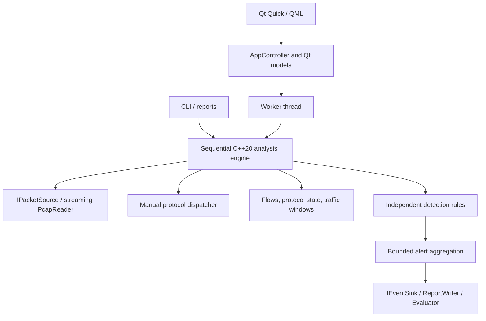

# Architecture and boundaries

The core imports no Qt, native UI or capture-library headers. IPacketSource,
IPacketDecoder, IDetectionRule, IAlertSink, IReportWriter, IAnalysisClock and
IProgressObserver isolate real seams. Cancellation uses a lock-free atomic flag.
A generic state-store interface is unnecessary; the concrete bounded StateTable has
one expiration node per entry. Hash lookups and ordered timer refreshes avoid scanning
all state for each packet. Full-table ordering happens only at final report flush.

Packet buffers belong to the source; parser spans expire on the next source read.
Persistent flows, ARP/DNS contexts and alert evidence own copied metadata. Windows
store bounded attempts with incremental source and destination aggregates. Capacity
exhaustion rejects new entries and records drops, reducing visibility rather than
allocating indefinitely. Per-table limits are not a hard process RSS budget.

Processing is deterministic in file order. Capture time drives detection and state
expiration; a nondecreasing watermark handles time regressions, which are counted.
Original timestamps remain on alerts. Steady wall time measures computation only.
GUI progress crosses threads at most around 10Hz; history snapshots transfer once.

ReportWriter creates a new session directory, streams rows and leaves an incomplete
marker until flush/finalization. Structural PCAP errors stop the run; individual
packet errors are counted and skipped. The evaluator consumes aggregate alerts and
bounded reference intervals. No look-ahead or learned dataset identity is used.
